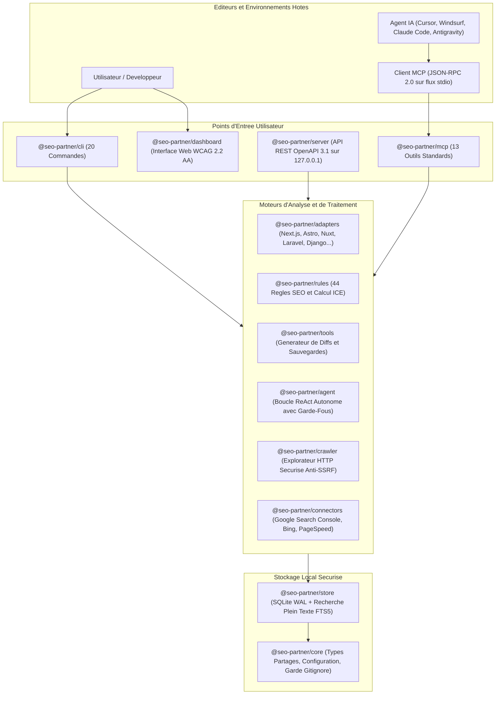

<div align="center">


<br />

[](./package.json)
[](https://nodejs.org/)
[](./tsconfig.base.json)
[](./package.json)
[](./packages/mcp/src/server.ts)
[](./packages/store/src/db.ts)
[](./packages/server/src/openapi.ts)
[](./packages/rules/src/engine.ts)
[](https://github.com/Firinze)
[](./LICENSE)

<br />

### Votre copilote technique tout-en-un pour propulser le referencement naturel de vos applications web

**Auditez votre code source en toute securite, visualisez la sante de votre site sur un tableau de bord intuitif, appliquez des correctifs automatiques garantis sans risque, et laissez la puissance des agents IA optimiser votre visibilite sur Google et Bing.**

<br />

<p align="center">
  <strong>Francais (Actif)</strong> &nbsp;|&nbsp; <a href="./README.md">Read in English (README.md)</a> &nbsp;|&nbsp; <a href="./SECURITY.md">Politique de Securite</a> &nbsp;|&nbsp; <a href="./CONTRIBUTING.md">Guide de Contribution</a>
</p>

</div>

---

> [!NOTE]
> **Version 1.0.0 GA Disponible** : SEO Partner est desormais stabilise en version finale pour la production. Il s'installe en quelques secondes via `npx seo-partner init`, fonctionne a 100 % en local sur votre poste (sans envoyer vos fichiers a des serveurs tiers), et ne necessite aucune dependance cloud obligatoire.

---

## Sommaire

1. [Pourquoi SEO Partner ? Le Constat et la Solution](#1-pourquoi-seo-partner--le-constat-et-la-solution)
2. [A Qui S'adresse cet Outil ?](#2-a-qui-sadresse-cet-outil-)
3. [Les 3 Facons Simples d'Utiliser SEO Partner](#3-les-3-facons-simples-dutiliser-seo-partner)
4. [Demarrage Rapide en 2 Minutes](#4-demarrage-rapide-en-2-minutes)
5. [Le Tableau de Bord Visuel : Tout Comprendre d'un Coup d'Oeil](#5-le-tableau-de-bord-visuel--tout-comprendre-dun-coup-doeil)
6. [Correctifs Automatiques : La Garantie Zero Casse](#6-correctifs-automatiques--la-garantie-zero-casse)
7. [Compatibilite Multi-Frameworks](#7-compatibilite-multi-frameworks)
8. [Connecteurs Officiels : Google Search Console, Bing et Core Web Vitals](#8-connecteurs-officiels--google-search-console-bing-et-core-web-vitals)
9. [Protocole MCP : Connectez Votre Agent IA Favori (Cursor, Claude, Windsurf...)](#9-protocole-mcp--connectez-votre-agent-ia-favori)
10. [Reference Complete des Commandes CLI](#10-reference-complete-des-commandes-cli)
11. [Architecture Technique et Monorepo](#11-architecture-technique-et-monorepo)
12. [Securite et Confidentialite Absolue](#12-securite-et-confidentialite-absolue)
13. [Feuille de Route et Historique des Jalons](#13-feuille-de-route-et-historique-des-jalons)
14. [Questions Frequentes (FAQ)](#14-questions-frequentes-faq)
15. [Auteur et Licence](#15-auteur-et-licence)

---

## 1. Pourquoi SEO Partner ? Le Constat et la Solution

### Le probleme du SEO technique aujourd'hui
Le referencement naturel est souvent percu comme une boite noire reservee a des consultants specialises :
- **Les scanners en ligne (SaaS)** coutent des abonnements mensuels onereux, scannent vos pages depuis l'exterieur sans comprendre votre code, et vous laissent seul face a une liste de 50 problemes sans vous aider a les coder.
- **Les modeles d'intelligence artificielle generatifs classiques** hallucinent regulierement du code incompatible avec votre framework et ne peuvent pas tester si leur modification casse votre application.
- **Les developpeurs et createurs de projets** manquent de temps pour eplucher les recommandations de Google (Core Web Vitals, balises OpenGraph, donnees structurees Schema.org, sitemaps, balises canoniques).

### La solution : SEO Partner
SEO Partner reunit en un seul outil local tout ce dont vous avez besoin pour reussir le referencement de vos sites et applications :

| Besoin | Outil Traditionnel | SEO Partner (v1.0.0 GA) |
| :--- | :--- | :--- |
| **Analyse du code** | Scanne uniquement les pages HTML en ligne | Analyse directement vos fichiers source (Next.js, Astro, Nuxt, Laravel, Django...) |
| **Correction des anomalies** | Simple rapport texte avec recommandations vagues | Genere des correctifs de code prets a integrer d'un simple clic |
| **Securite de votre code** | Envoi de vos donnees vers des serveurs distants | 100 % local sur votre machine, zero transmission de code, sauvegardes automatiques |
| **Intelligences Artificielles** | Copier-coller fastidieux dans une fenetre de chat | Serveur MCP integre : votre agent IA (Cursor, Windsurf, Claude Code) agit directement |
| **Vraies donnees de trafic** | Fenetres multiples entre Search Console et PageSpeed | Connecteurs Google Search Console, Bing Webmaster et Core Web Vitals centralises |
| **Simplicite d'acces** | Lignes de commande obscures | Tableau de bord graphique interactif utilisable par un debutant |

---

## 2. A Qui S'adresse cet Outil ?

Que vous soyez debutant absolu ou developpeur chevronne, SEO Partner s'adapte a votre niveau :

- **Pour les Debutants, Independants et Createurs de Contenu** :
  Vous n'avez pas besoin de comprendre le jargon informatique. Ouvrez le tableau de bord visuel, observez votre note sur 100, lisez les explications simples en francais pour chaque probleme et cliquez sur le bouton de correction automatique pour reparer les balises manquantes.

- **Pour les Developpeurs Web et Equipes Produit** :
  Gagnez des dizaines d'heures. Connectez SEO Partner a votre editeur prefere grace au standard MCP (13 outils). Lancez le mode surveillance (`seo-partner watch`) pour voir votre score SEO evoluer a chaque sauvegarde de fichier.

- **Pour les Agences et Experts SEO** :
  Beneficiez de 44 regles metier verifiees, d'une priorisation par score ICE (Impact, Confiance, Facilite), d'un comparateur entre le code source et le rendu final, et de rapports complets au format HTML autonome, Markdown ou JSON pour vos clients.

---

## 3. Les 3 Facons Simples d'Utiliser SEO Partner

Choisissez le mode qui vous convient le mieux :

### Mode 1 : Le Tableau de Bord Visuel dans Votre Navigateur (Recommande pour Debutants)
Lancez une seule commande :
```bash
npx seo-partner serve
```
Votre navigateur s'ouvre sur un tableau de bord complet avec des jauges de score, la liste des pages analysees, et un assistant de discussion IA pour vous guider pas a pas.

### Mode 2 : Dans Votre Editeur de Code avec un Agent IA (Cursor, Windsurf, Claude Code, Antigravity)
Activez les 13 outils d'optimisation directement dans votre agent IA :
```bash
npx seo-partner init --with-mcp
```
Votre agent IA comprend desormais la structure SEO de votre site. Demandez-lui simplement : *"Verifie le SEO de ma page d'accueil et corrige les balises manquantes"*.

### Mode 3 : En Ligne de Commande et dans Vos Pipelines CI/CD (GitHub Actions, GitLab)
Pour les habitues du terminal ou l'automatisation en continu :
```bash
npx seo-partner audit
npx seo-partner ci --max-blockers=0
```
Le terminal affiche un rapport precis en quelques secondes et retourne un code de sortie strict pour empecher la mise en production de pages mal referencees.

---

## 4. Demarrage Rapide en 2 Minutes

### Etape 1 : Initialiser votre projet
Placez-vous dans le dossier de votre projet web et executez :
```bash
npx seo-partner init
```
*SEO Partner detecte automatiquement votre framework (Next.js, Astro, Nuxt, Laravel, Django, etc.) et configure la base de donnees locale dans `.seo/`.*

### Etape 2 : Lancer un audit complet
```bash
npx seo-partner audit
```
*En moins de 5 secondes, les 44 regles SEO sont testees sur l'integralite de vos fichiers.*

### Etape 3 : Ouvrir l'interface graphique
```bash
npx seo-partner serve
```
*Le tableau de bord s'ouvre a l'adresse `http://127.0.0.1:4321`.*

### Etape 4 : Appliquer les correctifs recommandes
```bash
npx seo-partner patch --apply
```
*Toutes les balises indispensables (titres manquants, meta descriptions, attributs alt d'images, balises canoniques) sont inserees proprement avec une sauvegarde prealable.*

---

## 5. Le Tableau de Bord Visuel : Tout Comprendre d'un Coup d'Oeil

Le tableau de bord embarque tout ce qui est necessaire pour piloter votre referencement sans quitter votre machine :

```
[ Tableau de Bord SEO Partner ]
+-----------------------------------------------------------------------------------+
|  SANTE GLOBALE DU SITE : 87 / 100       |  PAGES ANALYSEES : 42                   |
|  [||||||||||||||||||||||||||||||||]     |  ANOMALIES CRITIQUES : 0                |
+-----------------------------------------------------------------------------------+
|  ONGLETS DISPONIBLES :                                                            |
|  - Vue d'Ensemble     : Scores par categorie (Metas, Indexation, Vitesse, Social)  |
|  - Anomalies          : Liste detaillee des defauts avec explications simples    |
|  - Plan d'Action ICE  : Taches prioritaires classees par impact sur votre trafic  |
|  - Correctifs Rapides : Previsualisation et application des correctifs en 1 clic  |
|  - Explorateur Pages  : Arborescence de toutes les URLs et gabarits du site      |
|  - Google Search      : Clics reels, impressions et positions moyennes           |
|  - Bing Webmaster     : Indexation instantanee via le protocole IndexNow         |
|  - Core Web Vitals    : Vitesse de chargement LCP, reactivite INP, stabilite CLS |
|  - Assistant Chat IA  : Posez vos questions en direct sur l'amelioration du site |
|  - Rapports Export    : Telechargez votre audit en HTML autonome ou Markdown     |
+-----------------------------------------------------------------------------------+
```

- **Zero configuration complexe** : Le serveur demarre instantanement en local.
- **Accessibilite certifiee** : Conforme aux normes d'accessibilite WCAG 2.2 AA.
- **Mode sombre & clair** : Une palette moderne et epuree concue pour le confort visuel.

---

## 6. Correctifs Automatiques : La Garantie Zero Casse

La grande force de SEO Partner est de ne jamais vous laisser seul avec des problemes de code. Cependant, toucher a votre code source exige une rigueur absolue. C'est pourquoi nous appliquons **quatre boucliers de protection** :

1. **Sauvegarde Prealable Automatique** : Avant toute modification, les fichiers d'origine sont sauvegardes dans le dossier `.seo/backups/<horodatage>/`. Vous pouvez revenir en arriere a tout moment.
2. **Garde-Fou Git** : Si des modifications non enregistrees (uncommitted) sont detectees dans votre depot Git, SEO Partner refuse d'appliquer des correctifs pour eviter tout conflit, sauf demande explicite avec `--force`.
3. **Previsualisation Transparente** : Aucun fichier n'est modifie en aveugle. Vous pouvez previsualiser les modifications exactes ligne par ligne (`seo-partner patch --preview`) avant de donner votre accord.
4. **Zero Execution de Code Cible** : SEO Partner analyse la structure de vos fichiers sans jamais executer de code inconnu sur votre machine (`zero interpreteur python/php/shell non controle`).

---

## 7. Compatibilite Multi-Frameworks

SEO Partner reconnait automatiquement la structure et les conventions de routage de vos frameworks favoris :

| Framework / Environnement | Routage Reconnu | Gestion des Metadonnees & Layouts |
| :--- | :--- | :--- |
| **Next.js** | App Router (`page.tsx`, `layout.tsx`) et Pages Router (`pages/*.tsx`) | `export const metadata`, balises `<Head>`, balises OpenGraph |
| **Astro** | `src/pages/**/*.{astro,md,mdx}` | Composants de mise en page et balises de head |
| **Nuxt 3** | `pages/**/*.vue` | Fonctions `useHead`, `useSeoMeta` et gabarits Vue |
| **SvelteKit** | `src/routes/**/+page.svelte` | Balises `<svelte:head>` et heritages de layouts |
| **Remix / React Router** | `app/routes/**/*.{tsx,jsx}` | Fonctions `meta` exportees et hierarchie de routes |
| **Django** | `urls.py` et `templates/**/*.html` | Blocs de gabarits `` et balises meta |
| **Laravel & Symfony** | `routes/web.php` et `resources/views/**/*.blade.php` | Directives `@section('title')`, Blade et Twig |
| **PHP Classique & Laragon** | Arborescence `.php` et fichiers d'inclusions | En-tetes de scripts et balises HTML standards |
| **HTML Statique** | Fichiers `.html` purs | Structure HTML5 standard, balises head et liens canoniques |

---

## 8. Connecteurs Officiels : Google Search Console, Bing et Core Web Vitals

Optimiser son code est essentiel, mais mesurer les resultats reels sur les moteurs de recherche l'est tout autant :

- **Google Search Console** :
  Connectez votre compte de service Google via une simple cle JSON (`.seo/credentials.json`). SEO Partner recupere directement vos vraies donnees de clics, d'impressions, de taux de clics (CTR) et de position moyenne, avec un cache local de 7 jours.

- **Bing Webmaster Tools & IndexNow** :
  Soumettez instantanement vos pages nouvellement creees ou modifiees a l'index Bing sans attendre le passage des robots d'exploration.

- **Core Web Vitals (CrUX & PageSpeed)** :
  Mesurez les signaux de qualite de Google directement dans votre tableau de bord :
  - **LCP (Largest Contentful Paint)** : Temps d'affichage du composant principal (< 2.5 s).
  - **INP (Interaction to Next Paint)** : Temps de reaction aux actions de l'utilisateur (< 200 ms).
  - **CLS (Cumulative Layout Shift)** : Stabilite visuelle de la page sans decalages inattendus (< 0.1).

---

## 9. Protocole MCP : Connectez Votre Agent IA Favori

SEO Partner integre nativement un serveur **Model Context Protocol (MCP)** standard conforme aux specifications officielles. Il permet a vos assistants de developpement (Antigravity `agy`, Claude Code, Cursor, Windsurf, Codex, Gemini Code Assist, Cline) d'interagir directement avec votre projet sans aucune manipulation manuelle.

### Installation en 1 commande :
```bash
npx seo-partner init --with-mcp
```

### Les 13 Outils MCP Disponibles :
1. `audit_rules` : Evalue l'ensemble des 44 regles SEO et retourne le score global.
2. `get_findings` : Liste toutes les anomalies classees par severite.
3. `get_route_inventory` : Affiche l'inventaire complet des pages et composants du site.
4. `inspect_url` : Analyse le code d'une page specifique du projet.
5. `propose_patch` : Calcule un correctif pret a etre applique pour resoudre une anomalie.
6. `search_knowledge` : Interroge la base documentaire des bonnes pratiques SEO.
7. `crawl_live` : Effectue une exploration en direct d'une URL de test avec protection anti-SSRF.
8. `fetch_gsc_performance` : Extrait les donnees reelles de requetes et clics Google.
9. `fetch_cwv_metrics` : Recupere les metriques de vitesse Google CrUX et PageSpeed.
10. `fetch_bing_performance` : Interroge l'API Bing Webmaster pour l'indexation.
11. `submit_bing_indexnow` : Notifie Bing de la mise a jour immediate d'une URL.
12. `generate_audit_report` : Exporte l'audit en fichier HTML, Markdown ou JSON.
13. `run_agent_step` : Execute une etape de raisonnement autonome ReAct avec garde-fous de boucle.

---

## 10. Reference Complete des Commandes CLI

Pour ceux qui aiment le terminal, 20 commandes simples et intuitives sont a votre disposition :

```bash
# Commandes de base
npx seo-partner init            # Initialise le projet et detecte le framework
npx seo-partner scan            # Scanne rapidement les fichiers modifies
npx seo-partner audit           # Realise l'audit SEO complet avec score sur 100
npx seo-partner serve           # Demarre le tableau de bord web interactif

# Correctifs et automatisation
npx seo-partner patch           # Liste et previsualise les correctifs disponibles
npx seo-partner patch --apply   # Applique les correctifs de maniere securisee
npx seo-partner watch           # Observe les fichiers en temps reel et met a jour le dashboard
npx seo-partner pr              # Cree automatiquement une branche et une Pull Request avec les correctifs

# Qualite et CI/CD
npx seo-partner ci              # Controle le respect des seuils SEO dans vos pipelines
npx seo-partner crawl <url>     # Explore une URL locale ou de staging en direct
npx seo-partner report          # Genere les rapports d'audit (HTML, Markdown, JSON)

# Connecteurs externes
npx seo-partner gsc query       # Affiche les clics et impressions Google Search Console
npx seo-partner cwv query       # Affiche les Core Web Vitals de vos pages
npx seo-partner bing query      # Interroge les donnees d'indexation Bing
npx seo-partner bing indexnow   # Soumet des URLs fraiches via IndexNow

# Intelligence Artificielle et MCP
npx seo-partner mcp             # Lance le serveur stdio pour vos IDEs
npx seo-partner agent run       # Lance la boucle d'optimisation autonome avec garde-fous
```

---

## 11. Architecture Technique et Monorepo

SEO Partner est concu comme une suite logicielle modulaire d'une grande robustesse, decoupee en 12 modules autonomes (`pnpm workspaces`) :



---

## 12. Securite et Confidentialite Absolue

Votre code source et vos metriques sont precieux. Nous appliquons les regles de securite les plus strictes de l'industrie :

- **Confidentialite Totale (Local-First)** : Aucun fichier de votre code source n'est envoye a un serveur tiers. L'analyse tourne a 100 % sur votre processeur local.
- **Protection Anti-Fuite de Secrets** : Les cles d'API, mots de passe et jetons sont filtres par un scanner d'integrite a 39 modeles et exclus des rapports d'audit.
- **Protection Anti-SSRF Stricte** : Le crawler HTTP verifie chaque adresse IP resolue. Toutes les adresses IP locales, privees et les metadonnees cloud (comme `169.254.169.254`) sont inconditionnellement bloquees.
- **Inclusion Obligatoire dans `.gitignore`** : Des l'initialisation, SEO Partner ajoute ses dossiers techniques (`.seo/index.db*`, `.seo/patches/`, `.seo/backups/`) dans votre `.gitignore` pour empecher tout commit accidentel.

---

## 13. Feuille de Route et Historique des Jalons

Toutes les etapes de la conception ont ete franchies avec succes jusqu'a la version stable actuelle :

```
[ v0.1 ] Initialisation du projet, Skill Pack bilingue, scanner statique Next.js et SQLite.
   |
[ v0.2 ] Scan incremental ultra-rapide (< 5 s), recherche FTS5, crawler HTTP et adaptateur PHP.
   |
[ v0.3 ] Serveur API local OpenAPI 3.1, repli automatique de port et tableau de bord Web WCAG 2.2 AA.
   |
[ v0.4 ] Serveur MCP stdio, moteur de correctifs securises avec sauvegardes et fusion multi-IDE.
   |
[ v0.5 ] Prise en charge d'Astro, Nuxt 3, SvelteKit, Remix et Django sans execution de code.
   |
[ v0.6 ] Connecteurs officiels Google Search Console, Core Web Vitals et boucle d'agent ReAct.
   |
[ v0.7 ] Surveillance en temps reel (watch), moteur CI/CD avec SARIF, bot de Pull Request et SEA.
   |
[ v0.8 ] Connecteur officiel Bing Webmaster / IndexNow et assistant chat interactif en streaming.
   |
[ v0.9 ] Audit multi-sites unifie, configurations d'entreprise et supervision de flux.
   |
[ v1.0.0 GA - LIVREE ] Durcissement final, 13 outils MCP geles, SBOM CycloneDX v1.5,
                      zero fuite de secrets, 44 regles validees, binaires autonomes et GA officielle.
```

---

## 14. Questions Frequentes (FAQ)

### Dois-je payer un abonnement pour utiliser SEO Partner ?
Non. SEO Partner est un logiciel libre et open-source sous licence MIT. Vous pouvez l'utiliser librement sur tous vos projets personnels ou commerciaux.

### Dois-je obligatoirement avoir une cle API d'intelligence artificielle ?
Non ! L'integralite des 44 regles SEO, de l'audit technique, du tableau de bord visuel et des correctifs de code fonctionne a 100 % en local et gratuitement sans aucune cle API. Si vous possedez une cle API (OpenAI, Anthropic Claude ou Google Gemini), vous pouvez l'activer pour enrichir l'assistant de chat ou beneficier de suggestions de textes redactionnels.

### Est-ce adapte si je ne sais pas coder ?
Oui. Lancez simplement `npx seo-partner serve`. Le tableau de bord affiche vos erreurs de facon visuelle avec des couleurs claires (Vert, Orange, Rouge). Pour chaque anomalie, une explication simple vous dit ce qui ne va pas et le bouton de correction applique la modification a votre place.

### Que se passe-t-il si un correctif automatique ne me plait pas ?
Chaque correctif est enregistre dans une sauvegarde horodatee dans `.seo/backups/`. De plus, si vous utilisez Git, vous pouvez voir la modification exacte et l'annuler en un clic (`git checkout .`).

### Puis-je l'utiliser sans installer Node.js ?
Oui. Des binaires autonomes sans dependance (Single Executable Applications) sont fournis pour Windows (`seo-partner.exe`), Linux (`seo-partner-linux`) et macOS (`seo-partner-darwin`).

---

## 15. Auteur et Licence

<br />

<div align="center">

### Concu et Developpe par

**Firinze Gbenito Dossou**

*Lead Architect & Product Experience Engineer*

[](https://github.com/Firinze)
[](https://github.com/Firinze/seo-partner)
[](./LICENSE)

<br />

Distribue sous licence libre **MIT**. Vous etes libre d'utiliser, de modifier et de distribuer ce projet conformement aux termes de la licence.

*Contributions, signalements d'anomalies et suggestions bienvenus via l'espace [GitHub Issues](https://github.com/Firinze/seo-partner/issues).*

</div>
