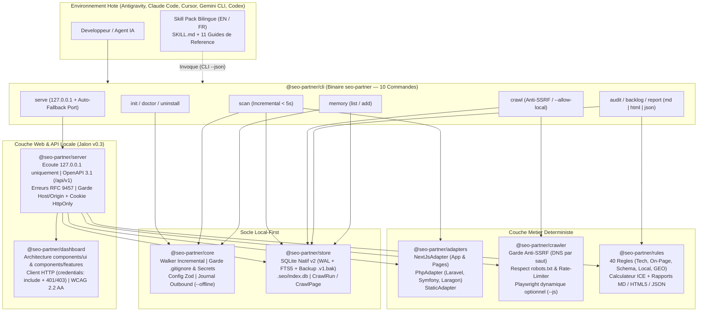
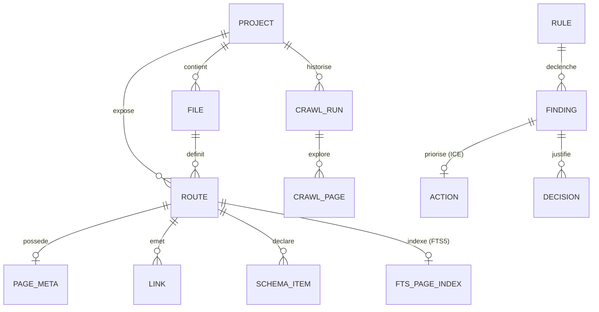

<div align="center">


<br />

[](./package.json)
[](https://nodejs.org/)
[](./tsconfig.base.json)
[](./packages/store/src/db.ts)
[](./packages/server/src/openapi.ts)
[](./packages/rules/src/engine.ts)
[](./LICENSE)

<p align="center">
  <strong>Scanner SEO incrémental (<code>&lt; 5 s</code>), Crawler HTTP anti-SSRF, Adapters Next.js &amp; PHP (Laravel, Symfony, Laragon), moteur de 40 règles déterministes avec priorisation ICE, Serveur API local <code>127.0.0.1</code> (OpenAPI 3.1 + RFC 9457) et Dashboard Web WCAG 2.2 AA.</strong><br />
  <em>Conçu pour Antigravity (<code>agy</code>), Claude Code, Cursor, Gemini CLI et Codex — sans exécution de code (<code>F-S5</code>) et sans piège d'installation.</em>
</p>

<p align="center">
  <strong>Français (Actif)</strong> &nbsp;|&nbsp; <a href="./README.md">Read in English (README.md)</a> &nbsp;|&nbsp; <a href="./SECURITY.md">Politique de Sécurité</a> &nbsp;|&nbsp; <a href="./CONTRIBUTING.md">Contribuer</a>
</p>

</div>

---

## Table des Matières

1. [Vision et Proposition de Valeur (`v0.3`)](#1-vision-et-proposition-de-valeur-v03)
2. [Architecture Système, Flux de Données et Schéma ERD (`SQLite v2`)](#2-architecture-système-flux-de-données-et-schéma-erd-sqlite-v2)
3. [Démarrage Rapide (Getting Started)](#3-démarrage-rapide-getting-started)
4. [Référence Complète de la CLI (10 Commandes)](#4-référence-complète-de-la-cli-10-commandes)
5. [Serveur API Local (`127.0.0.1`, OpenAPI 3.1, RFC 9457) & Dashboard Web (`v0.3`)](#5-serveur-api-local-127001-openapi-31-rfc-9457--dashboard-web-v03)
6. [Catalogue des 40 Règles SEO Vérifiées et Méthodologie ICE](#6-catalogue-des-40-règles-seo-vérifiées-et-méthodologie-ice)
7. [Support Multi-Frameworks : Next.js, Laravel, Symfony, PHP/Laragon et Statique](#7-support-multi-frameworks--nextjs-laravel-symfony-phplaragon-et-statique)
8. [Skill Pack Bilingue (`11/11` Références) et Intégration Multi-IDE](#8-skill-pack-bilingue-1111-références-et-intégration-multi-ide)
9. [Guide Développeur et Référence SDK TypeScript (8 Packages)](#9-guide-développeur-et-référence-sdk-typescript-8-packages)
10. [Sécurité, Anti-SSRF, Session `HttpOnly` et Garde-Fous `.gitignore`](#10-sécurité-anti-ssrf-session-httponly-et-garde-fous-gitignore)
11. [Guide de Dépannage (Troubleshooting) et FAQ](#11-guide-de-dépannage-troubleshooting-et-faq)
12. [Feuille de Route (`v0.1` à `v1.0`) et Gouvernance Documentaire](#12-feuille-de-route-v01-à-v10-et-gouvernance-documentaire)

---

## 1. Vision et Proposition de Valeur (`v0.3`)

`seo-partner` sépare strictement **ce qui doit être exact à 100 %** (exécuté par un moteur déterministe local en TypeScript, SQLite WAL + `FTS5`, et une API REST locale `127.0.0.1`) de **ce qui relève du conseil éditorial et stratégique** (guidé par le pack méthodologique de 11 références dans votre IDE) :

| Capacité | Prompt / Skill classique | Crawler Cloud SaaS | **`seo-partner` (`v0.3`)** |
| :--- | :--- | :--- | :--- |
| **Découverte des routes (Next.js, Laravel, Symfony, PHP/Laragon)** | Non (limité par le contexte) | Partiel (URLs publiées uniquement) | **Oui — 100 % déterministe (AST & parseurs statiques)** |
| **Scan incrémental en boucle courte IDE (`< 5 s`)** | Non (relecture intégrale) | Non | **Oui — Diff `(mtimeMs, sizeBytes, sha256)` + `FTS5` `< 100 ms`** |
| **Crawler HTTP sécurisé & Comparateur Code vs. Crawl** | Non | Sans lien avec le code source | **Oui — `seo-partner crawl` + Vue côte à côte Code vs. Crawl** |
| **Dashboard Web local & API OpenAPI 3.1 (`127.0.0.1`)** | Non | Cloud externe payant | **Oui — `seo-partner serve` (auto-fallback de port, RFC 9457, WCAG 2.2 AA)** |
| **Preuve obligatoire (`filePath:lineNumber` ou `url + statusCode`)** | Non (approximative) | HTML compilé uniquement | **Oui — Ligne exacte du fichier ou statut HTTP crawlé** |
| **Exécution du code du projet analysé (`F-S5`)** | Variable selon l'agent | N/A | **Zéro exécution (`php`/`eval`/`build` interdits)** |
| **Catalogue de règles & Priorisation mathématique ICE (`F-R3`)** | Non (subjective) | Générique | **40 règles vérifiées (`ICE = (I+C+E)/3` + Blocages en tête)** |
| **Livrables exécutifs (Markdown, JSON, HTML5 autonome)** | Texte brut éphémère | Export propriétaire | **Rapports 5 parties `.md`, `.json` et `.html` 100 % hors ligne** |

---

## 2. Architecture Système, Flux de Données et Schéma ERD (`SQLite v2`)

### 2.1 Architecture Modulaire du Monorepo (`8 Packages` — `pnpm workspaces`)



### 2.2 Diagramme Entité-Relation (`ERD` — Schéma SQLite `v2`)



---

## 3. Démarrage Rapide (Getting Started)

### 3.1 Prérequis

- **Node.js** : `>= 22.5.0` (requis pour le moteur SQLite natif `node:sqlite` avec `FTS5` intégré).
- **Gestionnaire de paquets** : `pnpm >= 9.x` (recommandé) ou `npm`.
- **Système d'exploitation** : Windows (PowerShell, Laragon), macOS ou Linux.

### 3.2 Installation

```powershell
# 1. Cloner le dépôt et installer les dépendances
git clone https://github.com/Firinze/seo-partner.git
cd seo-partner
pnpm install

# 2. Compiler les 8 packages du monorepo (core, store, adapters, crawler, rules, dashboard, server, cli)
pnpm run build

# 3. (Optionnel) Lier globalement la commande seo-partner sur votre machine
pnpm --filter seo-partner link --global
```

### 3.3 Workflow Complet en 7 Commandes (Next.js, Laravel, Symfony ou Laragon)

```powershell
# 1. Initialiser seo-partner en français pour Antigravity (agy) dans le projet courant
seo-partner init --here --ide agy --lang fr --ignore-agent-tools

# 2. Vérifier la santé de l'installation (< 5 s)
seo-partner doctor

# 3. Scanner le code source (incrémental automatique en < 5 s après le 1er scan)
seo-partner scan

# 4. (Optionnel) Crawler votre serveur local Laragon / artisan / symfony / next dev
seo-partner crawl http://mon-projet.test --allow-local

# 5. Auditer les 40 règles SEO (croisement Code + Crawl) et afficher le backlog ICE
seo-partner audit
seo-partner backlog

# 6. Générer le rapport HTML5 autonome (sans dépendance réseau) et/ou Markdown
seo-partner report --type audit-complet --format html

# 7. Lancer le Dashboard Web local et l'API REST OpenAPI 3.1 sur http://127.0.0.1:4321
seo-partner serve --port 4321 --lang fr
```

---

## 4. Référence Complète de la CLI (10 Commandes)

### 4.1 Options Globales et Codes de Sortie

| Option Globale | Type | Défaut | Description |
| :--- | :--- | :--- | :--- |
| `--cwd <dir>` | `string` | `process.cwd()` | Dossier racine du projet cible à analyser. |
| `--json` | `boolean` | `false` | Retourne une enveloppe JSON déterministe `{ success, data, error }` sur `stdout`. |
| `--offline` | `boolean` | `false` | Interdit strictement tout appel réseau sortant et journalise tout blocage dans `.seo/logs/outbound.jsonl`. |

| Code | Signification | Cas d'usage |
| :---: | :--- | :--- |
| `0` | **Succès** | Commande exécutée sans erreur. |
| `1` | **Échec Métier / Santé** | `doctor` a détecté un contrôle en erreur ou paramètre manquant. |
| `3` | **Blocage Sécurité Anti-SSRF / Offline** | Tentative de crawl vers une IP privée/locale sans `--allow-local`, ou appel réseau en mode `--offline`. |

### 4.2 Détail des 10 Commandes

1. **`seo-partner init`** : Initialise `.seo/config.json`, `.seo/decisions.md`, installe le skill pack bilingue (`en` ou `fr`) pour l'IDE choisi (`agy`, `claude`, `cursor`, `gemini`, `codex`) et sécurise `.gitignore`.
   ```powershell
   seo-partner init [--here] [--ide agy|claude|cursor|gemini|codex] [--lang en|fr] [--ignore-agent-tools] [--dry-run] [--json]
   ```
2. **`seo-partner doctor`** : Exécute 6 contrôles de santé déterministes (`node-version`, `seo-config`, `gitignore-security`, `ide-skill-integrity` `11/11`, `watch-freshness` `<= 90` jours, `sqlite-wal`).
   ```powershell
   seo-partner doctor [--json]
   ```
3. **`seo-partner scan`** : Exécute par défaut un **scan incrémental (`< 5 s`)** réutilisant les fichiers inchangés `(mtimeMs, sizeBytes, sha256)`, purgeant les routes supprimées et mettant à jour l'index plein texte `SQLite FTS5`.
   ```powershell
   seo-partner scan [--scope <dir>] [--rebuild] [--max-size <kb>] [--json]
   ```
4. **`seo-partner crawl <url>`** : Explore un site en ligne ou un serveur local (Laragon `http://app.test`, `http://127.0.0.1:8000`) en respectant `robots.txt` et la protection anti-SSRF à chaque saut de redirection.
   ```powershell
   seo-partner crawl <url> [--allow-local] [--max-pages 200] [--max-depth 4] [--concurrency 4] [--rate-limit-ms 200] [--js] [--resume <runId>] [--offline] [--json]
   ```
5. **`seo-partner audit`** : Évalue les **40 règles SEO déterministes** en croisant le scan statique du code et le dernier `CrawlRun` terminé (ou `--crawl-run <id>`).
   ```powershell
   seo-partner audit [--category technical|on-page|schema|local|geo] [--severity critical|high|medium|low] [--crawl-run <id>] [--json]
   ```
6. **`seo-partner backlog`** : Affiche les actions priorisées avec les **blocages d'indexation (`F-R3`) toujours en tête**, suivis du score `ICE` décroissant.
   ```powershell
   seo-partner backlog [--quick-wins] [--json]
   ```
7. **`seo-partner report`** : Génère le rapport exécutif en 5 sections normalisées aux formats **Markdown (`md`)**, **HTML5 autonome hors ligne (`html`)** ou **JSON (`json`)**.
   ```powershell
   seo-partner report [--type audit-complet|audit-technique|backlog] [--format md|html|json] [--output <path>] [--crawl-run <id>] [--json]
   ```
8. **`seo-partner serve`** : Démarre le serveur API local (`127.0.0.1` uniquement) et le Dashboard Web interactif. Si le port demandé (`4321` par défaut) est déjà occupé (`EADDRINUSE`), le serveur **bascule automatiquement sur le premier port libre suivant (`4322`, `4323`... jusqu'à +20 ports)**, recalibre dynamiquement ses contrôles `Host`/`Origin` et affiche l'URL retenue.
   ```powershell
   seo-partner serve [--port 4321] [--lang fr|en] [--no-open] [--json]
   ```
9. **`seo-partner memory`** : Consulte ou enregistre une décision d'arbitrage SEO dans `.seo/decisions.md` et SQLite.
   ```powershell
   seo-partner memory list | add --title "..." --rationale "..." [--finding <id>] [--json]
   ```
10. **`seo-partner uninstall`** : Supprime proprement les fichiers du skill installés dans l'IDE tout en préservant `.seo/decisions.md` (sauf si `--purge-data` est activé).
    ```powershell
    seo-partner uninstall [--purge-data] [--dry-run] [--json]
    ```

---

## 5. Serveur API Local (`127.0.0.1`, OpenAPI 3.1, RFC 9457) & Dashboard Web (`v0.3`)

### 5.1 Sécurité et Contrat d'Enveloppe JSON (`/api/v1`)

- **Écoute Loopback Exclusive (`127.0.0.1`)** : Aucune exposition sur `0.0.0.0`.
- **Auto-Fallback de Port (`EADDRINUSE`)** : Bascule automatique sur `port + 1..20` avec rapport explicite `{ requestedPort, port, fallbackUsed, url }`.
- **Validation `Host` & `Origin` + Session `HttpOnly`** : Toute requête avec un `Host` ou `Origin` externe est rejetée en `403 Forbidden`. Les routes de mutation (`POST`) exigent le cookie `HttpOnly; SameSite=Strict` (`seo_partner_session`).
- **Enveloppe JSON Stricte & RFC 9457 (`ProblemDetails`)** :
  ```json
  {
    "success": false,
    "data": {
      "problem": {
        "type": "https://seo-partner.local/problems/validation-error",
        "title": "Invalid Search Query Parameters",
        "status": 422,
        "detail": "Field 'q': Expected a string",
        "instance": "/api/v1/search"
      }
    },
    "error": "Field 'q': Expected a string"
  }
  ```

### 5.2 Les 16 Points de Terminaison (`/api/v1`)

| Méthode & Route | Session `HttpOnly` | Description |
| :--- | :---: | :--- |
| `GET /api/v1/health` | Non | Statut du serveur local, version `0.3.0` et port actif. |
| `GET /api/v1/session` | Initialise | Émet ou renouvelle le cookie `seo_partner_session` (`HttpOnly; SameSite=Strict`). |
| `GET /api/v1/openapi.json` | Non | Spécification **OpenAPI 3.1.0** complète calibrée sur le port actif. |
| `GET /api/v1/overview` | Non | KPIs agrégés du projet (fichiers, routes, blocages `F-R3`, Quick Wins, sévérités). |
| `GET /api/v1/routes` | Non | Liste des routes extraites avec `<title>`, `description`, `canonical`, `h1` et lignes. |
| `GET /api/v1/search?q=<terme>` | Non | Recherche plein texte instantanée via **SQLite `FTS5`** (`< 100 ms`). |
| `GET /api/v1/findings` | Non | Constats filtrables (`category`, `severity`, `blocksIndexing`, `ruleId`, `routePattern`). |
| `GET /api/v1/backlog` | Non | Backlog priorisé (`blocksIndexing DESC, ice.score DESC`) filtrable par rôle/horizon. |
| `GET /api/v1/crawls` | Non | Historique des sessions de crawl HTTP (`CrawlRun`). |
| `POST /api/v1/crawls` | **Oui** | Lance un crawl HTTP anti-SSRF (`startUrl`, `allowLocal`, `maxPages`, `maxDepth`). |
| `GET /api/v1/crawls/latest/compare` | Non | Comparaison côte à côte **Code Source vs. Crawl HTTP** (divergences `canonical`, `title`, `h1`, `X-Robots-Tag`, statut HTTP). |
| `POST /api/v1/scan` | **Oui** | Déclenche un scan incrémental ou complet (`rebuild`) + ré-évaluation des 40 règles. |
| `POST /api/v1/audit` | **Oui** | Ré-exécute le moteur des 40 règles SEO. |
| `GET /api/v1/decisions` | Non | Liste l'historique des décisions d'arbitrage SEO. |
| `POST /api/v1/decisions` | **Oui** | Crée une décision dans SQLite et synchronise `.seo/decisions.md`. |
| `POST /api/v1/reports` | **Oui** | Génère et retourne un rapport exécutif 5 parties (`html`, `md` ou `json`). |

### 5.3 Architecture du Dashboard Web (`@seo-partner/dashboard`)

- **`src/components/ui/`** : Composants UI purs et accessibles WCAG 2.2 AA (`renderKpiCard`, `renderSeverityBadge`, `renderIndexingBlockerBadge`, `renderIceScorePill`, `renderFilterToolbar`, `renderEmptyState`, `renderAlertBanner`, `renderModalShell`) avec HTML5 sémantique, rôles ARIA (`role="tablist"`, `aria-live="polite"`), palette émeraude mate (`#050b08` / `#10b981`), **zéro glassmorphisme** (`backdrop-filter` interdit) et **zéro emoji**.
- **`src/components/features/`** : 6 vues connectées à l'API (`OverviewFeature`, `RoutesSearchFeature`, `FindingsFeature`, `BacklogFeature`, `CrawlComparatorFeature`, `DecisionsReportsFeature`).
- **`src/lib/api-client.ts`** : Client HTTP unifié avec `credentials: 'include'` systématique et intercepteur `401`/`403` réinitialisant automatiquement la session.

---

## 6. Catalogue des 40 Règles SEO Vérifiées et Méthodologie ICE

$$\text{ICE} = \text{round}\left(\frac{\text{Impact} + \text{Confiance} + \text{Effort}}{3}, 2\right)$$

> [!IMPORTANT]
> **Règle d'Arbitrage Absolue (`F-R3`)** : Tout constat ayant `blocksIndexing = true` (`R-TECH-01`, `R-TECH-02`, `R-TECH-03`, `R-TECH-06`, `R-TECH-07`, `R-TECH-09`) passe **systématiquement en tête du backlog**, quel que soit son score ICE.

- **Technique (`R-TECH-01` à `R-TECH-14`, 14 règles)** : `robots.txt`, `sitemap.xml`, `noindex` code, route privée en sitemap, canonical manquant, page `'use client'` sans metadata serveur, erreur HTTP `4xx`/`5xx`, chaîne de redirections (`>= 2` sauts), en-tête `X-Robots-Tag: noindex`, contradiction canonical Code vs. Crawl, lien interne cassé, page orpheline, profondeur `> 3` clics, et attribut `<html lang>` manquant.
- **On-Page (`R-ONPAGE-01` à `R-ONPAGE-14`, 14 règles)** : `<title>` manquant/dupliqué/hors calibre (`50–60` car.), `description` manquante/dupliquée/hors calibre (`150–160` car.), `<h1>` absent/multiple/dupliqué, image sans `alt`, saut de hiérarchie `H1 -> H3`, image sans `width`/`height` (`CLS`), ancre interne générique, Open Graph incomplet, et divergence `<title>`/`<h1>` Code vs. Crawl.
- **Schema.org (`R-SCHEMA-01` à `R-SCHEMA-05`, 5 règles)** : `JSON-LD` invalide, `Organization`/`WebSite`, `Article`/`BlogPosting`, `Product`, et `FAQPage`/`BreadcrumbList`.
- **SEO Local (`R-LOCAL-01` à `R-LOCAL-04`, 4 règles)** : `LocalBusiness` (`address`, `telephone` NAP, format international `E.164`, `openingHoursSpecification`/`geo`).
- **GEO — International & IA (`R-GEO-01` à `R-GEO-03`, 3 règles)** : Validité `ISO 639-1`/`ISO 3166-1` des `hreflang`, réciprocité + `x-default`, et politique `robots.txt` explicite.

---

## 7. Support Multi-Frameworks : Next.js, Laravel, Symfony, PHP/Laragon et Statique

Conformément à l'exigence constitutionnelle `F-S5`, **aucun interpréteur externe (`php`, `node`, `eval`) n'est jamais exécuté sur le code cible**.

| Adapter | Environnements Détectés | Fichiers & Routes Analysés Statiquement | Résolution d'Héritage de Layouts |
| :--- | :--- | :--- | :--- |
| **`NextJsAdapter`** | Next.js App Router & Pages Router | `app/**/page.(tsx\|jsx)`, `pages/**/*.(tsx\|jsx)`, `metadata` / `generateMetadata` | Extraction AST TypeScript (`ts.createSourceFile`). |
| **`PhpAdapter` (`laravel`)** | Laravel (`composer.json` + `artisan`) | `routes/web.php` (`Route::view`, `Route::get`) + `resources/views/**/*.blade.php` | Fusion de `@extends('layouts.app')`, `@yield('title')` et `@section('title', ...)`. |
| **`PhpAdapter` (`symfony`)** | Symfony (`symfony/framework-bundle`) | Attributs PHP 8 `#[Route('/...')]` dans `src/Controller/*.php`, `config/routes.yaml` + `templates/**/*.html.twig` | Fusion de `` et ``. |
| **`PhpAdapter` (`php`)** | PHP Natif & Laragon (`*.test`) | `public/*.php` ou `*.php` à la racine | Résolution des `require` / `include` d'en-têtes (`includes/header.php`). |
| **`StaticAdapter`** | Sites HTML5 & Markdown | `**/*.html`, `**/*.md`, `**/*.mdx` | Extraction directe HTML et Frontmatter YAML. |

---

## 8. Skill Pack Bilingue (`11/11` Références) et Intégration Multi-IDE

Lors de `seo-partner init`, l'outil installe automatiquement la variante linguistique choisie (`fr` ou `en`) dans l'emplacement natif de votre assistant de code (`.agents/skills/seo-partner/`, `.claude/skills/seo-partner/`, `.cursor/rules/`, `.gemini/skills/seo-partner/`, `.codex/skills/seo-partner/`) avec ses **11 guides de référence méthodologiques** vérifiés par `seo-partner doctor`.

---

## 9. Guide Développeur et Référence SDK TypeScript (8 Packages)

### 9.1 Organisation des 8 Packages du Monorepo

```text
seo-partner/
├── assets/
│   └── seo-partner-hero.svg        # Banniere vectorielle emeraude scintillante (zero glassmorphisme)
├── packages/
│   ├── core/                       # @seo-partner/core : Types v0.3, Config Zod, Walker Incremental, Garde .gitignore
│   ├── store/                      # @seo-partner/store : SQLite WAL v2 (FTS5, CrawlRepository, backup .v1.bak)
│   ├── adapters/                   # @seo-partner/adapters : NextJsAdapter, PhpAdapter (Laravel/Symfony/Laragon), StaticAdapter
│   ├── crawler/                    # @seo-partner/crawler : Crawler HTTP, Garde Anti-SSRF, robots.txt, Playwright optionnel
│   ├── rules/                      # @seo-partner/rules : 40 Regles SEO, Score ICE, Rapports Markdown / HTML5 / JSON
│   ├── dashboard/                  # @seo-partner/dashboard : Composants ui/ & features/, client HTTP credentials: include, i18n FR/EN
│   ├── server/                     # @seo-partner/server : Serveur local 127.0.0.1, OpenAPI 3.1, RFC 9457, auto-fallback port
│   └── cli/                        # seo-partner : Binaire CLI (10 commandes dont serve) & 5 Installeurs d IDE
├── skills/
│   └── seo-partner/                # Skill Pack Bilingue EN & FR (SKILL.md + 11 references)
└── tests/
    ├── fixtures/                   # Projets temoins Next.js, Laravel, Symfony et PHP/Laragon
    ├── unit/                       # Suites unitaires (scan, FTS5, anti-SSRF, PhpAdapter, 40 regles, serveur API, dashboard UI)
    └── integration/                # Workflows E2E v0.1, v0.2 & v0.3 + Benchmark 10 000 fichiers
```

### 9.2 Commandes de Build et de Vérification

```powershell
pnpm run build                        # Compiler les 8 packages TypeScript
pnpm exec tsc --noEmit                # Verifier le typage strict (0 erreur sur tout le depot)
pnpm exec vitest run tests/unit       # Executer les suites unitaires rapides
pnpm run test:coverage                # Executer toutes les suites + benchmark 10k fichiers + couverture V8 (>= 80 %)
```

---

## 10. Sécurité, Anti-SSRF, Session `HttpOnly` et Garde-Fous `.gitignore`

1. **Zéro Exécution du Code Cible (`F-S5`)** : Ni Node.js ni PHP ne sont exécutés sur les fichiers du projet audité.
2. **Protection Anti-SSRF Stricte par Résolution DNS à Chaque Saut (`FR-004`)** : Par défaut, `seo-partner crawl` et `POST /api/v1/crawls` résolvent les adresses IP avant chaque requête et chaque saut de redirection (`redirect: 'manual'`) et bloquent `127.0.0.0/8`, `10.0.0.0/8`, `172.16.0.0/12`, `192.168.0.0/16`, `169.254.0.0/16`, `::1`, `fc00::/7`, `fe80::/10` ainsi que `localhost` et `*.test`. L'option explicite `--allow-local` / `allowLocal: true` permet d'auditer un serveur local tout en maintenant le blocage inconditionnel de `169.254.169.254`.
3. **Isolation Loopback (`127.0.0.1`) & Session `HttpOnly`** : Le serveur local rejette tout `Host` ou `Origin` externe (`403 Forbidden`) et protège toutes les mutations `POST /api/v1/*` par un cookie `HttpOnly; SameSite=Strict`.
4. **Marquage des Contenus Externes & Échappement XSS** : Toute donnée extraite par le crawler est marquée `untrustedExternal: true` et intégralement échappée dans le Dashboard et les rapports HTML5/Markdown.

---

## 11. Guide de Dépannage (Troubleshooting) et FAQ

<details>
<summary><strong>Question : Que se passe-t-il si le port <code>4321</code> est déjà utilisé lorsque je lance <code>seo-partner serve</code> ?</strong></summary>

Le serveur détecte automatiquement le conflit `EADDRINUSE` sur `127.0.0.1` et teste séquentiellement les ports suivants (`4322`, `4323`... jusqu'à `+20` ports). Dès qu'un port libre est trouvé, il recalibre ses contrôles de sécurité `Host`/`Origin` et sa spécification OpenAPI 3.1 sur ce port et affiche l'URL finale dans le terminal (ou dans `{ requestedPort, port, fallbackUsed: true, url }` en mode `--json`).
</details>

<details>
<summary><strong>Question : Comment auditer mon projet PHP / Laravel hébergé localement sous Laragon (ex. <code>http://mon-app.test</code>) ?</strong></summary>

Vous pouvez le faire en ligne de commande ou directement depuis l'onglet **Comparateur Code vs Crawl** du Dashboard (`seo-partner serve`) en cochant l'option `Autoriser le crawl local (--allow-local)` :
```powershell
seo-partner scan
seo-partner crawl http://mon-app.test --allow-local
seo-partner serve
```
</details>

---

## 12. Feuille de Route (`v0.1` à `v1.0`) et Gouvernance Documentaire

| Jalon | Statut | Périmètre Fonctionnel |
| :--- | :---: | :--- |
| **`v0.1` — Socle Fondamental** | **Livré** | Skill Pack bilingue (`11/11` réf. EN/FR), CLI 8 commandes, 5 installeurs IDE sans dépendance `PATH`, Scanner AST Next.js et Statique, SQLite WAL natif, 15 règles `Must`, score ICE (`F-R3`) et rapports 5 parties. |
| **`v0.2` — Scan Incrémental, Crawler Anti-SSRF, PHP & 40 Règles** | **Livré** | Scan incrémental (`< 5 s`) + recherche plein texte `SQLite FTS5` (`< 100 ms`), Crawler HTTP anti-SSRF (`seo-partner crawl` + `--allow-local` Laragon), `PhpAdapter` (Laravel/Blade, Symfony/Twig, PHP natif/Laragon), extension à **40 règles SEO vérifiées** et export de rapports **HTML5 autonomes** (`--format html`). |
| **`v0.3` — Dashboard Local et API OpenAPI 3.1** | **Livré** | Serveur API local `127.0.0.1` (`seo-partner serve`, auto-fallback de port, OpenAPI 3.1 `/api/v1`, erreurs RFC 9457, sécurité `Host`/`Origin` + cookie `HttpOnly`) et Dashboard Web modulaire WCAG 2.2 AA (`components/ui/`, `components/features/`, comparateur Code vs. Crawl, recherche `FTS5`, backlog ICE). |
| **`v0.4` — Serveur MCP et Mode `propose-patch`** | Planifié | Exposition des outils `packages/tools` via Model Context Protocol (`stdio`) et génération de correctifs Git sécurisés. |
| **`v0.5` — Adapters Multi-Frameworks Additionnels** | Planifié | Support Astro, Nuxt, Remix / React Router v7, SvelteKit et Django/Jinja. |
| **`v0.6`–`v1.0` — Mode Autonome et Release** | Planifié | Boucle d'agent interne multi-fournisseurs (Anthropic, OpenAI, Gemini), connecteurs GSC/CWV opt-in et binaires autonomes multi-OS. |

> [!NOTE]
> **Gouvernance Documentaire (Constitution Principe VI)** : Ce fichier (`README.fr.md`) ainsi que son homologue anglais ([`README.md`](./README.md)) constituent des livrables vivants. Toute nouvelle commande, règle, option ou évolution architecturale DOIT obligatoirement mettre à jour ces deux documents avant la validation du jalon.

---

## Licence

Distribué sous licence **MIT**. Voir le fichier [LICENSE](./LICENSE) pour plus d'informations.

<div align="center">
  <sub>Conçu et développé par <strong><a href="https://github.com/Firinze/seo-partner">Firinze Gbènito Dossou</a></strong></sub>
</div>
