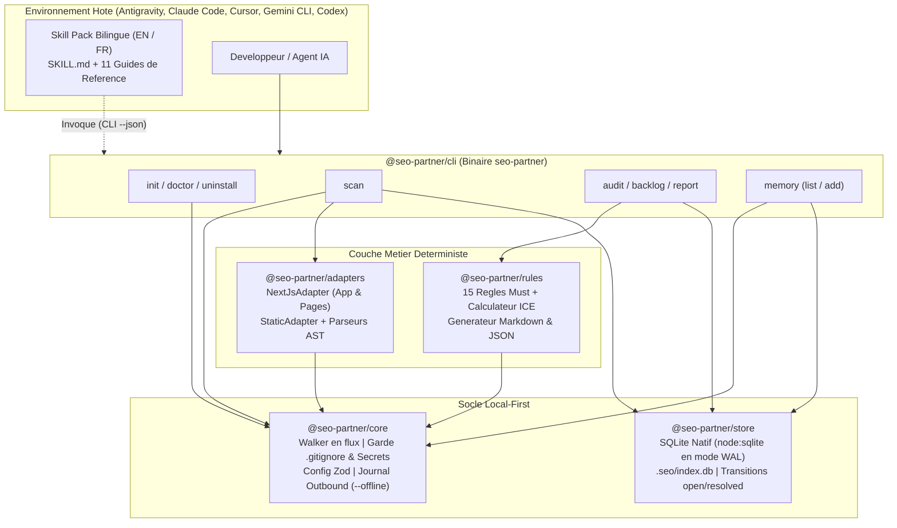
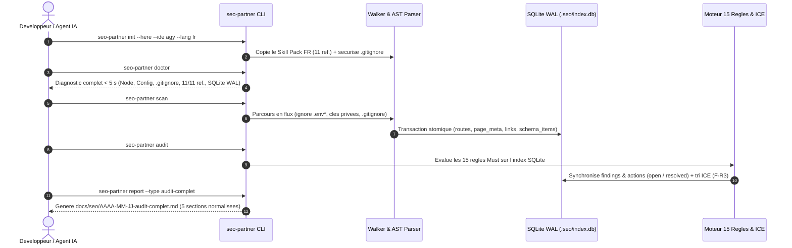

<div align="center">


<br />

[](./package.json)
[](https://nodejs.org/)
[](./tsconfig.base.json)
[](./packages/store/src/db.ts)
[](./vitest.config.ts)
[](./LICENSE)

<p align="center">
  <strong>Scanner SEO local déterministe, moteur des 15 règles <code>Must</code> avec priorisation ICE et pack méthodologique bilingue multi-IDE.</strong><br />
  <em>Conçu pour Antigravity (<code>agy</code>), Claude Code, Cursor, Gemini CLI et Codex — sans exécution de code et sans piège d'installation.</em>
</p>

<p align="center">
  <strong>Français (Actif)</strong> &nbsp;|&nbsp; <a href="./README.md">Read in English (README.md)</a> &nbsp;|&nbsp; <a href="./SECURITY.md">Politique de Sécurité</a> &nbsp;|&nbsp; <a href="./CONTRIBUTING.md">Contribuer</a>
</p>

</div>

---

## Table des Matières

1. [Vision et Proposition de Valeur](#1-vision-et-proposition-de-valeur)
2. [Architecture Système et Flux de Données](#2-architecture-système-et-flux-de-données)
3. [Démarrage Rapide (Getting Started)](#3-démarrage-rapide-getting-started)
4. [Référence Complète de la CLI (8 Commandes)](#4-référence-complète-de-la-cli-8-commandes)
5. [Catalogue des 15 Règles `Must` et Méthodologie ICE](#5-catalogue-des-15-règles-must-et-méthodologie-ice)
6. [Skill Pack Bilingue (`11/11` Références) et Intégration Multi-IDE](#6-skill-pack-bilingue-1111-références-et-intégration-multi-ide)
7. [Guide Développeur et Référence SDK TypeScript](#7-guide-développeur-et-référence-sdk-typescript)
8. [Sécurité, Confidentialité et Garde-Fous `.gitignore`](#8-sécurité-confidentialité-et-garde-fous-gitignore)
9. [Guide de Dépannage (Troubleshooting) et FAQ](#9-guide-de-dépannage-troubleshooting-et-faq)
10. [Feuille de Route (`v0.1` à `v1.0`) et Gouvernance Documentaire](#10-feuille-de-route-v01-à-v10-et-gouvernance-documentaire)

---

## 1. Vision et Proposition de Valeur

### Le problème des approches SEO actuelles

Les développeurs et équipes produit font face à deux extrêmes lorsqu'ils auditent le référencement d'une application moderne (Next.js, React, sites statiques) :

- **Les simples prompts / skills textuels** obligent l'agent IA à relire les fichiers un par un dans sa fenêtre de contexte, produisent des résultats variables d'une session à l'autre, oublient des routes et ne conservent aucune mémoire structurée des décisions prises.
- **Les crawlers SaaS externes** nécessitent un déploiement préalable, ignorent l'emplacement exact dans le code source (`fichier:ligne`) et ne s'intègrent pas nativement au flux de travail de l'IDE.

### La réponse `seo-partner` : Cœur Déterministe + Intelligence Agentique

`seo-partner` sépare strictement **ce qui doit être exact à 100 %** (exécuté par un moteur déterministe local en TypeScript/SQLite) de **ce qui relève du conseil éditorial et stratégique** (guidé par le pack méthodologique de 11 références dans votre IDE) :

| Capacité | Prompt / Skill classique | Crawler Cloud SaaS | **`seo-partner` (`v0.1`)** |
| :--- | :--- | :--- | :--- |
| **Découverte exhaustive des routes (App & Pages Router)** | Non (limité par le contexte) | Partiel (URLs publiées uniquement) | **Oui — 100 % déterministe (AST statique)** |
| **Preuve obligatoire (`filePath` + `lineNumber >= 1`)** | Non (approximative) | Non (HTML compilé uniquement) | **Oui — Ligne exacte du fichier source (`SC-003`)** |
| **Exécution du code du projet analysé (`F-S5`)** | Variable selon l'agent | N/A | **Zéro exécution (`eval`/`build` interdits)** |
| **Mémoire inter-sessions et transitions de statut** | Non (perdue entre sessions) | Cloud propriétaire | **SQLite WAL local (`.seo/index.db`) + `.seo/decisions.md`** |
| **Priorisation mathématique ICE et Arbitrage `F-R3`** | Non (subjective) | Générique | **Score `ICE = (I+C+E)/3` + Blocages en tête** |
| **Installation Windows sans binaire IDE dans le `PATH`** | Échoue souvent | N/A | **Philosophie Spec Kit (`--ignore-agent-tools`)** |

---

## 2. Architecture Système et Flux de Données

### 2.1 Architecture Modulaire du Monorepo (`pnpm workspaces`)



### 2.2 Pipeline d'Exécution de Bout en Bout



---

## 3. Démarrage Rapide (Getting Started)

### 3.1 Prérequis

- **Node.js** : `>= 22.5.0` (requis pour le moteur SQLite natif `node:sqlite` sans compilation C++ `node-gyp`).
- **Gestionnaire de paquets** : `pnpm >= 9.x` (recommandé) ou `npm`.
- **Système d'exploitation** : Windows (PowerShell), macOS ou Linux.

### 3.2 Installation (Philosophie Spec Kit)

#### Option A — Depuis le dépôt source (Développement / Monorepo)

```powershell
# 1. Cloner le dépôt et installer les dépendances
git clone https://github.com/leadbooster/seo-partner.git
cd seo-partner
pnpm install

# 2. Compiler tous les packages du monorepo
pnpm run build

# 3. (Optionnel) Lier globalement la commande seo-partner sur votre machine
pnpm --filter seo-partner link --global
```

#### Option B — Installation globale dans un projet hôte

```powershell
# Installer une seule fois globalement
pnpm add -g seo-partner

# Puis dans n'importe quel projet Next.js ou web existant :
cd /chemin/vers/mon-projet
seo-partner init --here --ide agy --lang fr --ignore-agent-tools
```

### 3.3 Vos 5 premières commandes (moins de 2 minutes)

```powershell
# 1. Initialiser seo-partner en français pour Antigravity (agy) dans le projet courant
seo-partner init --here --ide agy --lang fr --ignore-agent-tools

# 2. Vérifier la santé de l'installation (6 contrôles déterministes en < 5 s)
seo-partner doctor

# 3. Scanner le code source (AST Next.js / HTML / robots.txt / sitemap.xml)
seo-partner scan

# 4. Auditer les 15 règles Must et afficher le backlog priorisé par score ICE
seo-partner audit
seo-partner backlog

# 5. Générer le rapport exécutif en 5 parties dans docs/seo/AAAA-MM-JJ-audit-complet.md
seo-partner report --type audit-complet
```

---

## 4. Référence Complète de la CLI (8 Commandes)

### 4.1 Options Globales et Codes de Sortie

Toutes les commandes de `seo-partner` acceptent les drapeaux globaux suivants :

| Option Globale | Type | Défaut | Description |
| :--- | :--- | :--- | :--- |
| `--cwd <dir>` | `string` | `process.cwd()` | Dossier racine du projet cible à analyser. |
| `--json` | `boolean` | `false` | Retourne une enveloppe JSON déterministe sur `stdout` (conçu pour les agents IA et la CI/CD). |
| `--offline` | `boolean` | `false` | Interdit strictement tout appel réseau sortant et journalise toute tentative bloquée dans `.seo/logs/outbound.jsonl`. |

#### Enveloppe JSON Standardisée (`--json`)

```json
{
  "success": true,
  "command": "audit",
  "timestamp": "2026-10-28T14:00:00.000Z",
  "durationMs": 42,
  "data": {},
  "error": null
}
```

#### Codes de Sortie (`Exit Codes`)

| Code | Signification | Cas d'usage |
| :---: | :--- | :--- |
| `0` | **Succès** | Commande exécutée sans erreur (et sans anomalie bloquante si `--fail-on-error`). |
| `1` | **Échec Métier / Santé** | `doctor` a détecté un contrôle en erreur, ou `audit --fail-on-error` a trouvé au moins un constat `error`. |
| `2` | **Arguments Invalides** | Option CLI manquante ou valeur non reconnue (ex. `--ide inconnu`). |
| `3` | **Erreur Externe / Sécurité** | Violation du mode `--offline` ou erreur d'accès disque/SQLite. |

---

### 4.2 Détail des 8 Commandes

#### 4.2.1 `seo-partner init`
Initialise `.seo/config.json`, crée le journal `.seo/decisions.md`, installe le skill pack dans la langue choisie (`en` ou `fr`) pour le(s) IDE cible(s) sans jamais écraser les fichiers existants, et sécurise le `.gitignore`.

```powershell
seo-partner init [--here] [--ide <agy|claude|cursor|gemini|codex|all>] [--lang <en|fr>] [--ignore-agent-tools] [--terminal-only] [--dry-run] [--json]
```
- `--here` : Cible le répertoire courant.
- `--ide <cible>` : Cible un IDE spécifique ou `all`. Si omis, détecte automatiquement les dossiers `.agents`, `.claude`, `.cursor`, `.gemini`, `.codex` existants (défaut : `agy`).
- `--lang <en|fr>` : Installe la variante linguistique choisie et configure la langue des rapports dans `.seo/config.json`.
- `--ignore-agent-tools` : Ne vérifie jamais la présence du binaire de l'IDE dans le `PATH` système (évite le piège classique sous Windows).
- `--terminal-only` : Initialise uniquement `.seo/` et `.gitignore` sans copier de fichiers IDE.
- `--dry-run` : Simule l'opération et affiche la liste exacte des fichiers qui seraient créés.

#### 4.2.2 `seo-partner doctor`
Exécute **6 contrôles de santé** en moins de 5 secondes :
1. `node-version` : Vérifie que Node.js supporte `node:sqlite` (`>= 20.0.0` / recommandé `>= 22.5.0`).
2. `seo-config` : Valide `.seo/config.json` via Zod.
3. `gitignore-security` : Vérifie que `.agents/` et `.seo/index.db` sont protégés dans `.gitignore`.
4. `ide-skill-integrity` : Vérifie la présence de `SKILL.md` et des **11 guides de référence** dans chaque IDE configuré.
5. `watch-freshness` : Vérifie la date `last_verified` dans `01-veille-mises-a-jour.md` (alerte `warn` si `> 90` jours).
6. `sqlite-wal` : Vérifie l'ouverture de `.seo/index.db` en mode `journal_mode = WAL`.

```powershell
seo-partner doctor [--json]
```

#### 4.2.3 `seo-partner scan`
Parcourt l'arborescence en flux (`opendir`), ignore strictement les secrets (`.env*`, `*.pem`, `*.key`) et les motifs `.gitignore`, détecte les frameworks (`NextJsAdapter`, `StaticAdapter`) et indexe les routes, balises meta, titres `H1`-`H6`, images, liens et blocs `JSON-LD` dans `.seo/index.db`.

```powershell
seo-partner scan [--scope <subpath>] [--rebuild] [--max-size <kb>] [--json]
```
- `--rebuild` : Purge et reconstruit intégralement l'index SQLite avant le scan.
- `--max-size <kb>` : Taille maximale d'un fichier texte analysé (défaut : `2048` Ko).

#### 4.2.4 `seo-partner audit`
Évalue les **15 règles `Must`** sur l'index SQLite, met à jour les statuts des constats (`open` vers `resolved` pour les anomalies corrigées, préservation de `acknowledged`), calcule les scores ICE et persiste le backlog.

```powershell
seo-partner audit [--category <technical|onpage|schema|all>] [--severity <error|warning|info>] [--fail-on-error] [--json]
```

#### 4.2.5 `seo-partner backlog`
Affiche les actions priorisées du projet : **les problèmes bloquant l'indexation (`F-R3`) apparaissent toujours en tête**, suivis des autres actions triées par score `ICE` décroissant.

```powershell
seo-partner backlog [--status <open|acknowledged|resolved|all>] [--limit <n>] [--json]
```

#### 4.2.6 `seo-partner report`
Génère un livrable normalisé en **5 sections obligatoires** dans `docs/seo/AAAA-MM-JJ-<type>.md` (ou en `.json`), rédigé dans la langue configurée du projet (`fr` ou `en`) :
1. *Résumé décisionnel*
2. *Constats avec preuves (`filePath:lineNumber` et source officielle)*
3. *Actions priorisées (Score ICE)*
4. *Impact attendu (sans promesse de position ni de délai garanti)*
5. *Suivi et Décisions enregistrées*

```powershell
seo-partner report [--type <type>] [--format <md|json>] [--out <filepath>] [--json]
```

#### 4.2.7 `seo-partner memory`
Consulte ou ajoute une décision d'arbitrage SEO persistée simultanément dans `.seo/decisions.md` (lisible et versionnable dans Git) et dans la table `decision` de `.seo/index.db`.

```powershell
# Ajouter une décision
seo-partner memory add --title "Conserver /dashboard hors index" --rationale "Espace client authentifié" [--finding-id <id>]

# Lister l'historique des décisions
seo-partner memory list [--json]
```

#### 4.2.8 `seo-partner uninstall`
Supprime proprement les fichiers du skill installés dans les dossiers IDE du projet hôte. Par défaut, conserve `.seo/decisions.md` sauf si `--purge-data` est spécifié.

```powershell
seo-partner uninstall [--ide <cible|all>] [--purge-data] [--dry-run] [--json]
```

---

## 5. Catalogue des 15 Règles `Must` et Méthodologie ICE

### 5.1 Formule du Score ICE et Règle d'Arbitrage Absolue (`F-R3`)

Chaque constat génère une action notée sur 3 critères de `1` à `10` :
- **Impact (`I`)** : Effet potentiel sur la découvrabilité, l'indexation ou le taux de clic organique.
- **Confiance (`C`)** : Certitude de la preuve statique et du consensus officiel Google Search Central.
- **Effort (`E`)** : Facilité de mise en œuvre technique (`10` = très rapide/facile à corriger, `1` = refonte lourde).

$$\text{ICE} = \text{round}\left(\frac{\text{Impact} + \text{Confiance} + \text{Effort}}{3}, 2\right)$$

> [!IMPORTANT]
> **Règle d'Arbitrage Absolue (`F-R3`)** : Tout constat ayant `blocksIndexing = true` (`R-TECH-01`, `R-TECH-02`, `R-TECH-03`, `R-TECH-06`) passe **systématiquement en tête du backlog**, avant toute action non bloquante, même si cette dernière possède un score ICE facialement supérieur.

### 5.2 Référentiel des 15 Règles `Must` (`v0.1`)

| ID Règle | Catégorie | Sévérité | Bloque l'indexation (`F-R3`) | Notes par défaut `(I, C, E)` | Score ICE | Condition détectée et Preuve |
| :--- | :--- | :---: | :---: | :---: | :---: | :--- |
| **`R-TECH-01`** | `technical` | `error` | **Oui (Priorité 1)** | `(9, 10, 9)` | **9.33** | Absence de `public/robots.txt` ou `app/robots.(ts\|js)`. |
| **`R-TECH-02`** | `technical` | `error` | **Oui (Priorité 1)** | `(9, 10, 8)` | **9.00** | Absence de `public/sitemap.xml` ou `app/sitemap.(ts\|js)`. |
| **`R-TECH-03`** | `technical` | `error` | **Oui (Priorité 1)** | `(10, 10, 9)` | **9.67** | Directive `noindex` présente sur une route publique. |
| **`R-TECH-04`** | `technical` | `error` | Non | `(8, 9, 8)` | **8.33** | Route privée (`/admin`, `/dashboard`, `/auth`) listée dans le `sitemap.xml`. |
| **`R-TECH-05`** | `technical` | `warning` | Non | `(7, 9, 8)` | **8.00** | URL canonique (`alternates.canonical` ou `<link rel="canonical">`) absente sur une route publique. |
| **`R-TECH-06`** | `technical` | `error` | **Oui (Priorité 1)** | `(9, 8, 6)` | **7.67** | Page publique en rendu client exclusif (`'use client'`) sans export serveur de métadonnées. |
| **`R-ONPAGE-01`** | `onpage` | `error` | Non | `(9, 10, 9)` | **9.33** | Balise `<title>` ou `metadata.title` absente ou vide. |
| **`R-ONPAGE-02`** | `onpage` | `error` | Non | `(8, 10, 8)` | **8.67** | `<title>` en doublon exact sur plusieurs routes publiques. |
| **`R-ONPAGE-03`** | `onpage` | `warning` | Non | `(6, 8, 9)` | **7.67** | Longueur du `<title>` hors de la plage optimale (`< 30` ou `> 60` caractères). |
| **`R-ONPAGE-04`** | `onpage` | `error` | Non | `(8, 10, 9)` | **9.00** | Meta `description` absente ou vide sur une route publique. |
| **`R-ONPAGE-05`** | `onpage` | `warning` | Non | `(7, 10, 8)` | **8.33** | Meta `description` en doublon exact sur plusieurs routes publiques. |
| **`R-ONPAGE-06`** | `onpage` | `info` | Non | `(5, 8, 9)` | **7.33** | Longueur de la meta `description` hors de la plage optimale (`< 70` ou `> 160` caractères). |
| **`R-ONPAGE-07`** | `onpage` | `error` | Non | `(8, 9, 8)` | **8.33** | Absence de `<h1>` ou présence de plusieurs `<h1>` sur une même route publique. |
| **`R-ONPAGE-08`** | `onpage` | `warning` | Non | `(6, 10, 8)` | **8.00** | Balise `` ou composant `<Image>` dépourvu d'attribut `alt`. |
| **`R-SCHEMA-01`** | `schema` | `error` | Non | `(7, 10, 8)` | **8.33** | Bloc `<script type="application/ld+json">` au JSON invalide ou sans `@context: "https://schema.org"` / `@type`. |

---

## 6. Skill Pack Bilingue (`11/11` Références) et Intégration Multi-IDE

### 6.1 Matrice des 5 IDE Supportés

Lors de `seo-partner init`, l'outil installe automatiquement la variante linguistique choisie (`fr` ou `en`) dans l'emplacement natif de votre assistant de code, **sans jamais dépendre du `PATH` système** :

| Identifiant `--ide` | Assistant / IDE Cible | Emplacement des Fichiers Installés | Particularités |
| :--- | :--- | :--- | :--- |
| **`agy`** | **Google Antigravity** | `.agents/skills/seo-partner/SKILL.md` + `references/` | Détection native par le système de skills Antigravity. |
| **`claude`** | **Claude Code** | `.claude/skills/seo-partner/SKILL.md` + `references/` | Compatible avec les workflows Claude Code locaux. |
| **`cursor`** | **Cursor** | `.cursor/rules/seo-partner.mdc` + `.cursor/skills/seo-partner/` | Génère automatiquement la règle `.mdc` avec frontmatter Cursor. |
| **`gemini`** | **Gemini CLI** | `.gemini/skills/seo-partner/SKILL.md` + `references/` | Chargement contextuel des 11 références. |
| **`codex`** | **OpenAI Codex CLI** | `.codex/skills/seo-partner/SKILL.md` + `references/` | Compatible avec la structure locale `.codex/`. |

### 6.2 Les 11 Guides de Référence Méthodologiques (`skills/seo-partner/<lang>/references/`)

Contrairement aux skills incomplets dont les liens internes pointent vers des fichiers inexistants, `seo-partner` livre et vérifie via `doctor` l'intégralité des **11 guides de référence** en français et en anglais :

| N° | Fichier de Référence | Domaine Couvert |
| :---: | :--- | :--- |
| `01` | `01-veille-mises-a-jour.md` | Protocole de veille officielle (< 90 jours), Core Updates Google, Search Central et Bing. |
| `02` | `02-audit-technique.md` | Exploration, budget de crawl, indexation, canoniques, redirections, Core Web Vitals (`LCP`, `INP`, `CLS`). |
| `03` | `03-implementation-nextjs.md` | Patterns Next.js App Router et Pages Router (`generateMetadata`, `robots.ts`, `sitemap.ts`, `next/image`). |
| `04` | `04-strategie-mots-cles.md` | Recherche d'intentions (`Informationnelle`, `Commerciale`, `Transactionnelle`), cocons sémantiques, anti-cannibalisation. |
| `05` | `05-on-page-et-contenu.md` | Optimisation `<title>`, meta `description`, hiérarchie `H1`-`H6`, `E-E-A-T`, maillage interne. |
| `06` | `06-schema-donnees-structurees.md` | Implémentation et validation `JSON-LD` (`Organization`, `WebSite`, `Article`, `Product`, `FAQPage`, `LocalBusiness`). |
| `07` | `07-seo-local.md` | Google Business Profile, cohérence `NAP` (Nom, Adresse, Téléphone), pages locales, gestion des avis. |
| `08` | `08-geo-geographique-et-generatif.md` | SEO international (`hreflang`, architecture multi-pays) et **GEO** (*Generative Engine Optimization* pour moteurs IA). |
| `09` | `09-netlinking-autorite.md` | Acquisition éthique de backlinks, Digital PR, actifs « linkables », désaveu prudent. |
| `10` | `10-mesure-dashboard-roi.md` | Cadre de mesure Google Search Console / GA4, suivi des conversions organiques et calcul de ROI réaliste. |
| `11` | `11-roadmap-12-mois.md` | Planification trimestrielle (`M1-M3` Fondations, `M4-M6` Contenu, `M7-M9` Autorité, `M10-M12` Industrialisation). |

---

## 7. Guide Développeur et Référence SDK TypeScript

### 7.1 Organisation des Packages du Monorepo

```text
seo-partner/
├── assets/
│   └── seo-partner-hero.svg        # Banniere vectorielle emeraude scintillante (zero glassmorphisme)
├── packages/
│   ├── core/                       # @seo-partner/core : Types, Config Zod, Walker, Garde .gitignore & Offline
│   ├── store/                      # @seo-partner/store : SQLite WAL natif (node:sqlite) & Repositories
│   ├── adapters/                   # @seo-partner/adapters : NextJsAdapter, StaticAdapter & Parseurs AST
│   ├── rules/                      # @seo-partner/rules : 15 Regles Must, Score ICE & Generateur de Rapports
│   └── cli/                        # seo-partner : Binaire CLI (8 commandes) & 5 Installeurs d IDE
├── skills/
│   └── seo-partner/
│       ├── en/                     # Skill Pack Anglais (SKILL.md + 11 references)
│       └── fr/                     # Skill Pack Francais (SKILL.md + 11 references)
└── tests/
    ├── fixtures/                   # Projets temoins Next.js App Router & Pages Router
    ├── unit/                       # Tests unitaires (walker, store, adapters, ICE, 15 regles, IDEs)
    └── integration/                # Workflow E2E complet & Benchmark 10 000 fichiers
```

### 7.2 Exemple d'Utilisation Programmatique (SDK Node.js / TypeScript)

Vous pouvez utiliser les commandes ou les briques de `seo-partner` directement dans vos scripts d'intégration continue ou outils internes :

```typescript
import {
  runInitCommand,
  runScanCommand,
  runAuditCommand,
  runReportCommand,
} from 'seo-partner';

async function runAutomatedSeoGate(projectRoot: string): Promise<void> {
  // 1. Initialisation non-interactive en français pour Antigravity
  runInitCommand({
    projectRoot,
    ide: 'agy',
    lang: 'fr',
    ignoreAgentTools: true,
  });

  // 2. Scan statique déterministe vers .seo/index.db
  const scanStats = await runScanCommand({ projectRoot });
  console.log(`Routes analysées : ${scanStats.routesDiscovered} en ${scanStats.durationMs} ms`);

  // 3. Audit des 15 règles Must avec priorisation ICE
  const audit = await runAuditCommand({ projectRoot, category: 'all' });
  console.log(`Constats : ${audit.totalFindings} (dont ${audit.blockingIndexingCount} bloquants)`);

  // 4. Génération du rapport Markdown normalisé en 5 sections
  const report = await runReportCommand({
    projectRoot,
    type: 'ci-gate',
    format: 'md',
  });
  console.log(`Rapport généré : ${report.filePath}`);
}
```

### 7.3 Commandes de Développement et de Test

```powershell
# Compiler tous les packages TypeScript
pnpm run build

# Vérifier le typage strict sur l'ensemble du monorepo (packages + tests + fixtures)
pnpm exec tsc --noEmit

# Lancer les tests unitaires rapides
pnpm exec vitest run tests/unit

# Lancer la suite complète (incluant le benchmark 10 000 fichiers) avec couverture V8 (>= 80 %)
pnpm run test:coverage
```

---

## 8. Sécurité, Confidentialité et Garde-Fous `.gitignore`

`seo-partner` applique par conception la **Constitution Principe II (*Local-First, Sécurité et Zéro Exécution*)** :

1. **Zéro Exécution du Code Cible (`F-S5`)** : Le scanner lit les fichiers en flux et construit l'arbre syntaxique via `ts.createSourceFile` sans jamais importer, compiler ni exécuter le code du projet hôte.
2. **Exclusion Stricte des Secrets (`SC-005`)** : Les fichiers `.env`, `.env.*` (à l'exception de `.env.example` / `.env.template`), `*.pem`, `*.key`, `*.p12`, `*.pfx`, `id_rsa`, `.npmrc` et `credentials.json` sont rejetés **avant toute ouverture de descripteur de fichier**.
3. **Mode `--offline` et Journal d'Audit Réseau** : Avec `--offline`, toute tentative de requête sortante est immédiatement bloquée (`exit code 3`) et consignée dans `.seo/logs/outbound.jsonl`.
4. **Protection Automatique du `.gitignore`** : Tant dans ce dépôt que lors d'un `seo-partner init` chez l'utilisateur, les dossiers d'agents (`.agents/`, `.claude/`, `.cursor/`, `.gemini/`, `.codex/`, `.specify/`, `specs/`) et les fichiers SQLite reconstructibles (`.seo/index.db*`, `.seo/logs/`, `.seo/cache/`) sont automatiquement inscrits dans `.gitignore`.

---

## 9. Guide de Dépannage (Troubleshooting) et FAQ

<details>
<summary><strong>Question : Mon IDE (Antigravity / Cursor / Claude) n'est pas reconnu dans mon terminal Windows PowerShell</strong></summary>

C'est un comportement fréquent sous Windows lorsque le binaire CLI de l'IDE n'est pas ajouté au `PATH` système. `seo-partner` est conçu pour ne **jamais** dépendre du binaire de l'IDE : il écrit directement la structure de fichiers attendue par l'assistant dans votre projet (`.agents/skills/seo-partner/`, `.cursor/rules/`, etc.). Utilisez simplement :
```powershell
seo-partner init --here --ide agy --lang fr --ignore-agent-tools
```
</details>

<details>
<summary><strong>Question : <code>seo-partner doctor</code> affiche un avertissement sur <code>watch-freshness</code> (&gt; 90 jours)</strong></summary>

Conformément au Principe I de la Constitution, la référence `01-veille-mises-a-jour.md` comporte une date `last_verified` qui doit dater de moins de 90 jours. Mettez à jour la veille officielle des Core Updates Google et actualisez la date `last_verified: AAAA-MM-JJ` en haut du fichier `01-veille-mises-a-jour.md`, puis relancez `seo-partner init --here`.
</details>

<details>
<summary><strong>Question : Comment repartir d'un index SQLite vierge après un changement massif de branches Git ?</strong></summary>

La base `.seo/index.db` est 100 % reconstructible à tout moment sans perdre vos décisions enregistrées dans `.seo/decisions.md`. Exécutez :
```powershell
seo-partner scan --rebuild
```
</details>

<details>
<summary><strong>Question : L'IDE affiche encore des erreurs TypeScript en cache sur d'anciens onglets ouverts</strong></summary>

Si le serveur TypeScript de VS Code (`tsserver`) avait ouvert un fichier de test avant la génération des builds ou du `tsconfig.json` racine, ouvrez la palette de commandes (`Ctrl+Shift+P` / `Cmd+Shift+P`) et exécutez **`TypeScript: Restart TS Server`**.
</details>

---

## 10. Feuille de Route (`v0.1` à `v1.0`) et Gouvernance Documentaire

| Jalon | Statut | Périmètre Fonctionnel |
| :--- | :---: | :--- |
| **`v0.1` — Socle Fondamental** | **Livré** | Skill Pack bilingue (`11/11` réf. EN/FR), CLI 8 commandes, 5 installeurs IDE sans dépendance `PATH`, Scanner AST Next.js et Statique, SQLite WAL natif, 15 règles `Must`, score ICE (`F-R3`) et rapports 5 parties. |
| **`v0.2` — Crawl Local et Règles Étendues** | Planifié | Crawler HTTP local respectant `robots.txt` (anti-SSRF), détection des chaînes de redirections, statuts `4xx`/`5xx`, maillage interne profond et passage à 30 règles. |
| **`v0.3` — Dashboard Local et API OpenAPI 3.1** | Planifié | Serveur local `127.0.0.1` (Hono + Zod + erreurs RFC 9457) et interface SPA React/TailwindCSS WCAG 2.2 AA. |
| **`v0.4` — Serveur MCP et Mode `propose-patch`** | Planifié | Exposition des outils `packages/tools` via Model Context Protocol (`stdio`) et génération de correctifs Git sécurisés. |
| **`v0.5` — Adapters Multi-Frameworks** | Planifié | Support Astro, Nuxt, Remix / React Router v7, SvelteKit, Django/Jinja et WordPress. |
| **`v0.6`–`v1.0` — Mode Autonome et Release** | Planifié | Boucle d'agent interne multi-fournisseurs (Anthropic, OpenAI, Gemini), connecteurs GSC/CWV opt-in et binaires autonomes multi-OS. |

> [!NOTE]
> **Gouvernance Documentaire (Constitution Principe VI)** : Ce fichier (`README.fr.md`) ainsi que son homologue anglais ([`README.md`](./README.md)) constituent des livrables vivants. Toute nouvelle commande, règle, option ou évolution architecturale DOIT obligatoirement mettre à jour ces deux documents avant la validation du jalon.

---

## Licence

Distribué sous licence **MIT**. Voir le fichier [LICENSE](./LICENSE) pour plus d'informations.

<div align="center">
  <sub>Conçu et développé par <strong>Firinze Gbènito Dossou (Leadbooster)</strong></sub>
</div>
