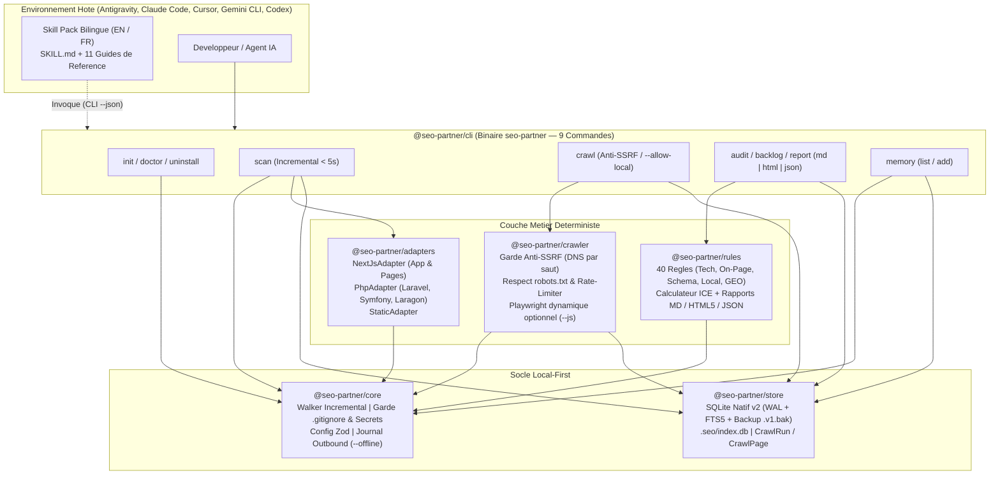
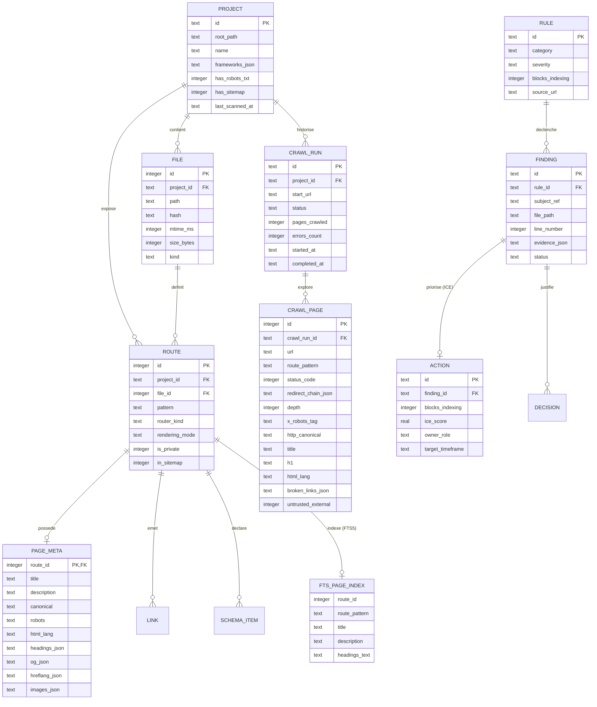

<div align="center">


<br />

[](./package.json)
[](https://nodejs.org/)
[](./tsconfig.base.json)
[](./packages/store/src/db.ts)
[](./packages/rules/src/engine.ts)
[](./LICENSE)

<p align="center">
  <strong>Scanner SEO incrémental (<code>&lt; 5 s</code>), Crawler HTTP anti-SSRF, Adapters Next.js &amp; PHP (Laravel, Symfony, Laragon), moteur de 40 règles déterministes avec priorisation ICE, rapports HTML5 autonomes et pack méthodologique bilingue multi-IDE.</strong><br />
  <em>Conçu pour Antigravity (<code>agy</code>), Claude Code, Cursor, Gemini CLI et Codex — sans exécution de code (<code>F-S5</code>) et sans piège d'installation.</em>
</p>

<p align="center">
  <strong>Français (Actif)</strong> &nbsp;|&nbsp; <a href="./README.md">Read in English (README.md)</a> &nbsp;|&nbsp; <a href="./SECURITY.md">Politique de Sécurité</a> &nbsp;|&nbsp; <a href="./CONTRIBUTING.md">Contribuer</a>
</p>

</div>

---

## Table des Matières

1. [Vision et Proposition de Valeur (`v0.2`)](#1-vision-et-proposition-de-valeur-v02)
2. [Architecture Système, Flux de Données et Schéma ERD (`SQLite v2`)](#2-architecture-système-flux-de-données-et-schéma-erd-sqlite-v2)
3. [Démarrage Rapide (Getting Started)](#3-démarrage-rapide-getting-started)
4. [Référence Complète de la CLI (9 Commandes)](#4-référence-complète-de-la-cli-9-commandes)
5. [Catalogue des 40 Règles SEO Vérifiées et Méthodologie ICE](#5-catalogue-des-40-règles-seo-vérifiées-et-méthodologie-ice)
6. [Support Multi-Frameworks : Next.js, Laravel, Symfony, PHP/Laragon et Statique](#6-support-multi-frameworks--nextjs-laravel-symfony-phplaragon-et-statique)
7. [Skill Pack Bilingue (`11/11` Références) et Intégration Multi-IDE](#7-skill-pack-bilingue-1111-références-et-intégration-multi-ide)
8. [Guide Développeur et Référence SDK TypeScript](#8-guide-développeur-et-référence-sdk-typescript)
9. [Sécurité, Anti-SSRF, Confidentialité et Garde-Fous `.gitignore`](#9-sécurité-anti-ssrf-confidentialité-et-garde-fous-gitignore)
10. [Guide de Dépannage (Troubleshooting) et FAQ](#10-guide-de-dépannage-troubleshooting-et-faq)
11. [Feuille de Route (`v0.1` à `v1.0`) et Gouvernance Documentaire](#11-feuille-de-route-v01-à-v10-et-gouvernance-documentaire)

---

## 1. Vision et Proposition de Valeur (`v0.2`)

`seo-partner` sépare strictement **ce qui doit être exact à 100 %** (exécuté par un moteur déterministe local en TypeScript et SQLite WAL + `FTS5`) de **ce qui relève du conseil éditorial et stratégique** (guidé par le pack méthodologique de 11 références dans votre IDE) :

| Capacité | Prompt / Skill classique | Crawler Cloud SaaS | **`seo-partner` (`v0.2`)** |
| :--- | :--- | :--- | :--- |
| **Découverte des routes (Next.js, Laravel, Symfony, PHP/Laragon)** | Non (limité par le contexte) | Partiel (URLs publiées uniquement) | **Oui — 100 % déterministe (AST & parseurs statiques)** |
| **Scan incrémental en boucle courte IDE (`< 5 s`)** | Non (relecture intégrale) | Non | **Oui — Diff `(mtimeMs, sizeBytes, sha256)` + `FTS5` `< 100 ms`** |
| **Crawler HTTP sécurisé & Croisement Code vs. Rendu** | Non | Sans lien avec le code source | **Oui — `seo-partner crawl` (anti-SSRF + `--allow-local` Laragon)** |
| **Preuve obligatoire (`filePath:lineNumber` ou `url + statusCode`)** | Non (approximative) | HTML compilé uniquement | **Oui — Ligne exacte du fichier ou statut HTTP crawlé** |
| **Exécution du code du projet analysé (`F-S5`)** | Variable selon l'agent | N/A | **Zéro exécution (`php`/`eval`/`build` interdits)** |
| **Catalogue de règles & Priorisation mathématique ICE (`F-R3`)** | Non (subjective) | Générique | **40 règles vérifiées (`ICE = (I+C+E)/3` + Blocages en tête)** |
| **Livrables exécutifs (Markdown, JSON, HTML5 autonome)** | Texte brut éphémère | Export propriétaire | **Rapports 5 parties `.md`, `.json` et `.html` 100 % hors ligne** |

---

## 2. Architecture Système, Flux de Données et Schéma ERD (`SQLite v2`)

### 2.1 Architecture Modulaire du Monorepo (`pnpm workspaces`)



### 2.2 Diagramme Entité-Relation (`ERD` — Schéma SQLite `v2`)



---

## 3. Démarrage Rapide (Getting Started)

### 3.1 Prérequis

- **Node.js** : `>= 22.5.0` (requis pour le moteur SQLite natif `node:sqlite` avec `FTS5` intégré).
- **Gestionnaire de paquets** : `pnpm >= 9.x` (recommandé) ou `npm`.
- **Système d'exploitation** : Windows (PowerShell, Laragon), macOS ou Linux.

### 3.2 Installation

```powershell
# 1. Cloner le dépôt et installer les dépendances
git clone https://github.com/Firinze/seo-partner.git
cd seo-partner
pnpm install

# 2. Compiler tous les packages du monorepo (core, store, adapters, crawler, rules, cli)
pnpm run build

# 3. (Optionnel) Lier globalement la commande seo-partner sur votre machine
pnpm --filter seo-partner link --global
```

### 3.3 Workflow Complet en 6 Commandes (Next.js, Laravel, Symfony ou Laragon)

```powershell
# 1. Initialiser seo-partner en français pour Antigravity (agy) dans le projet courant
seo-partner init --here --ide agy --lang fr --ignore-agent-tools

# 2. Vérifier la santé de l'installation (< 5 s)
seo-partner doctor

# 3. Scanner le code source (incrémental automatique en < 5 s après le 1er scan)
seo-partner scan

# 4. (Optionnel) Crawler votre serveur local Laragon / artisan / symfony / next dev
seo-partner crawl http://mon-projet.test --allow-local

# 5. Auditer les 40 règles SEO (croisement Code + Crawl) et afficher le backlog ICE
seo-partner audit
seo-partner backlog

# 6. Générer le rapport HTML5 autonome (sans dépendance réseau) et/ou Markdown
seo-partner report --type audit-complet --format html
seo-partner report --type audit-complet --format md
```

---

## 4. Référence Complète de la CLI (9 Commandes)

### 4.1 Options Globales et Codes de Sortie

| Option Globale | Type | Défaut | Description |
| :--- | :--- | :--- | :--- |
| `--cwd <dir>` | `string` | `process.cwd()` | Dossier racine du projet cible à analyser. |
| `--json` | `boolean` | `false` | Retourne une enveloppe JSON déterministe `{ success, data, error }` sur `stdout`. |
| `--offline` | `boolean` | `false` | Interdit strictement tout appel réseau sortant et journalise tout blocage dans `.seo/logs/outbound.jsonl`. |

| Code | Signification | Cas d'usage |
| :---: | :--- | :--- |
| `0` | **Succès** | Commande exécutée sans erreur. |
| `1` | **Échec Métier / Santé** | `doctor` a détecté un contrôle en erreur ou paramètre manquant. |
| `3` | **Blocage Sécurité Anti-SSRF / Offline** | Tentative de crawl vers une IP privée/locale sans `--allow-local`, ou appel réseau en mode `--offline`. |

### 4.2 Détail des 9 Commandes

1. **`seo-partner init`** : Initialise `.seo/config.json`, `.seo/decisions.md`, installe le skill pack bilingue (`en` ou `fr`) pour l'IDE choisi (`agy`, `claude`, `cursor`, `gemini`, `codex`) et sécurise `.gitignore`.
   ```powershell
   seo-partner init [--here] [--ide agy|claude|cursor|gemini|codex] [--lang en|fr] [--ignore-agent-tools] [--dry-run] [--json]
   ```
2. **`seo-partner doctor`** : Exécute 6 contrôles de santé déterministes (`node-version`, `seo-config`, `gitignore-security`, `ide-skill-integrity` `11/11`, `watch-freshness` `<= 90` jours, `sqlite-wal`).
   ```powershell
   seo-partner doctor [--json]
   ```
3. **`seo-partner scan`** : Exécute par défaut un **scan incrémental (`< 5 s`)** réutilisant les fichiers inchangés `(mtimeMs, sizeBytes, sha256)`, purgeant les routes supprimées et mettant à jour l'index plein texte `SQLite FTS5`.
   ```powershell
   seo-partner scan [--scope <dir>] [--rebuild] [--max-size <kb>] [--json]
   ```
4. **`seo-partner crawl <url>`** : Explore un site en ligne ou un serveur local (Laragon `http://app.test`, `http://127.0.0.1:8000`) en respectant `robots.txt` et la protection anti-SSRF à chaque saut de redirection.
   ```powershell
   seo-partner crawl <url> [--allow-local] [--max-pages 200] [--max-depth 4] [--concurrency 4] [--rate-limit-ms 200] [--js] [--resume <runId>] [--offline] [--json]
   ```
   - `--allow-local` : Autorise explicitement le crawl d'adresses locales (`127.0.0.1`, `localhost`, domaines virtuels Laragon `*.test`) tout en maintenant le blocage absolu de `169.254.169.254`.
   - `--js` : Charge dynamiquement `playwright` à la demande (`import('playwright')`) uniquement lorsque le rendu JavaScript est requis.
   - `--resume <runId>` : Reprend une session de crawl interrompue depuis `.seo/index.db`.
5. **`seo-partner audit`** : Évalue les **40 règles SEO déterministes** en croisant le scan statique du code et le dernier `CrawlRun` terminé (ou `--crawl-run <id>`).
   ```powershell
   seo-partner audit [--category technical|on-page|schema|local|geo] [--severity critical|high|medium|low] [--crawl-run <id>] [--json]
   ```
6. **`seo-partner backlog`** : Affiche les actions priorisées avec les **blocages d'indexation (`F-R3`) toujours en tête**, suivis du score `ICE` décroissant.
   ```powershell
   seo-partner backlog [--quick-wins] [--json]
   ```
7. **`seo-partner report`** : Génère le rapport exécutif en 5 sections normalisées aux formats **Markdown (`md`)**, **HTML5 autonome hors ligne (`html`)** ou **JSON (`json`)**.
   ```powershell
   seo-partner report [--type audit-complet|audit-technique|backlog] [--format md|html|json] [--output <path>] [--crawl-run <id>] [--json]
   ```
8. **`seo-partner memory`** : Consulte ou enregistre une décision d'arbitrage SEO dans `.seo/decisions.md` et SQLite.
   ```powershell
   seo-partner memory list | add --title "..." --rationale "..." [--finding <id>] [--json]
   ```
9. **`seo-partner uninstall`** : Supprime proprement les fichiers du skill installés dans l'IDE tout en préservant `.seo/decisions.md` (sauf si `--purge-data` est activé).
   ```powershell
   seo-partner uninstall [--purge-data] [--dry-run] [--json]
   ```

---

## 5. Catalogue des 40 Règles SEO Vérifiées et Méthodologie ICE

$$\text{ICE} = \text{round}\left(\frac{\text{Impact} + \text{Confiance} + \text{Effort}}{3}, 2\right)$$

> [!IMPORTANT]
> **Règle d'Arbitrage Absolue (`F-R3`)** : Tout constat ayant `blocksIndexing = true` (`R-TECH-01`, `R-TECH-02`, `R-TECH-03`, `R-TECH-06`, `R-TECH-07`, `R-TECH-09`) passe **systématiquement en tête du backlog**, quel que soit son score ICE.

### 5.1 Famille `technical` (14 Règles : `R-TECH-01` à `R-TECH-14`)

| ID | Sévérité | Bloque l'indexation | `(I, C, E)` | Condition détectée et Preuve |
| :--- | :---: | :---: | :---: | :--- |
| **`R-TECH-01`** | `critical` | **Oui** | `(8, 10, 9)` | Fichier `robots.txt` absent. |
| **`R-TECH-02`** | `high` | **Oui** | `(9, 10, 8)` | Fichier `sitemap.xml` ou générateur de sitemap absent. |
| **`R-TECH-03`** | `critical` | **Oui** | `(10, 10, 10)` | Directive `noindex` dans le code d'une route publique. |
| **`R-TECH-04`** | `high` | Non | `(7, 9, 9)` | Route privée (`/admin`, `/dashboard`, `/login`) incluse dans `sitemap.xml`. |
| **`R-TECH-05`** | `high` | Non | `(8, 9, 8)` | URL canonique absente sur une route publique. |
| **`R-TECH-06`** | `high` | **Oui** | `(9, 9, 7)` | Page publique `'use client'` sans métadonnées serveur. |
| **`R-TECH-07`** | `critical` | **Oui** | `(10, 10, 8)` | Page publique retournant une erreur HTTP `4xx` ou `5xx` lors du crawl. |
| **`R-TECH-08`** | `high` | Non | `(8, 10, 8)` | Chaîne de redirections excessive (`>= 2` sauts) ou boucle de redirection. |
| **`R-TECH-09`** | `critical` | **Oui** | `(10, 10, 9)` | En-tête HTTP `X-Robots-Tag: noindex` servi sur une page publique. |
| **`R-TECH-10`** | `high` | Non | `(8, 9, 7)` | Contradiction d'URL `canonical` entre le code source et le HTML/en-tête crawlé. |
| **`R-TECH-11`** | `high` | Non | `(8, 10, 8)` | Lien interne cassé pointant vers une URL en erreur `4xx`/`5xx`. |
| **`R-TECH-12`** | `medium` | Non | `(7, 9, 7)` | Page publique orpheline (aucun lien interne entrant et absente du sitemap). |
| **`R-TECH-13`** | `medium` | Non | `(6, 9, 6)` | Profondeur de clic excessive (`> 3` clics depuis la page d'accueil). |
| **`R-TECH-14`** | `medium` | Non | `(6, 10, 9)` | Attribut `lang` manquant ou vide sur la balise `<html>`. |

### 5.2 Famille `on-page` (14 Règles : `R-ONPAGE-01` à `R-ONPAGE-14`)

| ID | Sévérité | `(I, C, E)` | Condition détectée et Preuve |
| :--- | :---: | :---: | :--- |
| **`R-ONPAGE-01`** | `high` | `(9, 10, 9)` | Balise `<title>` absente ou vide sur une page publique. |
| **`R-ONPAGE-02`** | `high` | `(8, 9, 8)` | `<title>` dupliqué entre plusieurs pages publiques. |
| **`R-ONPAGE-03`** | `low` | `(5, 7, 9)` | Longueur du `<title>` hors de la plage recommandée (`50–60` caractères). |
| **`R-ONPAGE-04`** | `medium` | `(7, 9, 9)` | Meta `description` absente ou vide sur une page publique. |
| **`R-ONPAGE-05`** | `medium` | `(6, 8, 8)` | Meta `description` dupliquée entre plusieurs pages publiques. |
| **`R-ONPAGE-06`** | `low` | `(4, 7, 9)` | Longueur de la meta `description` hors de la plage recommandée (`150–160` caractères). |
| **`R-ONPAGE-07`** | `high` | `(8, 9, 9)` | Absence de `<h1>` ou présence de plusieurs `<h1>` sur une même page. |
| **`R-ONPAGE-08`** | `medium` | `(6, 9, 9)` | Image dépourvue d'attribut `alt` descriptif. |
| **`R-ONPAGE-09`** | `low` | `(5, 9, 8)` | Saut de niveau dans la hiérarchie des titres (ex. `H1 -> H3` sans `H2`). |
| **`R-ONPAGE-10`** | `medium` | `(7, 9, 8)` | Contenu de `<h1>` dupliqué à l'identique sur plusieurs pages publiques. |
| **`R-ONPAGE-11`** | `medium` | `(6, 9, 8)` | Image sans attributs `width` et `height` explicites (prévention du `CLS`). |
| **`R-ONPAGE-12`** | `low` | `(6, 9, 8)` | Lien interne avec texte d'ancre vide ou générique (`cliquez ici`, `lire la suite`, `here`). |
| **`R-ONPAGE-13`** | `low` | `(5, 9, 8)` | Balises Open Graph incomplètes (`og:title`, `og:description`, `og:image`). |
| **`R-ONPAGE-14`** | `medium` | `(7, 9, 7)` | Divergence du `<title>` ou du `<h1>` entre le code source et le HTML crawlé. |

### 5.3 Familles `schema` (5 Règles), `local` (4 Règles) et `geo` (3 Règles)

| ID | Catégorie | Sévérité | `(I, C, E)` | Condition détectée et Preuve |
| :--- | :---: | :---: | :---: | :--- |
| **`R-SCHEMA-01`** | `schema` | `high` | `(8, 9, 8)` | Bloc `JSON-LD` syntaxiquement invalide ou dépourvu de `@context` / `@type`. |
| **`R-SCHEMA-02`** | `schema` | `medium` | `(6, 9, 8)` | Schéma `Organization` ou `WebSite` incomplet (`name` ou `url` manquant). |
| **`R-SCHEMA-03`** | `schema` | `medium` | `(7, 9, 8)` | Schéma `Article` / `BlogPosting` incomplet (`headline`, `datePublished` ou `author` manquant). |
| **`R-SCHEMA-04`** | `schema` | `high` | `(8, 10, 7)` | Schéma `Product` incomplet (`name` ou `offers`/`review`/`aggregateRating` manquant). |
| **`R-SCHEMA-05`** | `schema` | `medium` | `(7, 9, 8)` | Schéma `FAQPage` ou `BreadcrumbList` avec `mainEntity` ou `itemListElement` vide. |
| **`R-LOCAL-01`** | `local` | `high` | `(8, 10, 8)` | Schéma `LocalBusiness` dépourvu d'adresse postale structurée (`address`). |
| **`R-LOCAL-02`** | `local` | `medium` | `(7, 10, 9)` | Schéma `LocalBusiness` dépourvu de numéro de téléphone (`telephone` / `NAP`). |
| **`R-LOCAL-03`** | `local` | `low` | `(6, 9, 9)` | Numéro de téléphone `LocalBusiness` non formaté en international E.164 (`+...`). |
| **`R-LOCAL-04`** | `local` | `low` | `(6, 8, 8)` | Schéma `LocalBusiness` sans horaires (`openingHoursSpecification`) ni coordonnées (`geo`). |
| **`R-GEO-01`** | `geo` | `high` | `(8, 10, 8)` | Code de langue ou de région `hreflang` invalide (ex. `en-UK` au lieu de `en-GB`). |
| **`R-GEO-02`** | `geo` | `medium` | `(7, 9, 8)` | Grappe `hreflang` sans lien auto-référent ou sans entrée `x-default`. |
| **`R-GEO-03`** | `geo` | `low` | `(6, 8, 8)` | Directive `robots.txt` bloquant globalement l'indexation (`Disallow: /` sur `*`). |

---

## 6. Support Multi-Frameworks : Next.js, Laravel, Symfony, PHP/Laragon et Statique

Conformément à l'exigence constitutionnelle `F-S5`, **aucun interpréteur externe (`php`, `node`, `eval`) n'est jamais exécuté sur le code cible**.

| Adapter | Environnements Détectés | Fichiers & Routes Analysés Statiquement | Résolution d'Héritage de Layouts |
| :--- | :--- | :--- | :--- |
| **`NextJsAdapter`** | Next.js App Router & Pages Router | `app/**/page.(tsx\|jsx)`, `pages/**/*.(tsx\|jsx)`, `metadata` / `generateMetadata` | Extraction AST TypeScript (`ts.createSourceFile`). |
| **`PhpAdapter` (`laravel`)** | Laravel (`composer.json` + `artisan`) | `routes/web.php` (`Route::view`, `Route::get`) + `resources/views/**/*.blade.php` | Fusion de `@extends('layouts.app')`, `@yield('title')` et `@section('title', ...)`. |
| **`PhpAdapter` (`symfony`)** | Symfony (`symfony/framework-bundle`) | Attributs PHP 8 `#[Route('/...')]` dans `src/Controller/*.php`, `config/routes.yaml` + `templates/**/*.html.twig` | Fusion de `` et ``. |
| **`PhpAdapter` (`php`)** | PHP Natif & Laragon (`*.test`) | `public/*.php` ou `*.php` à la racine | Résolution des `require` / `include` d'en-têtes (`includes/header.php`). |
| **`StaticAdapter`** | Sites HTML5 & Markdown | `**/*.html`, `**/*.md`, `**/*.mdx` | Extraction directe HTML et Frontmatter YAML. |

---

## 7. Skill Pack Bilingue (`11/11` Références) et Intégration Multi-IDE

Lors de `seo-partner init`, l'outil installe automatiquement la variante linguistique choisie (`fr` ou `en`) dans l'emplacement natif de votre assistant de code (`.agents/skills/seo-partner/`, `.claude/skills/seo-partner/`, `.cursor/rules/`, `.gemini/skills/seo-partner/`, `.codex/skills/seo-partner/`) avec ses **11 guides de référence méthodologiques** vérifiés par `seo-partner doctor`.

---

## 8. Guide Développeur et Référence SDK TypeScript

### 8.1 Organisation des 6 Packages du Monorepo

```text
seo-partner/
├── assets/
│   └── seo-partner-hero.svg        # Banniere vectorielle emeraude scintillante (zero glassmorphisme)
├── packages/
│   ├── core/                       # @seo-partner/core : Types v0.2, Config Zod, Walker Incremental, Garde .gitignore
│   ├── store/                      # @seo-partner/store : SQLite WAL v2 (FTS5, CrawlRepository, backup .v1.bak)
│   ├── adapters/                   # @seo-partner/adapters : NextJsAdapter, PhpAdapter (Laravel/Symfony/Laragon), StaticAdapter
│   ├── crawler/                    # @seo-partner/crawler : Crawler HTTP, Garde Anti-SSRF, robots.txt, Playwright optionnel
│   ├── rules/                      # @seo-partner/rules : 40 Regles SEO, Score ICE, Rapports Markdown / HTML5 / JSON
│   └── cli/                        # seo-partner : Binaire CLI (9 commandes) & 5 Installeurs d IDE
├── skills/
│   └── seo-partner/                # Skill Pack Bilingue EN & FR (SKILL.md + 11 references)
└── tests/
    ├── fixtures/                   # Projets temoins Next.js, Laravel, Symfony et PHP/Laragon
    ├── unit/                       # Suites unitaires (scan incremental, FTS5, anti-SSRF, PhpAdapter, 40 regles, HTML)
    └── integration/                # Workflows E2E v0.1 & v0.2 + Benchmark 10 000 fichiers
```

### 8.2 Commandes de Build et de Vérification

```powershell
pnpm run build                        # Compiler les 6 packages TypeScript
pnpm exec tsc --noEmit                # Verifier le typage strict (0 erreur sur tout le depot)
pnpm exec vitest run tests/unit       # Executer les suites unitaires rapides
pnpm run test:coverage                # Executer toutes les suites + benchmark 10k fichiers + couverture V8 (>= 80 %)
```

---

## 9. Sécurité, Anti-SSRF, Confidentialité et Garde-Fous `.gitignore`

1. **Zéro Exécution du Code Cible (`F-S5`)** : Ni Node.js ni PHP ne sont exécutés sur les fichiers du projet audité.
2. **Protection Anti-SSRF Stricte par Résolution DNS à Chaque Saut (`FR-004`)** : Par défaut, `seo-partner crawl` résout les adresses IP avant chaque requête et chaque saut de redirection (`redirect: 'manual'`) et bloque `127.0.0.0/8`, `10.0.0.0/8`, `172.16.0.0/12`, `192.168.0.0/16`, `169.254.0.0/16`, `::1`, `fc00::/7`, `fe80::/10` ainsi que `localhost` et `*.test`. Le drapeau explicite `--allow-local` permet d'auditer un serveur local (Laragon, `artisan serve`, `symfony server`, `next dev`) tout en maintenant le blocage inconditionnel de l'IP de métadonnées cloud `169.254.169.254`.
3. **Marquage des Contenus Externes & Échappement HTML** : Toute donnée extraite par le crawler est marquée `untrustedExternal: true` et intégralement échappée dans les rapports HTML5 et Markdown.
4. **Sauvegarde Automatique lors des Migrations SQLite** : Lors du passage du schéma `v1` à `v2`, `.seo/index.db.v1.bak` est créé automatiquement avant migration.

---

## 10. Guide de Dépannage (Troubleshooting) et FAQ

<details>
<summary><strong>Question : Comment auditer mon projet PHP / Laravel hébergé localement sous Laragon (ex. <code>http://mon-app.test</code>) ?</strong></summary>

Lancez d'abord `seo-partner scan` à la racine de votre projet PHP/Laravel, puis lancez le crawler avec le drapeau explicite `--allow-local` :
```powershell
seo-partner scan
seo-partner crawl http://mon-app.test --allow-local
seo-partner audit
seo-partner report --format html
```
</details>

<details>
<summary><strong>Question : Comment utiliser le rendu navigateur JavaScript (<code>--js</code>) lors d'un crawl ?</strong></summary>

Afin de garder une installation légère par défaut, Playwright n'est chargé qu'à la demande lorsque `--js` est passé. Installez-le uniquement si vous en avez besoin :
```powershell
pnpm add -D playwright
npx playwright install chromium
seo-partner crawl https://example.com --js
```
</details>

---

## 11. Feuille de Route (`v0.1` à `v1.0`) et Gouvernance Documentaire

| Jalon | Statut | Périmètre Fonctionnel |
| :--- | :---: | :--- |
| **`v0.1` — Socle Fondamental** | **Livré** | Skill Pack bilingue (`11/11` réf. EN/FR), CLI 8 commandes, 5 installeurs IDE sans dépendance `PATH`, Scanner AST Next.js et Statique, SQLite WAL natif, 15 règles `Must`, score ICE (`F-R3`) et rapports 5 parties. |
| **`v0.2` — Scan Incrémental, Crawler Anti-SSRF, PHP & 40 Règles** | **Livré** | Scan incrémental (`< 5 s`) + recherche plein texte `SQLite FTS5` (`< 100 ms`), Crawler HTTP anti-SSRF (`seo-partner crawl` + `--allow-local` Laragon), `PhpAdapter` (Laravel/Blade, Symfony/Twig, PHP natif/Laragon), extension à **40 règles SEO vérifiées** et export de rapports **HTML5 autonomes** (`--format html`). |
| **`v0.3` — Dashboard Local et API OpenAPI 3.1** | Planifié | Serveur local `127.0.0.1` (Hono + Zod + erreurs RFC 9457) et interface SPA React/TailwindCSS WCAG 2.2 AA. |
| **`v0.4` — Serveur MCP et Mode `propose-patch`** | Planifié | Exposition des outils `packages/tools` via Model Context Protocol (`stdio`) et génération de correctifs Git sécurisés. |
| **`v0.5` — Adapters Multi-Frameworks Additionnels** | Planifié | Support Astro, Nuxt, Remix / React Router v7, SvelteKit et Django/Jinja. |
| **`v0.6`–`v1.0` — Mode Autonome et Release** | Planifié | Boucle d'agent interne multi-fournisseurs (Anthropic, OpenAI, Gemini), connecteurs GSC/CWV opt-in et binaires autonomes multi-OS. |

> [!NOTE]
> **Gouvernance Documentaire (Constitution Principe VI)** : Ce fichier (`README.fr.md`) ainsi que son homologue anglais ([`README.md`](./README.md)) constituent des livrables vivants. Toute nouvelle commande, règle, option ou évolution architecturale DOIT obligatoirement mettre à jour ces deux documents avant la validation du jalon.

---

## Licence

Distribué sous licence **MIT**. Voir le fichier [LICENSE](./LICENSE) pour plus d'informations.

<div align="center">
  <sub>Conçu et développé par <strong><a href="https://github.com/Firinze/seo-partner">Firinze Gbènito Dossou</a></strong></sub>
</div>
