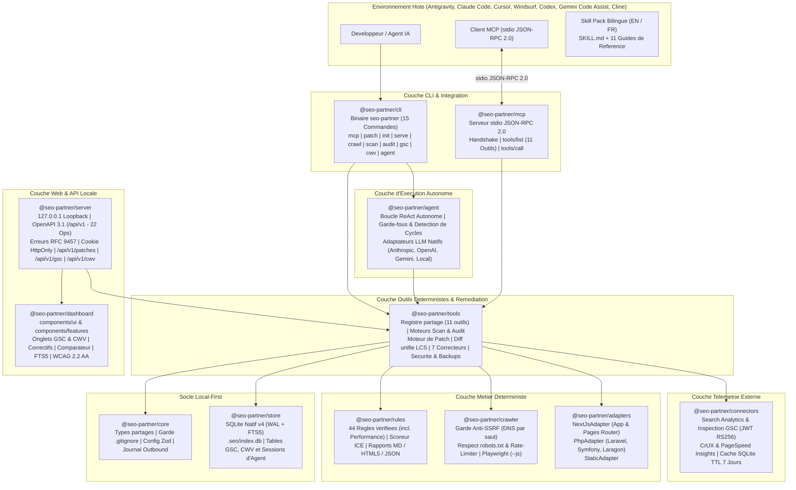

<div align="center">


<br />

[](./package.json)
[](https://nodejs.org/)
[](./tsconfig.base.json)
[](./package.json)
[](./packages/mcp/src/server.ts)
[](./packages/store/src/db.ts)
[](./packages/server/src/openapi.ts)
[](./packages/rules/src/engine.ts)
[](./LICENSE)

<p align="center">
  <strong>Registre d'outils SEO deterministes local-first, Serveur MCP standard sur flux stdio (11 outils), Moteur de remediation par diffs Git unifies (<code>seo-partner patch</code>), Connecteurs Google Search Console & Core Web Vitals, Boucle d'agent autonome ReAct (<code>seo-partner agent run</code>), Adapteurs multi-frameworks (Next.js, Astro, Nuxt 3, SvelteKit, Remix, Django, Laravel, Symfony, PHP, Statique), Crawler anti-SSRF, Moteur de 44 regles avec scoring ICE, API REST locale et Dashboard WCAG 2.2 AA.</strong><br />
  <em>Concu pour Antigravity (<code>agy</code>), Claude Code, Cursor, Windsurf, Codex, Gemini Code Assist et Cline — zero generation LLM non verifiee, zero execution de code cible (<code>F-S5</code>) et sauvegardes automatiques.</em>
</p>

<p align="center">
  <strong>Francais (Actif)</strong> &nbsp;|&nbsp; <a href="./README.md">Read in English (README.md)</a> &nbsp;|&nbsp; <a href="./SECURITY.md">Politique de Securite</a> &nbsp;|&nbsp; <a href="./CONTRIBUTING.md">Contribuer</a>
</p>

</div>

---

## Table des Matieres

1. [Vision et Proposition de Valeur (`v0.6`)](#1-vision-et-proposition-de-valeur-v06)
2. [Architecture Systeme et Flux de Donnees (`12 Packages`)](#2-architecture-systeme-et-flux-de-donnees-12-packages)
3. [Demarrage Rapide](#3-demarrage-rapide)
4. [Reference Complete de la CLI (15 Commandes)](#4-reference-complete-de-la-cli-15-commandes)
5. [Serveur Model Context Protocol (MCP) (`@seo-partner/mcp`)](#5-serveur-model-context-protocol-mcp-seo-partnermcp)
6. [Moteur de Remediation Deterministe (`seo-partner patch`)](#6-moteur-de-remediation-deterministe-seo-partner-patch)
7. [Connecteurs Externes : Google Search Console & Core Web Vitals](#7-connecteurs-externes--google-search-console--core-web-vitals)
8. [Boucle d'Agent Autonome ReAct (`seo-partner agent run`)](#8-boucle-dagent-autonome-react-seo-partner-agent-run)
9. [Serveur API Local (`127.0.0.1`, OpenAPI 3.1, RFC 9457) & Dashboard Web](#9-serveur-api-local-127001-openapi-31-rfc-9457--dashboard-web)
10. [Catalogue des 44 Regles SEO Verifiees et Methodologie ICE](#10-catalogue-des-44-regles-seo-verifiees-et-methodologie-ice)
11. [Support Multi-Frameworks : Next.js, Astro, Nuxt 3, SvelteKit, Remix, Django, Laravel, Symfony, PHP/Laragon et Statique](#11-support-multi-frameworks--nextjs-astro-nuxt-3-sveltekit-remix-django-laravel-symfony-phplaragon-et-statique)
12. [Guide Developpeur et Architecture du Workspace](#12-guide-developpeur-et-architecture-du-workspace)
13. [Securite, Garde-Fou Git, Sauvegardes et Anti-SSRF](#13-securite-garde-fou-git-sauvegardes-et-anti-ssrf)
14. [Guide de Depannage et FAQ](#14-guide-de-depannage-et-faq)
15. [Feuille de Route (`v0.1` a `v1.0`) et Gouvernance Documentaire](#15-feuille-de-route-v01-a-v10-et-gouvernance-documentaire)

---

## 1. Vision et Proposition de Valeur (`v0.6`)

`seo-partner` separe strictement **ce qui doit etre exact a 100 %** (analyse statique en TypeScript, serveur MCP stdio standard, crawl HTTP anti-SSRF, base SQLite WAL + `FTS5`, correctifs deterministes par diffs unifies, synchronisation des connecteurs GSC / CWV et API OpenAPI locale) de **ce qui releve de la boucle d'agent autonome et du conseil editorial** (agents IA dans leurs IDE hotes et boucles ReAct supervisees par garde-fous) :

| Capacite | Agent IA Generique | Crawler Cloud SaaS | **`seo-partner` (`v0.6`)** |
| :--- | :--- | :--- | :--- |
| **Model Context Protocol (MCP)** | Prompts manuels copies-colles | API proprietaires | **Oui — Serveur stdio JSON-RPC 2.0 Standard (11 outils partages)** |
| **Remediation & Patchs securises** | Hallucinations de code | Audit en lecture seule | **Oui — Diffs unifies verifiables + `--apply` atomique + Sauvegardes** |
| **Google Search Console & CWV** | Deconnectes | Connecteurs SaaS lourds | **Oui — JWT RS256 natif + CrUX & PageSpeed avec cache SQLite 7 jours** |
| **Boucle d'Agent Autonome ReAct** | Boucles infinies | Boite noire cloud | **Oui — Moteur ReAct local avec garde-fous de cycle & traces JSONL** |
| **Decouverte des routes multi-frameworks** | Limites de fenetre contextuelle | URLs publiees seulement | **Oui — Next.js, Astro, Nuxt 3, SvelteKit, Remix, Django, Laravel, Symfony, PHP, Statique** |
| **Scan incremental en boucle courte IDE (`< 5 s`)** | Relecture integrale | N/A | **Oui — Diff `(mtimeMs, sizeBytes, sha256)` + `FTS5` `< 100 ms`** |
| **Crawler HTTP securise & Comparateur Code vs. Crawl** | Non | Sans lien avec le code | **Oui — `seo-partner crawl` + Comparateur cote a cote** |
| **Dashboard Web local & API OpenAPI 3.1 (`127.0.0.1`)** | Non | Cloud payant externe | **Oui — `seo-partner serve` (Auto-fallback de port, RFC 9457, WCAG 2.2 AA)** |
| **Execution du code du projet analyse (`F-S5`)** | Appels shell risques | N/A | **Zero execution (`php`/`python`/`eval`/`build` strictement interdits)** |
| **Catalogue de regles & Priorisation ICE (`F-R3`)** | Subjective | Generique | **44 regles verifiees (`ICE = (I+C+E)/3` + Blocages en tete + Performance)** |
| **Livrables executifs (Markdown, JSON, HTML5 autonome)** | Chat ephemere | Export proprietaire | **Rapports 5 parties `.md`, `.json` et `.html` 100 % hors ligne** |

---

## 2. Architecture Systeme et Flux de Donnees (`12 Packages`)

### 2.1 Architecture Modulaire du Monorepo (`12 Packages` — `pnpm workspaces`)



---

## 3. Demarrage Rapide

```powershell
# 0. Cloner le depot et construire les 12 packages du workspace
git clone https://github.com/Firinze/seo-partner.git
cd seo-partner
pnpm install
pnpm run build

# 1. Initialiser seo-partner avec fusion des configurations MCP multi-IDE
seo-partner init --here --ide all --with-mcp --lang fr

# 2. Verifier l'integrite de l'installation (6 verifications en < 5 s)
seo-partner doctor

# 3. Demarrer le serveur MCP stdio (ou laisser Claude / Cursor l'invoquer)
seo-partner mcp

# 4. Scanner les fichiers sources de facon incrementale (< 5 s + index FTS5)
seo-partner scan

# 5. Executer l'audit des 44 regles (avec integration Core Web Vitals optionnelle)
seo-partner audit --with-cwv

# 6. Synchroniser les performances Google Search Console
seo-partner gsc sync --site https://example.com/

# 7. Recuperer les Core Web Vitals depuis CrUX et PageSpeed Insights
seo-partner cwv fetch https://example.com/

# 8. Lancer la boucle d'agent autonome ReAct avec garde-fous
seo-partner agent run "Inspecter les blocages d'indexation et proposer des diffs unifies"

# 9. Generer les propositions de correctifs deterministes (dry-run par defaut)
seo-partner patch

# 10. Appliquer en toute securite avec sauvegarde automatique et garde Git
seo-partner patch --apply

# 11. Lancer le Dashboard Web local sur http://127.0.0.1:4321
seo-partner serve --port 4321 --lang fr
```

---

## 4. Reference Complete de la CLI (15 Commandes)

1. **`seo-partner init`**: Cree `.seo/config.json`, `.seo/decisions.md`, securise `.gitignore`, installe les skills et, avec `--with-mcp`, fusionne automatiquement la configuration stdio MCP pour Claude Code, Cursor, Windsurf, Codex, Gemini Code Assist et Cline.
2. **`seo-partner mcp`**: Demarre le serveur Model Context Protocol sur flux stdio (JSON-RPC 2.0), exposant les 11 outils deterministes. Accepte le drapeau `--allow-apply` pour autoriser l'application directe des correctifs.
3. **`seo-partner patch`**: Genere des diffs Git unifies verifiables (`.seo/patches/<batchId>.diff`) pour les regles corrigibles (`R-TECH-01`, `R-TECH-02`, `R-TECH-03`, `R-TECH-05`, `R-TECH-14`, `R-ONPAGE-01`, `R-ONPAGE-04`). Avec `--apply`, verifie l'etat Git, cree une sauvegarde dans `.seo/backups/<timestamp>/`, applique les diffs et decompte les marqueurs `TODO-SEO`.
4. **`seo-partner gsc <sync|inspect>`**: Se connecte a Google Search Console via un compte de service signe en RS256 JWT sans dependance SDK externe lourde. Synchronise les metriques de recherche (clics, impressions, CTR, position) ou inspecte l'indexation d'une URL en temps reel.
5. **`seo-partner cwv fetch <url>`**: Recupere les percentiles au 75e rang des Core Web Vitals (LCP, INP, CLS, FCP, TTFB) depuis Google CrUX avec repli au niveau de l'origine, ou lance un audit PageSpeed Insights avec mise en cache SQLite sur 7 jours.
6. **`seo-partner agent run <goal>`**: Execute une boucle ReAct autonome resolvant des objectifs SEO cibles a l'aide de `@seo-partner/tools`. Protege par detection de cycles, budget d'iterations et assainissement securise des arguments.
7. **`seo-partner doctor`**: Execute 6 controles de sante en moins de 5 secondes (`node-version`, `seo-config`, `gitignore-security`, `ide-skill-integrity`, `watch-freshness`, `sqlite-wal`).
8. **`seo-partner scan`**: Scanner incremental (`< 5 s`), reemployant les fichiers inchanges grace au triplet `(mtimeMs, sizeBytes, sha256)`, purgeant les routes supprimees et actualisant l'index SQLite FTS5.
9. **`seo-partner crawl <url>`**: Crawler HTTP anti-SSRF respectant robots.txt, la validation DNS par saut et la limitation de debit (`--allow-local` pour Laragon / `127.0.0.1`).
10. **`seo-partner audit`**: Evalue 44 regles SEO deterministes sur les donnees du scan statique, du crawl et des Core Web Vitals (`--with-cwv`).
11. **`seo-partner backlog`**: Affiche les actions prioritaires avec les blocages d'indexation (`F-R3`) systematiquement en tete, suivis du score ICE decroissant.
12. **`seo-partner report`**: Genere des rapports executifs 5 parties en Markdown, JSON ou HTML5 autonome hors ligne.
13. **`seo-partner serve`**: Lance le serveur API local et le Dashboard Web interactif sur `127.0.0.1` avec fallback automatique de port (`+1..20`).
14. **`seo-partner memory`**: Synchronise les decisions architecturales SEO entre `.seo/decisions.md` et SQLite.
15. **`seo-partner uninstall`**: Supprime proprement les fichiers de skills IDE tout en preservant les donnees `.seo/`.

---

## 5. Serveur Model Context Protocol (MCP) (`@seo-partner/mcp`)

Le serveur MCP met en oeuvre le protocole Model Context Protocol officiel sur flux `stdio` avec JSON-RPC 2.0 sans dependance SDK externe lourde :

### Outils Exposes (11 Outils Deterministes)

| Nom de l'Outil | Parametres | Description |
| :--- | :--- | :--- |
| `list_routes` | `limit?: number, offset?: number` | Liste toutes les routes decouvertes avec framework, title, canonical et robots. |
| `get_route` | `routePattern: string` | Restitue les metadonnees detaillees, la hierarchie H1-H6 et les liens pour une route donnee. |
| `search_routes` | `query: string, limit?: number` | Recherche plein texte SQLite FTS5 sur les titres, descriptions et titres H1-H6 (`< 100 ms`). |
| `get_findings` | `category?, severity?, blocksIndexing?: boolean` | Liste les constats d'audit avec preuve exacte (`filePath:lineNumber`) et conseil de remediation. |
| `get_backlog` | `ownerRole?, targetTimeframe?` | Retourne les actions priorisees ICE (`ICE = (I+C+E)/3`) avec blocages d'indexation en tete. |
| `run_audit` | `crawlRunId?: string` | Declenche une evaluation fraiche de l'audit et enregistre les constats dans SQLite. |
| `propose_patch` | `findingId?, ruleId?, apply?: boolean, force?: boolean` | Genere des diffs unifies pour les regles corrigibles ; n'applique que si `--allow-apply` est actif. |
| `get_gsc_performance` | `siteUrl?: string, startDate?: string, endDate?: string, limit?: number` | Interroge l'historique de performance (clics, impressions, CTR, position) depuis SQLite. |
| `inspect_gsc_url` | `url: string, siteUrl?: string` | Interroge les donnees d'inspection d'URL Google Search Console (verdict, couverture, indexation). |
| `get_cwv_metrics` | `url: string, formFactor?: string` | Restitue les percentiles et statuts Core Web Vitals evalues (CrUX / PageSpeed) depuis SQLite. |
| `run_agent_step` | `action: string, params: object` | Execute une etape d'outil isolee pour les agents avec validation securitaire stricte. |

---

## 6. Moteur de Remediation Deterministe (`seo-partner patch`)

Le moteur de remediation repare les defauts SEO corrigibles par transformation directe d'AST ou de chaines, sans hallucination de code :

1. **Regles Corrigibles (`7 Regles`)**:
   - `R-TECH-01`: Cree un fichier `public/robots.txt` manquant avec politique d'acces par defaut et directive `Sitemap`.
   - `R-TECH-02`: Cree un fichier `public/sitemap.xml` manquant a partir des routes canoniques decouvertes.
   - `R-TECH-03`: Remplace les directives `noindex` involontaires par `index, follow`.
   - `R-TECH-05`: Injecte la balise auto-referente `<link rel="canonical" href="...">`.
   - `R-TECH-14`: Ajoute l'attribut `<html lang="fr">` manquant sur les elements HTML racine.
   - `R-ONPAGE-01`: Injecte la balise `<title>` manquante avec le marqueur editorial deterministe `TODO-SEO`.
   - `R-ONPAGE-04`: Injecte le titre `<h1>` manquant avec le marqueur editorial deterministe `TODO-SEO`.

2. **Generation de Diff Unifie (Algorithme LCS)**:
   - Construit une matrice LCS (Plus Longue Sous-Sequence Commune) avec un plafond de securite a 5000 lignes.
   - Produit des sections de diff unifie standard (`@@ -oldStart,oldLines +newStart,newLines @@`) compatibles avec `git apply --check`.

3. **Pipeline d'Application Securise**:
   - **Protection contre les Chemins Malveillants**: Rejette `..`, les chemins absolus, `.git/` et les secrets `.env*`.
   - **Garde-Fou d'Espace de Travail Git Modifie**: Refuse d'ecrire si les fichiers cibles comportent des modifications non validees (contournable avec `--force`).
   - **Sauvegardes Horodatees Automatiques**: Sauvegarde chaque fichier modifie dans `.seo/backups/<timestamp>/` avant toute modification.
   - **Ecriture Atomique avec Restauration**: Ecrit dans un fichier temporaire frere avant renommage atomique ; restaure la sauvegarde en cas d'erreur.

---

## 7. Connecteurs Externes : Google Search Console & Core Web Vitals

### 7.1 Google Search Console (`@seo-partner/connectors`)
- **Authentification JWT RS256 Native**: Aucune dependance aux bibliotheques client Google. Emploie le module standard `node:crypto` pour generer des JWT signes echangeables contre un jeton OAuth avec perimetre en lecture seule `https://www.googleapis.com/auth/webmasters.readonly`.
- **Search Analytics**: Extraction des impressions, clics, CTR et positions moyennes par page et intervalle de dates.
- **Inspection d'URL**: Recuperation en temps reel du verdict de couverture, de l'etat d'indexation, de l'ergonomie mobile et de la canonique Google.

### 7.2 Core Web Vitals (`@seo-partner/connectors`)
- **Chrome User Experience Report (CrUX)**: Collecte des metriques de terrain (LCP, INP, CLS, FCP, TTFB). Repli automatique et gracieux sur l'origine si la page dispose d'un volume de trafic insuffisant.
- **PageSpeed Insights**: Realisation d'audits de performance en environnement de laboratoire lorsque les donnees de terrain sont absentes.
- **Cache SQLite TTL 7 Jours**: Evite la surconsommation des quotas d'API en conservant les mesures evaluees pendant 7 jours (contournable avec `--refresh`).

---

## 8. Boucle d'Agent Autonome ReAct (`seo-partner agent run`)

Le moteur d'agent execute une boucle locale ReAct (Pensee-Action-Observation) resolvant des objectifs SEO etapes par etapes :

1. **Adaptateurs LLM Natifs et Legers**:
   - Anthropic Claude (`/v1/messages`)
   - OpenAI (`/v1/chat/completions`)
   - Google Gemini (`/v1beta/models`)
   - Inference LLM locale via `--base-url` (Ollama, vLLM, LM Studio)
2. **Garde-fous & Mecanismes de Securite**:
   - **Detection de Cycles**: Interrompt immediatement l'execution si le meme appel d'outil avec les memes arguments se repete 3 fois d'affilee.
   - **Budget d'Iterations**: Plafond strict sur le nombre d'etapes (10 par defaut, reglable via `--max-iterations`).
   - **Assainissement des Arguments**: Neutralise les parametres destructeurs et force le mode simulation sauf mention explicite de `--auto-apply`.
3. **Journalisation d'Audit Structuree**:
   - Enregistre l'ensemble des pensees, appels et observations dans SQLite (`agent_run_session` et `agent_step_log`).
   - Produit un journal de streaming verifiable dans `.seo/logs/agent-<sessionId>.jsonl`.

---

## 9. Serveur API Local (`127.0.0.1`, OpenAPI 3.1, RFC 9457) & Dashboard Web

- **Isolation Boucle Locale (`127.0.0.1`)**: N'ecoute jamais sur le reseau externe ni sur `0.0.0.0`.
- **Intercepteurs de Securite**: Controle strict des en-tetes `Host` et `Origin` ; cookie HttpOnly `seo_partner_session` obligatoire sur tous les POST mutants.
- **Points de Terminaison REST (`22 Operations`)**:
  - `GET /api/v1/patches`, `POST /api/v1/patches`
  - `GET /api/v1/gsc/performance`, `POST /api/v1/gsc/sync`, `POST /api/v1/gsc/inspect`
  - `GET /api/v1/cwv`, `POST /api/v1/cwv/fetch`
  - Routes, constats, backlog, comparateur et audits.
- **Dashboard Modulaire (`@seo-partner/dashboard`)**:
  - 9 onglets interactifs : Synthese, Routes, Constats, Backlog, Comparateur, Decisions, Correctifs, **Google Search Console** et **Core Web Vitals**.
  - Regles d'interface strictes : conformite WCAG 2.2 AA, zero emoji, zero glassmorphism (`backdrop-filter` interdit) et zero bordure laterale d'accentuation.

---

## 10. Catalogue des 44 Regles SEO Verifiees et Methodologie ICE

$$\text{ICE} = \text{round}\left(\frac{\text{Impact} + \text{Confidence} + \text{Effort}}{3}, 2\right)$$

> [!IMPORTANT]
> **Regle de Priorite Absolue (`F-R3`)**: Tout constat comportant `blocksIndexing = true` (`R-TECH-01`, `R-TECH-02`, `R-TECH-03`, `R-TECH-06`, `R-TECH-07`, `R-TECH-09`) est **toujours place en tete de liste**, devant tous les constats non bloquants, quel que soit leur score ICE nominal.

- **Technique (`R-TECH-01` a `R-TECH-14`, 14 regles)**: `robots.txt`, `sitemap.xml`, `noindex`, routes privees dans sitemap, canonique manquante, routes client-only, erreurs HTTP `4xx`/`5xx`, chaines de redirections, `X-Robots-Tag`, contradictions code vs crawl, liens casses, pages orphelines, profondeur de clic `> 3` et attribut `<html lang>` manquant.
- **On-Page (`R-ONPAGE-01` a `R-ONPAGE-14`, 14 regles)**: Balises `<title>` manquantes ou sous-optimales, meta `description`, structure `<h1>`, textes `alt` d'images, hierarchie des titres, doublons de `<h1>`, dimensions d'images (`CLS`), textes d'ancres generiques, balises Open Graph et divergences code vs crawl.
- **Schema.org (`R-SCHEMA-01` a `R-SCHEMA-05`, 5 regles)**: Validite syntaxique JSON-LD, `Organization`/`WebSite`, `Article`/`BlogPosting`, `Product` et `FAQPage`/`BreadcrumbList`.
- **SEO Local (`R-LOCAL-01` a `R-LOCAL-04`, 4 regles)**: Adresse `LocalBusiness`, `telephone` (NAP), formatage E.164 international et horaires d'ouverture / coordonnees geo.
- **GEO — International & Generatif (`R-GEO-01` a `R-GEO-03`, 3 regles)**: Validite ISO des `hreflang`, exhaustivite du cluster et politique explicite des robots d'exploration IA dans `robots.txt`.
- **Performance (`R-PERF-01` a `R-PERF-04`, 4 regles)**:
  - `R-PERF-01`: Largest Contentful Paint (`LCP > 2.5s`) depassant le seuil recommande par Google (Critique).
  - `R-PERF-02`: Interaction to Next Paint (`INP > 200ms`) depassant le seuil de reactivite (Eleve).
  - `R-PERF-03`: Cumulative Layout Shift (`CLS > 0.1`) depassant le seuil de stabilite visuelle (Eleve).
  - `R-PERF-04`: First Contentful Paint (`FCP > 1.8s`) ou Time to First Byte (`TTFB > 800ms`) sous-performants (Moyen).

---

## 11. Support Multi-Frameworks : Next.js, Astro, Nuxt 3, SvelteKit, Remix, Django, Laravel, Symfony, PHP/Laragon et Statique

En conformite absolue avec le Principe Constitutionnel II (`F-S5`), **aucun interpreteur externe (`python`, `php`, `node`, `eval`) n'est jamais execute sur les fichiers du projet analyse** :

- **`AstroAdapter` (`astro`)**: Analyse statique de `src/pages/**` (`.astro`, `.md`, `.mdx`, `.html`), extraction du frontmatter YAML, des composants `<Layout title="...">` et resolution de l'heritage `<html lang>`.
- **`NuxtAdapter` (`nuxt`)**: Analyse statique de `pages/**` Nuxt 3 (`.vue`), extraction des composables `useSeoMeta()` et `useHead()`, des balises de gabarit Vue, et heritage des metadonnees racine depuis `layouts/default.vue`.
- **`SvelteKitAdapter` (`sveltekit`)**: Analyse statique de `src/routes/**/+page.svelte`, extraction des balises SEO `<svelte:head>`, et heritage hierarchique des gabarits depuis `+layout.svelte`.
- **`RemixAdapter` (`remix`)**: Adaptateur unifie pour Remix et React Router v7 (`app/routes/**`), extraction de `export const meta = [...]` et heritage du `<html lang>` global depuis `app/root.tsx`.
- **`DjangoAdapter` (`django`)**: Parseur Python a 100 % statique sans execution, resolution des motifs `urls.py` vers les vues de `views.py`, extraction des balises de gabarit DTL (``, ``) avec capture exacte des lignes source.
- **`NextJsAdapter` (`nextjs-app`, `nextjs-pages`)**: App Router (`app/**/page.tsx`) et Pages Router (`pages/**/*.tsx`), `metadata` statique et `generateMetadata`.
- **`PhpAdapter` (`laravel`)**: Analyse `routes/web.php` et les gabarits Blade avec `@extends`, `@section` et `@yield`.
- **`PhpAdapter` (`symfony`)**: Analyse les attributs PHP 8 `#[Route]`, `config/routes.yaml` et les gabarits Twig avec `` et ``.
- **`PhpAdapter` (`php`)**: Analyse les projets PHP natifs / Laragon (`public/*.php`), resolvant les inclusions d'en-tetes.
- **`StaticAdapter` (`static-html`, `markdown`)**: Fichiers HTML5 statiques (`*.html`) et Markdown (`*.md`, `*.mdx`).

---

## 12. Guide Developpeur et Architecture du Workspace

```powershell
pnpm run build                        # Compiler les 12 packages du workspace
pnpm exec tsc --noEmit                # Verification TypeScript stricte integrale
pnpm exec vitest run tests/unit       # Suite de tests unitaires
pnpm run test:coverage                # Suite complete de couverture (>= 80%)
```

### Packages du Workspace (`12 Packages`)

- `@seo-partner/core`: Interfaces partagees, configuration, garde gitignore et journal d'audit.
- `@seo-partner/store`: Base de donnees SQLite native avec WAL, recherche FTS5 et migrations v1 a v4.
- `@seo-partner/connectors`: Connecteurs Google Search Console (RS256 JWT) et Core Web Vitals (CrUX, PageSpeed).
- `@seo-partner/agent`: Boucle d'agent autonome ReAct avec adaptateurs de fournisseurs et garde-fous de cycle.
- `@seo-partner/adapters`: Parseurs statiques d'AST et de gabarits pour Astro, Nuxt, SvelteKit, Remix, Django, Next.js, PHP et Statique.
- `@seo-partner/crawler`: Crawler HTTP anti-SSRF avec validation DNS par saut et parseur robots.txt.
- `@seo-partner/rules`: Moteur de 44 regles SEO verifiees et priorisation ICE.
- `@seo-partner/tools`: Registre de 11 outils partages, moteurs de scan/audit incrementaux, diff unifie LCS et correcteurs deterministes.
- `@seo-partner/mcp`: Serveur stdio JSON-RPC 2.0 exposant les 11 outils deterministes.
- `@seo-partner/server`: API REST locale sur `127.0.0.1` (OpenAPI 3.1, RFC 9457).
- `@seo-partner/dashboard`: Dashboard Web local SPA conforme WCAG 2.2 AA avec onglets GSC et CWV.
- `@seo-partner/cli`: Executable complet en ligne de commande (`seo-partner`, 15 commandes).

---

## 13. Securite, Garde-Fou Git, Sauvegardes et Anti-SSRF

- **Zero Execution de Code Cible (`F-S5`)**: Analyse statique d'AST et de gabarits uniquement ; aucun interpreteur externe invoque sur les fichiers scannes.
- **Correcteurs Deterministes Exclusifs**: Aucune generation de code LLM non controlee ; les textes editoriaux utilisent des marqueurs `TODO-SEO`.
- **Verification de Travail Git Non Commite**: Refus d'ecraser des fichiers si des modifications non validees sont detectees.
- **Sauvegardes Prealables Horodatees**: Sauvegarde dans `.seo/backups/<timestamp>/` avant application des modifications.
- **Anti-SSRF Strict par Saut DNS**: Blocage des adresses IP privees, locales et de metadonnees cloud (`169.254.169.254` bloque inconditionnellement).
- **Protection Obligatoire `.gitignore`**: Verification et injection systematiques de `.seo/index.db*`, `.seo/patches/`, `.seo/backups/` et `.seo/audit.log`.

---

## 14. Guide de Depannage et FAQ

- **Comment connecter Claude Code ou Cursor a seo-partner via MCP ?**:
  Executez `seo-partner init --with-mcp`. La commande fusionne l'entree du serveur stdio `seo-partner` dans la configuration de votre IDE sans ecraser les serveurs existants.
- **Pourquoi l'application de correctifs est-elle refusee via l'API REST ?**:
  L'ecriture directe sur disque via une requete HTTP est strictement interdite pour des raisons de securite. Les correctifs doivent etre appliques en ligne de commande (`seo-partner patch --apply`) ou via MCP avec le drapeau explicite `--allow-apply`.
- **Comment fonctionne l'authentification Google Search Console sans les bibliotheques Google ?**:
  `seo-partner` utilise le module standard `node:crypto` avec signature RS256 sur votre cle de compte de service (`.seo/credentials.json`), obtenant un jeton d'acces OAuth sans aucune dependance externe volumineuse.
- **Que faire si un fichier comporte des modifications Git non validees ?**:
  `seo-partner patch --apply` rejette l'operation avec le code `git-dirty`. Commitez ou remisez vos modifications au prealable, ou utilisez `--force` si vous souhaitez deliberement poursuivre.

---

## 15. Feuille de Route (`v0.1` a `v1.0`) et Gouvernance Documentaire

- **`v0.1` (Livree)**: Skill Pack bilingue (`11/11` EN/FR), 8 commandes CLI, 5 installateurs IDE, Scanner Next.js et Statique, SQLite WAL, 15 regles indispensables, calcul ICE et rapports 5 parties.
- **`v0.2` (Livree)**: Scan incremental (`< 5 s`) + recherche SQLite FTS5, Crawler HTTP anti-SSRF, PhpAdapter (Laravel, Symfony, Laragon), 40 regles SEO verifiees et rapports HTML5 autonomes.
- **`v0.3` (Livree)**: Serveur API local sur `127.0.0.1` (auto-fallback de port, OpenAPI 3.1, RFC 9457, cookie HttpOnly) et Dashboard Web modulaire WCAG 2.2 AA.
- **`v0.4` (Livree)**: Serveur MCP stdio standard (`@seo-partner/mcp`, 7 outils), Moteur de remediation deterministe (`seo-partner patch`, diffs unifies LCS, `--apply` securise, sauvegardes, garde-fou Git), Fusion de configuration MCP multi-IDE et Onglet Correctifs du Dashboard.
- **`v0.5` (Livree)**: Adapters Astro, Nuxt 3, SvelteKit, Remix (avec React Router v7) et Django (Zero execution de code F-S5, heritage hierarchique des layouts, correctifs deterministes).
- **`v0.6` (Livree)**: Connecteur Google Search Console (GSC), Connecteur Core Web Vitals (CrUX/PageSpeed), Regles de performance (`R-PERF-01..04`), Boucle d'agent autonome ReAct avec garde-fous de cycle, 11 outils MCP, 15 commandes CLI.
- **`v0.7`–`v1.0` (Planifiees)**: Binaires systeme autonomes, demon d'observation de fichiers en temps reel et bot de pull requests automatique.

---

## Licence

Distribue sous licence **MIT**. Consulter le fichier [LICENSE](./LICENSE) pour plus de details.

<div align="center">
  <sub>Concu par <strong><a href="https://github.com/Firinze/seo-partner">Firinze Gbenito Dossou</a></strong></sub>
</div>
