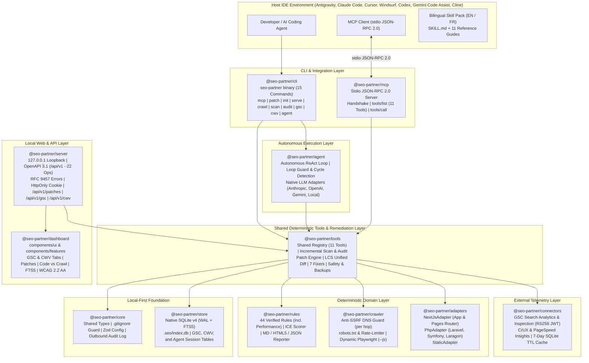

<div align="center">


<br />

[](./package.json)
[](https://nodejs.org/)
[](./tsconfig.base.json)
[](./package.json)
[](./packages/mcp/src/server.ts)
[](./packages/store/src/db.ts)
[](./packages/server/src/openapi.ts)
[](./packages/rules/src/engine.ts)
[](./LICENSE)

<p align="center">
  <strong>Local-First Deterministic SEO Tools Registry, Standard stdio MCP Server (13 Tools), Git Unified Diff Remediation Engine (<code>seo-partner patch</code>), Google Search Console & Core Web Vitals Connectors, Autonomous ReAct Agent Loop (<code>seo-partner agent run</code>), Real-Time Watcher Daemon (<code>seo-partner watch</code>), CI/CD Compliance Engine with OASIS SARIF v2.1.0 (<code>seo-partner ci</code>), Automated PR Bot (<code>seo-partner pr</code>), Standalone OS Binaries (SEA), Multi-Framework Adapters (Next.js, Astro, Nuxt 3, SvelteKit, Remix, Django, Laravel, Symfony, PHP, Static), Anti-SSRF Crawler, 44 Rules Engine with ICE Scoring, Local REST API, and WCAG 2.2 AA Dashboard.</strong><br />
  <em>Engineered for Antigravity (<code>agy</code>), Claude Code, Cursor, Windsurf, Codex, Gemini Code Assist, and Cline — zero LLM repairs, zero code execution (<code>F-S5</code>), and verifiable backups.</em>
</p>

<p align="center">
  <strong>English (Active)</strong> &nbsp;|&nbsp; <a href="./README.fr.md">Lire en Francais (README.fr.md)</a> &nbsp;|&nbsp; <a href="./SECURITY.md">Security Policy</a> &nbsp;|&nbsp; <a href="./CONTRIBUTING.md">Contributing</a>
</p>

</div>

---

## Table of Contents

1. [Vision and Value Proposition (`v0.7`)](#1-vision-and-value-proposition-v07)
2. [System Architecture and Data Flow (`12 Packages`)](#2-system-architecture-and-data-flow-12-packages)
3. [Quick Start Guide](#3-quick-start-guide)
4. [Complete CLI Reference (20 Commands)](#4-complete-cli-reference-18-commands)
5. [Model Context Protocol (MCP) Server (`@seo-partner/mcp`)](#5-model-context-protocol-mcp-server-seo-partnermcp)
6. [Deterministic Remediation Engine (`seo-partner patch`)](#6-deterministic-remediation-engine-seo-partner-patch)
7. [External Connectors: Google Search Console & Core Web Vitals](#7-external-connectors-google-search-console--core-web-vitals)
8. [Autonomous ReAct Agent Loop (`seo-partner agent run`)](#8-autonomous-react-agent-loop-seo-partner-agent-run)
9. [Real-Time Watcher Daemon & Server-Sent Events (`seo-partner watch`)](#9-real-time-watcher-daemon--server-sent-events-seo-partner-watch)
10. [CI/CD Compliance Engine & OASIS SARIF v2.1.0 (`seo-partner ci`)](#10-cicd-compliance-engine--oasis-sarif-v210-seo-partner-ci)
11. [Automated Pull Request Bot (`seo-partner pr`)](#11-automated-pull-request-bot-seo-partner-pr)
12. [Standalone Executable Binaries (Node.js 22 SEA)](#12-standalone-executable-binaries-nodejs-22-sea)
13. [Local REST API (`127.0.0.1`, OpenAPI 3.1, RFC 9457) & Web Dashboard](#13-local-rest-api-127001-openapi-31-rfc-9457--web-dashboard)
14. [The 44 Verified SEO Rules Catalog and ICE Methodology](#14-the-44-verified-seo-rules-catalog-and-ice-methodology)
15. [Multi-Framework Support: Next.js, Astro, Nuxt 3, SvelteKit, Remix, Django, Laravel, Symfony, PHP/Laragon & Static](#15-multi-framework-support-nextjs-astro-nuxt-3-sveltekit-remix-django-laravel-symfony-phplaragon--static)
16. [Developer Guide and Workspace Architecture](#16-developer-guide-and-workspace-architecture)
17. [Security, Git Guard, Safe Backups, and Anti-SSRF](#17-security-git-guard-safe-backups-and-anti-ssrf)
18. [Troubleshooting Guide and FAQ](#18-troubleshooting-guide-and-faq)
19. [Roadmap (`v0.1` to `v1.0`) and Documentation Governance](#19-roadmap-v01-to-v10-and-documentation-governance)

---

## 1. Vision and Value Proposition (`v0.7`)

`seo-partner` separates **what must be 100% deterministic** (local TypeScript scanning, standard stdio MCP tools, anti-SSRF crawling, native SQLite WAL + `FTS5`, deterministic AST diff repairs, GSC / CWV connector synchronization, real-time watchers with debouncing, CI/CD threshold gates with OASIS SARIF v2.1.0, and local `127.0.0.1` OpenAPI server) from **creative, architectural, and autonomous agent loops** (AI coding agents in host IDEs, automated PR proposals, and autonomous ReAct cycles with loop guards):

| Capability | Generic AI Coding Agent | Cloud SaaS Crawler | **`seo-partner` (`v0.7`)** |
| :--- | :--- | :--- | :--- |
| **Model Context Protocol (MCP)** | Manual copy-paste prompts | Proprietary APIs | **Yes — Standard JSON-RPC 2.0 stdio Server (13 Shared Tools)** |
| **Code Remediation & Safe Patches** | Hallucinated code edits | Read-only audit | **Yes — Verifiable Unified Diffs + Safe Atomic `--apply` + Backups** |
| **Google Search Console & CWV** | Disconnected | Heavy SaaS connectors | **Yes — Native RS256 JWT + CrUX & PageSpeed with 7-Day SQLite TTL** |
| **Autonomous ReAct Agent Loop** | Uncontrolled loops | Black-box cloud agent | **Yes — Local ReAct Engine with Cycle Guards & Step JSONL Auditing** |
| **Real-Time Watcher Daemon** | Polling scripts | Remote webhooks | **Yes — Native `node:fs` + 300ms Debounce + SSE Push to Dashboard** |
| **CI/CD Quality Gate & SARIF** | Custom bash exit scripts | Proprietary SaaS | **Yes — Non-Zero Exit Code on Blockers (F-R3) + OASIS SARIF v2.1.0** |
| **Automated PR Bot** | Manual PR authoring | Uncontrolled bots | **Yes — Local Branch + Safe Patches + `.seo/pr-body.md` + Optional `gh`** |
| **Standalone OS Binaries (SEA)** | Requires Node.js runtime | Docker container | **Yes — Self-Contained Node.js 22 SEA Executables (`.exe`, Linux, macOS)** |
| **Multi-Framework Route Discovery** | Context window limits | Deployed URLs only | **Yes — Next.js, Astro, Nuxt 3, SvelteKit, Remix, Django, Laravel, Symfony, PHP, Static** |
| **Incremental Scan in Fast IDE Loops (`< 5s`)** | Re-reads files | N/A | **Yes — `(mtimeMs, sizeBytes, sha256)` diff + `FTS5` `< 100ms`** |
| **Anti-SSRF HTTP Crawler & Code vs. Crawl** | No | Disconnected from code | **Yes — `seo-partner crawl` + Side-by-Side Code vs. Crawl Diff** |
| **Local Web Dashboard & OpenAPI 3.1 Server (`127.0.0.1`)** | No | Paid external SaaS | **Yes — `seo-partner serve` (Port Auto-Fallback, RFC 9457, WCAG 2.2 AA)** |
| **Target Code Execution (`F-S5`)** | Unsafe shell calls | N/A | **Zero Execution (`php`/`python`/`eval`/`build` strictly forbidden)** |
| **Rules Catalog & Mathematical ICE Prioritization (`F-R3`)** | Subjective | Generic | **44 Verified Rules (`ICE = (I+C+E)/3` + Blockers First + Performance)** |
| **Executive Deliverables (Markdown, JSON, Standalone HTML5)** | Ephemeral chat | Proprietary export | **5-section `.md`, `.json`, and 100% offline `.html` reports** |

---

## 2. System Architecture and Data Flow (`12 Packages`)

### 2.1 Modular Monorepo Architecture (`12 Packages` — `pnpm workspaces`)



---

## 3. Quick Start Guide

```powershell
# 0. Clone the repository and build all 12 workspace packages
git clone https://github.com/Firinze/seo-partner.git
cd seo-partner
pnpm install
pnpm run build

# 1. Initialize seo-partner with multi-IDE MCP configurations
seo-partner init --here --ide all --with-mcp --lang fr

# 2. Verify installation health (6 deterministic checks in < 5s)
seo-partner doctor

# 3. Start the MCP stdio server manually (or let Claude/Cursor invoke it)
seo-partner mcp

# 4. Scan source files incrementally (< 5s + FTS5 index)
seo-partner scan

# 5. Run the 44 rules audit (optionally with Core Web Vitals)
seo-partner audit --with-cwv

# 6. Synchronize Google Search Console performance metrics
seo-partner gsc sync --site https://example.com/

# 7. Fetch Core Web Vitals from CrUX and PageSpeed Insights
seo-partner cwv fetch https://example.com/

# 8. Run the autonomous ReAct agent loop with loop guards
seo-partner agent run "Inspect indexing blockers and propose unified diffs"

# 9. Generate deterministic unified patch proposals (dry-run by default)
seo-partner patch

# 10. Safely apply patches with automatic backup and git dirty protection
seo-partner patch --apply

# 11. Start background file watcher daemon with 300ms debounce
seo-partner watch --notify

# 12. Evaluate CI/CD threshold quality gate with SARIF export
seo-partner ci --fail-on-blockers --format sarif --output results.sarif

# 13. Create automated remediation Git branch and pull request
seo-partner pr --dry-run

# 14. Launch the Local Web Dashboard on http://127.0.0.1:4321
seo-partner serve --port 4321 --lang fr
```

---

## 4. Complete CLI Reference (20 Commands)

1. **`seo-partner init`**: Creates `.seo/config.json`, `.seo/decisions.md`, secures `.gitignore`, installs skill packs, and with `--with-mcp` automatically merges stdio MCP configurations for Claude Code, Cursor, Windsurf, Codex, Gemini Code Assist, and Cline.
2. **`seo-partner mcp`**: Runs the Model Context Protocol stdio server using JSON-RPC 2.0, exposing all 11 deterministic tools. Accepts `--allow-apply` to permit automated patch application.
3. **`seo-partner patch`**: Generates verifiable Git unified diffs (`.seo/patches/<batchId>.diff`) for corrigible rules (`R-TECH-01`, `R-TECH-02`, `R-TECH-03`, `R-TECH-05`, `R-TECH-14`, `R-ONPAGE-01`, `R-ONPAGE-04`). With `--apply`, checks git dirty files, creates backups in `.seo/backups/<timestamp>/`, applies diffs, and counts remaining `TODO-SEO` markers.
4. **`seo-partner watch`**: Reactive file observation daemon using native `node:fs` with a 300 ms debounce window and avalanche grouping guard (> 50 files). Triggers incremental scans and broadcasts real-time SSE updates to the web dashboard.
5. **`seo-partner ci`**: Continuous integration and compliance evaluator returning non-zero exit codes (exit 1) on blocking indexing issues (F-R3). Formats GitHub Step Summary Markdown and exports OASIS SARIF v2.1.0 for GitHub Code Scanning.
6. **`seo-partner pr`**: Automated Git pull request engine. Verifies clean git tree, creates dedicated remediation branches, applies deterministic AST patches safely, writes `.seo/pr-body.md`, commits changes, and optionally invokes GitHub CLI (`gh pr create`).
7. **`seo-partner gsc <sync|inspect>`**: Connects to Google Search Console via Service Account RS256 JWT auth without heavy SDKs. Synchronizes search analytics metrics (clicks, impressions, CTR, position) or inspects URL indexing status in real time.
8. **`seo-partner cwv fetch <url>`**: Retrieves 75th percentile Core Web Vitals (LCP, INP, CLS, FCP, TTFB) from Google CrUX with origin fallback, or runs PageSpeed Insights audits, persisting results in SQLite with 7-day TTL cache.
9. **`seo-partner agent run <goal>`**: Executes an autonomous ReAct loop solving targeted SEO goals using `@seo-partner/tools`. Protected by cycle detection, maximum iteration budgets, and safe argument sanitizers.
10. **`seo-partner doctor`**: Runs 6 health checks in under 5 seconds (`node-version`, `seo-config`, `gitignore-security`, `ide-skill-integrity`, `watch-freshness`, `sqlite-wal`).
11. **`seo-partner scan`**: Incremental scanner (`< 5s`), reusing unchanged files via `(mtimeMs, sizeBytes, sha256)`, purging deleted routes, and indexing routes in SQLite FTS5.
12. **`seo-partner crawl <url>`**: Anti-SSRF HTTP crawler enforcing robots.txt, per-hop DNS validation, and rate limiting (`--allow-local` for Laragon / `127.0.0.1`).
13. **`seo-partner audit`**: Evaluates 44 deterministic SEO rules across static scan data, crawl results, and opt-in Core Web Vitals metrics (`--with-cwv`).
14. **`seo-partner backlog`**: Displays prioritized action items with indexing blockers (`F-R3`) always listed first, followed by descending ICE score.
15. **`seo-partner report`**: Generates 5-section executive reports in Markdown, JSON, or standalone offline HTML5.
16. **`seo-partner serve`**: Starts the local API server and interactive Web Dashboard on `127.0.0.1` with automatic port fallback (`+1..20`).
17. **`seo-partner memory`**: Synchronizes architectural SEO decisions between `.seo/decisions.md` and SQLite.
18. **`seo-partner uninstall`**: Safely removes IDE skill files while preserving `.seo/` data.
19. **`seo-partner watch sync --google`**: Synchronizes official Google Search Central Blog and Status Dashboard feeds with SHA-256 revision hashing and 90-day freshness alerts (`F-V1`).
20. **`seo-partner bing <sync|inspect>`**: Read-only Bing Webmaster Tools connector querying 30-day performance stats and inspecting URL indexation with 7-day TTL SQLite caching (`M9`).

---

## 5. Model Context Protocol (MCP) Server (`@seo-partner/mcp`)

The MCP server implements the standard Model Context Protocol over `stdio` using JSON-RPC 2.0 without third-party heavyweight SDKs:

### Exposed Tools (13 Deterministic Tools)

| Tool Name | Parameters | Description |
| :--- | :--- | :--- |
| `list_routes` | `limit?: number, offset?: number` | Lists all discovered application routes with framework, title, canonical, and robots. |
| `get_route` | `routePattern: string` | Retrieves detailed metadata, headings hierarchy (H1-H6), and links for a single route. |
| `search_routes` | `query: string, limit?: number` | Performs SQLite FTS5 full-text search across titles, descriptions, and headings (`< 100ms`). |
| `get_findings` | `category?, severity?, blocksIndexing?: boolean` | Lists audit findings with exact evidence (`filePath:lineNumber`) and remediation advice. |
| `get_backlog` | `ownerRole?, targetTimeframe?` | Returns ICE prioritized actions (`ICE = (I+C+E)/3`) with indexing blockers ranked first. |
| `run_audit` | `crawlRunId?: string` | Triggers a fresh audit evaluation over static scan data and records findings to SQLite. |
| `propose_patch` | `findingId?, ruleId?, apply?: boolean, force?: boolean` | Generates unified diffs for corrigible rules; applies safely only when `--allow-apply` is granted. |
| `get_gsc_performance` | `siteUrl?: string, startDate?: string, endDate?: string, limit?: number` | Queries historical search performance (clicks, impressions, CTR, position) from SQLite store. |
| `inspect_gsc_url` | `url: string, siteUrl?: string` | Queries live or cached Google Search Console URL inspection data (verdict, coverage, indexing). |
| `get_cwv_metrics` | `url: string, formFactor?: string` | Retrieves evaluated Core Web Vitals percentiles and status from CrUX and PageSpeed SQLite store. |
| `run_agent_step` | `action: string, params: object` | Executes an isolated single tool step for autonomous coding agents with safety validation. |

---

## 6. Deterministic Remediation Engine (`seo-partner patch`)

The remediation engine repairs corrigible SEO defects using pure AST and string transformations without LLM code hallucinations:

1. **Corrigible Rules (`7 Rules`)**:
   - `R-TECH-01`: Creates missing `public/robots.txt` with default crawl policy and `Sitemap` declaration.
   - `R-TECH-02`: Creates missing `public/sitemap.xml` with discovered canonical routes.
   - `R-TECH-03`: Replaces unintended `noindex` directives with `index, follow`.
   - `R-TECH-05`: Injects self-referential `<link rel="canonical" href="...">` tags.
   - `R-TECH-14`: Adds missing `<html lang="fr">` attributes to HTML root elements.
   - `R-ONPAGE-01`: Injects missing `<title>` tags with deterministic `TODO-SEO` editorial placeholders.
   - `R-ONPAGE-04`: Injects missing `<h1>` headings with deterministic `TODO-SEO` editorial placeholders.

2. **Unified Diff Generation (LCS Algorithm)**:
   - Uses Longest Common Subsequence (LCS) matrix with a 5000-line safety cap.
   - Produces standard unified diff hunks (`@@ -oldStart,oldLines +newStart,newLines @@`) compatible with `git apply --check`.

3. **Safe Application Pipeline**:
   - **Path Traversal Protection**: Rejects `..`, absolute paths, `.git/`, and `.env*` secrets.
   - **Git Dirty Work Tree Guard**: Aborts before writing if modified target files have uncommitted git changes (bypassable via `--force`).
   - **Automatic Timestamped Backups**: Backs up every modified file to `.seo/backups/<timestamp>/` before applying changes.
   - **Atomic Writes with Rollback**: Writes to sibling temporary files before atomic rename; restores backups upon failure.

---

## 7. External Connectors: Google Search Console & Core Web Vitals

### 7.1 Google Search Console (`@seo-partner/connectors`)
- **Native RS256 JWT Authentication**: Zero external Google API client dependencies. Uses standard `node:crypto` to generate signed JWTs exchangeable for OAuth tokens with read-only scope `https://www.googleapis.com/auth/webmasters.readonly`.
- **Search Analytics**: Pulls impressions, clicks, CTR, and average position broken down by page and query date range.
- **URL Inspection API**: Fetches real-time coverage verdicts, indexing status, mobile usability, and canonical verification.

### 7.2 Core Web Vitals (`@seo-partner/connectors`)
- **Chrome User Experience Report (CrUX)**: Retrieves field data for LCP, INP, CLS, FCP, and TTFB. Gracefully falls back to origin-level metrics if page-level data is sparse.
- **PageSpeed Insights**: Conducts lab performance audits when field data is unavailable.
- **SQLite 7-Day TTL Cache**: Prevents duplicate API quota consumption by caching evaluated CWV payloads for 7 days (`--refresh` bypass available).

---

---

## 7b. Bing Webmaster Tools Connector (M9)

The Bing Webmaster Tools connector provides read-only search intelligence and URL inspection without third-party dependencies:
- **API v2 Integration**: Queries `GetQueryStats` for 30-day impressions, clicks, CTR, and average position, and `GetUrlTrafficStats` for real-time indexing status.
- **7-Day SQLite TTL Cache**: Results are persisted in `bing_performance` and `bing_inspection` tables. Cached data is served instantly unless `--force` is supplied.
- **Universal Surface**: Exposed via CLI (`seo-partner bing sync/inspect`), MCP tools (`get_bing_performance`, `inspect_bing_url`), local REST API (`/api/v1/bing/*`), and the web dashboard.

---

## 9b. Official Google SEO Watch & 90-Day Freshness (F-V1)

- **Official Feeds**: Ingests Google Search Central Blog (Atom) and Google Search Status Dashboard (RSS).
- **Revision Tracking**: Compares content SHA-256 digests in `watch_source` and persists entries into `watch_entry`.
- **Reference Generation**: Generates `skills/seo-partner/references/veille-mises-a-jour.md`. Unconfirmed community rules are marked "Reported, to verify" (`confirmed: false`).
- **Doctor Freshness Check**: `seo-partner doctor` triggers a warning whenever the latest official sync is older than 90 days.

---

## 10b. Packaged GitHub Action (action.yml, M12)

The official composite GitHub Action encapsulates CI threshold enforcement and automated SARIF uploading:
```yaml
- name: Audit SEO Compliance
  uses: Firinze/seo-partner@v0.8
  with:
    fail-on-blockers: 'true'
    min-score: '80'
    upload-sarif: 'true'
```
Generates `$GITHUB_STEP_SUMMARY` and uploads findings directly to GitHub Code Scanning.

---

## 13b. Agent Chat Tab & Interactive Patch Modal (M14)

The local web dashboard (`seo-partner serve`) includes a dedicated "Agent Chat" tab:
- **Real-Time Streaming**: Listens to SSE events (`agent:thought`, `agent:tool_call`, `agent:tool_result`, `agent:patch_proposed`, `agent:completed`).
- **Explicit Patch Approval**: Inline unified diff viewer and confirmation modal dialog enforcing Constitution Principle II before calling `POST /api/v1/agent/apply-patch`.
- **Accessibility**: Zero emojis, zero glassmorphism, WCAG 2.2 AA compliant focus traps and keyboard navigation.

---

## 8. Autonomous ReAct Agent Loop (`seo-partner agent run`)

The agent engine runs a local ReAct (Thought-Action-Observation) loop solving multi-step SEO optimization goals:

1. **Lightweight Native LLM Adapters**:
   - Anthropic Claude (`/v1/messages`)
   - OpenAI (`/v1/chat/completions`)
   - Google Gemini (`/v1beta/models`)
   - Local LLM inference via `--base-url` (Ollama, vLLM, LM Studio)
2. **Loop Guard & Safety Mechanism**:
   - **Cycle Detection**: Immediately aborts if the exact same tool call and arguments recur 3 times consecutively.
   - **Iteration Budget**: Hard limit on loop iterations (default 10, configurable via `--max-iterations`).
   - **Safe Parameter Sanitization**: Prevents execution of destructive tool arguments; enforces dry-run mode unless `--auto-apply` is explicitly passed.
3. **Structured Audit Logging**:
   - Persists all thoughts, tool calls, and observations in SQLite (`agent_run_session` and `agent_step_log`).
   - Writes human-verifiable streaming logs to `.seo/logs/agent-<sessionId>.jsonl`.

---

## 9. Real-Time Watcher Daemon & Server-Sent Events (`seo-partner watch`)

The watcher daemon provides continuous, zero-config observation of local workspaces:

- **Native `node:fs` Cross-Platform Abstraction**: Uses recursive file system watching on Windows and macOS, falling back to directory-tree observation on Linux without heavy C++ native npm dependencies.
- **In-Memory Debouncer (300 ms)**: Groups rapid keystrokes and file saves into single evaluation cycles, completing incremental re-scans in `< 200 ms`.
- **Avalanche Batching Guard**: When bulk operations alter more than 50 files simultaneously (e.g., `git checkout` or `git pull`), the watcher defers scanning until disk activity stabilizes.
- **Server-Sent Events (`GET /api/v1/events`)**: Streams `scan:started`, `route:discovered`, `audit:completed`, and `blocking:detected` notifications to the web dashboard with automatic browser reconnection.

---

## 10. CI/CD Compliance Engine & OASIS SARIF v2.1.0 (`seo-partner ci`)

The CI engine enforces deterministic SEO quality gates in automated build pipelines:

- **Constitutional Principle IV (F-R3 Blockers Enforcement)**: Fails with non-zero exit code (`exit 1`) whenever any indexing-blocking defect (`blocksIndexing === true`) or critical threshold is violated.
- **OASIS SARIF v2.1.0 Export**: Produces standardized Static Analysis Results Interchange Format (SARIF) JSON compatible with GitHub Code Scanning, GitLab Security, and Azure DevOps.
- **GitHub Step Summary Markdown**: Outputs high-signal build summaries directly into `$GITHUB_STEP_SUMMARY` without emojis or decorative noise.

---

## 11. Automated Pull Request Bot (`seo-partner pr`)

The PR bot orchestrates end-to-end safe remediation workflows:

- **Git Dirty Work Tree Guard**: Aborts immediately before modifying any file if uncommitted working tree changes exist (bypassable via `--force`).
- **Dedicated Git Branching**: Automatically creates isolated remediation branches (e.g., `fix/seo-remediations`).
- **Deterministic Patch Application**: Applies unified diffs using the AST remediation engine with automatic backups in `.seo/backups/<timestamp>/`.
- **Pull Request Documentation**: Formats `.seo/pr-body.md` summarizing remediated rules and ICE impact scores.
- **GitHub CLI Integration**: When `--publish` is specified and `gh` is available on `PATH`, seamlessly delegates PR submission via `gh pr create`.

---

## 12. Standalone Executable Binaries (Node.js 22 SEA)

Single-Executable Applications (SEA) package `seo-partner` into self-contained operating system executables requiring no pre-installed Node.js runtime:

- **Unified CommonJS Bundling**: Uses `esbuild` to produce a consolidated, tree-shaken runtime bundle at `dist/sea/bundle.cjs`.
- **Node.js 22 SEA Blob Generation**: Builds preparation blobs via `node --experimental-sea-config sea-config.json`.
- **Postject Resource Injection**: Embeds the preparation blob directly into target host binaries (`dist/binaries/seo-partner.exe`, `seo-partner-linux`, `seo-partner-darwin`).
- **Cryptographic Manifest**: Automatically calculates SHA-256 integrity checksums saved to `dist/binaries/SHA256SUMS` and `dist/binaries/manifest.json`.

---

## 13. Local REST API (`127.0.0.1`, OpenAPI 3.1, RFC 9457) & Web Dashboard

- **Loopback Isolation (`127.0.0.1`)**: Never exposes endpoints to external networks or `0.0.0.0`.
- **Security Interceptors**: Validates `Host` and `Origin` headers; requires `seo_partner_session` HttpOnly cookie or session header on all mutating POST endpoints.
- **REST Endpoints (`22 Operations`)**:
  - `GET /api/v1/patches`, `POST /api/v1/patches`
  - `GET /api/v1/gsc/performance`, `POST /api/v1/gsc/sync`, `POST /api/v1/gsc/inspect`
  - `GET /api/v1/cwv`, `POST /api/v1/cwv/fetch`
  - Standard routes, findings, backlog, comparator, and audit endpoints.
- **Modular Dashboard (`@seo-partner/dashboard`)**:
  - 9 Interactive Tabs: Overview, Routes, Findings, Backlog, Comparator, Decisions, Patches, **Google Search Console**, and **Core Web Vitals**.
  - Strict UI Rules: WCAG 2.2 AA compliant, zero emojis, zero glassmorphism (`backdrop-filter` forbidden), and zero lateral accent borders.

---

## 14. The 44 Verified SEO Rules Catalog and ICE Methodology

$$\text{ICE} = \text{round}\left(\frac{\text{Impact} + \text{Confidence} + \text{Effort}}{3}, 2\right)$$

> [!IMPORTANT]
> **Absolute Priority Rule (`F-R3`)**: Any finding with `blocksIndexing = true` (`R-TECH-01`, `R-TECH-02`, `R-TECH-03`, `R-TECH-06`, `R-TECH-07`, `R-TECH-09`) is **always ranked first**, ahead of all non-blocking findings regardless of their nominal ICE score.

- **Technical (`R-TECH-01` to `R-TECH-14`, 14 rules)**: `robots.txt`, `sitemap.xml`, `noindex`, private routes in sitemap, missing canonical, client-only routes, HTTP `4xx`/`5xx` errors, redirect chains, `X-Robots-Tag`, code vs crawl canonical contradictions, broken links, orphan pages, click depth `> 3`, and missing `<html lang>`.
- **On-Page (`R-ONPAGE-01` to `R-ONPAGE-14`, 14 rules)**: Missing/duplicate/suboptimal `<title>`, meta `description`, `<h1>` structure, image `alt`, heading hierarchy, duplicate `<h1>`, image dimensions (`CLS`), generic anchor text, Open Graph tags, and code vs crawl divergences.
- **Schema.org (`R-SCHEMA-01` to `R-SCHEMA-05`, 5 rules)**: JSON-LD validity, `Organization`/`WebSite`, `Article`/`BlogPosting`, `Product`, and `FAQPage`/`BreadcrumbList`.
- **Local SEO (`R-LOCAL-01` to `R-LOCAL-04`, 4 rules)**: `LocalBusiness` address, `telephone` (NAP), international E.164 phone formatting, and opening hours / geo coordinates.
- **GEO — International & Generative (`R-GEO-01` to `R-GEO-03`, 3 rules)**: ISO `hreflang` validity, cluster completeness, and explicit AI crawler access policies in `robots.txt`.
- **Performance (`R-PERF-01` to `R-PERF-04`, 4 rules)**:
  - `R-PERF-01`: Largest Contentful Paint (`LCP > 2.5s`) exceeding Google recommended threshold (Critical).
  - `R-PERF-02`: Interaction to Next Paint (`INP > 200ms`) exceeding responsiveness threshold (High).
  - `R-PERF-03`: Cumulative Layout Shift (`CLS > 0.1`) exceeding visual stability threshold (High).
  - `R-PERF-04`: First Contentful Paint (`FCP > 1.8s`) or Time to First Byte (`TTFB > 800ms`) degradation (Medium).

---

## 15. Multi-Framework Support: Next.js, Astro, Nuxt 3, SvelteKit, Remix, Django, Laravel, Symfony, PHP/Laragon & Static

In strict adherence to Constitutional Principle II (`F-S5`), **no external interpreter (`python`, `php`, `node`, `eval`) is ever executed on target project files**:

- **`AstroAdapter` (`astro`)**: Statically parses `src/pages/**` (`.astro`, `.md`, `.mdx`, `.html`), extracts YAML frontmatter, `<Layout title="...">` components, and `<html lang>` layout inheritance.
- **`NuxtAdapter` (`nuxt`)**: Statically parses Nuxt 3 `pages/**` (`.vue`), extracts `useSeoMeta()` and `useHead()` composables, Vue `<template>` tags, and inherits root metadata from `layouts/default.vue`.
- **`SvelteKitAdapter` (`sveltekit`)**: Statically parses `src/routes/**/+page.svelte`, extracts `<svelte:head>` SEO tags, and resolves hierarchical layout inheritance from `+layout.svelte`.
- **`RemixAdapter` (`remix`)**: Unified adapter for Remix and React Router v7 (`app/routes/**`), extracts `export const meta = [...]` and inherits global `<html lang>` from `app/root.tsx`.
- **`DjangoAdapter` (`django`)**: 100% zero-execution Python parser, maps `urls.py` patterns to views in `views.py`, extracts DTL template tags (``, ``) and captures exact source lines.
- **`NextJsAdapter` (`nextjs-app`, `nextjs-pages`)**: App Router (`app/**/page.tsx`) and Pages Router (`pages/**/*.tsx`), static `metadata` and `generateMetadata`.
- **`PhpAdapter` (`laravel`)**: Parses `routes/web.php` and Blade templates with `@extends`, `@section`, and `@yield`.
- **`PhpAdapter` (`symfony`)**: Parses PHP 8 `#[Route]` attributes, `config/routes.yaml`, and Twig templates with `` and ``.
- **`PhpAdapter` (`php`)**: Analyzes native PHP / Laragon projects (`public/*.php`), resolving header inclusions.
- **`StaticAdapter` (`static-html`, `markdown`)**: Static HTML5 (`*.html`) and Markdown (`*.md`, `*.mdx`) files.

---

## 16. Developer Guide and Workspace Architecture

```powershell
pnpm run build                        # Build all 12 workspace packages
pnpm run build:sea                    # Package standalone Single-Executable Applications (Node.js 22 SEA)
pnpm exec tsc --noEmit                # Full TypeScript strict verification
pnpm exec vitest run tests/unit       # Unit test suite
pnpm run test:coverage                # Full coverage suite (>= 80%)
```

### Workspace Packages (`12 Packages`)

- `@seo-partner/core`: Shared interfaces, configuration, gitignore guard, and audit log.
- `@seo-partner/store`: Native SQLite database with WAL, FTS5 full-text search, and migrations v1-v4.
- `@seo-partner/connectors`: Google Search Console (RS256 JWT) and Core Web Vitals (CrUX, PageSpeed) connectors.
- `@seo-partner/agent`: Autonomous ReAct agent execution loop with provider adapters, cycle detection, and safety guards.
- `@seo-partner/adapters`: Static AST and template parsers for Next.js, PHP, and Static.
- `@seo-partner/crawler`: Per-hop anti-SSRF HTTP crawler with robots.txt parser.
- `@seo-partner/rules`: 44 verified SEO rules engine and ICE prioritization.
- `@seo-partner/tools`: Shared tools registry (11 tools), incremental scan/audit engines, LCS unified diff, CI evaluator, SARIF serializer, and watcher abstractions.
- `@seo-partner/mcp`: Standard JSON-RPC 2.0 stdio MCP server exposing 11 shared tools.
- `@seo-partner/server`: Local REST API on `127.0.0.1` (OpenAPI 3.1, RFC 9457, SSE streaming).
- `@seo-partner/dashboard`: WCAG 2.2 AA compliant local web dashboard SPA with GSC and CWV tabs.
- `@seo-partner/cli`: Complete command-line executable (`seo-partner`, 18 commands).

---

## 17. Security, Git Guard, Safe Backups, and Anti-SSRF

- **Zero Target Code Execution (`F-S5`)**: Static AST and template parsing only; never invokes external interpreters on scanned files.
- **Deterministic Fixers Only**: No generative LLM code generation for repairs; editorial text uses `TODO-SEO` placeholders for human review.
- **Git Dirty Work Tree Check**: Refuses to overwrite files if uncommitted modifications are detected, preventing accidental loss of work.
- **Automated Pre-Apply Backups**: Saves target files in `.seo/backups/<timestamp>/` prior to applying diffs.
- **Strict Anti-SSRF with Per-Hop DNS Resolution**: Blocks private, link-local, and cloud metadata IPs (`169.254.169.254` unconditionally blocked).
- **Mandatory Gitignore Protection**: Automatically verifies and injects `.seo/index.db*`, `.seo/patches/`, `.seo/backups/`, and `.seo/audit.log` into `.gitignore`.

---

## 18. Troubleshooting Guide and FAQ

- **How do I connect Claude Code or Cursor to seo-partner via MCP?**:
  Run `seo-partner init --with-mcp`. The command merges the `seo-partner` stdio server entry into your IDE configuration without overwriting existing servers.
- **Why are patch applications rejected via REST API?**:
  Applying file modifications directly via HTTP is strictly forbidden for security. Patches must be reviewed and applied using the CLI (`seo-partner patch --apply`) or via MCP with explicit `--allow-apply`.
- **How does Google Search Console authentication work without Google SDKs?**:
  `seo-partner` uses native Node.js `crypto` with RS256 signing on your Service Account JSON key (`.seo/credentials.json`), requesting scoped OAuth access tokens without heavyweight external dependencies.
- **What happens if a file has uncommitted git changes?**:
  `seo-partner patch --apply` or `seo-partner pr` will reject the operation with `git-dirty`. Commit or stash your changes first, or pass `--force` if you intentionally wish to proceed.
- **Can I run seo-partner without Node.js installed?**:
  Yes. Single-Executable Applications (`dist/binaries/seo-partner.exe` on Windows, `seo-partner-linux` on Linux, `seo-partner-darwin` on macOS) bundle the complete Node.js runtime and application into an autonomous binary verified by cryptographic SHA-256 manifests (`SHA256SUMS`).

---

## 19. Roadmap (`v0.1` to `v1.0`) and Documentation Governance

- **`v0.1` (Delivered)**: Bilingual Skill Pack (`11/11` EN/FR), 8 CLI commands, 5 IDE installers, Next.js and Static AST Scanner, native SQLite WAL, 15 Must rules, ICE scorer, and 5-part reports.
- **`v0.2` (Delivered)**: Incremental Scan (`< 5s`) + SQLite FTS5 search, Anti-SSRF HTTP Crawler, PhpAdapter (Laravel, Symfony, Laragon), 40 Verified SEO Rules, and standalone HTML5 reports.
- **`v0.3` (Delivered)**: Local API Server on `127.0.0.1` (port auto-fallback, OpenAPI 3.1, RFC 9457, HttpOnly cookie) and Modular WCAG 2.2 AA Web Dashboard.
- **`v0.4` (Delivered)**: Standard stdio MCP Server (`@seo-partner/mcp`, 7 tools), Deterministic Remediation Engine (`seo-partner patch`, LCS unified diffs, safe `--apply`, backups, git dirty guard), Multi-IDE MCP config merge, and Dashboard Patches tab.
- **`v0.5` (Delivered)**: Astro, Nuxt 3, SvelteKit, Remix (with React Router v7), and Django adapters (Zero target code execution F-S5, hierarchical layout inheritance, deterministic patch support).
- **`v0.6` (Delivered)**: Google Search Console (GSC) connector, Core Web Vitals (CrUX/PageSpeed) connector, Performance rules (`R-PERF-01..04`), Autonomous ReAct agent loop with cycle guards, 11 MCP tools, 15 CLI commands.
- **`v0.7` (Delivered)**: Real-time file watcher daemon (`seo-partner watch` with SSE push), CI/CD compliance engine (`seo-partner ci` with OASIS SARIF v2.1.0 export), automated Git pull request bot (`seo-partner pr`), and standalone Single-Executable Applications (Node.js 22 SEA).
- **`v0.8`–`v1.0` (Planned)**: Enterprise integrations, multi-site continuous auditing, and distributed cluster monitoring.

---

## License

Distributed under the **MIT License**. See [LICENSE](./LICENSE) for details.

<div align="center">
  <sub>Crafted by <strong><a href="https://github.com/Firinze/seo-partner">Firinze Gbenito Dossou</a></strong></sub>
</div>
