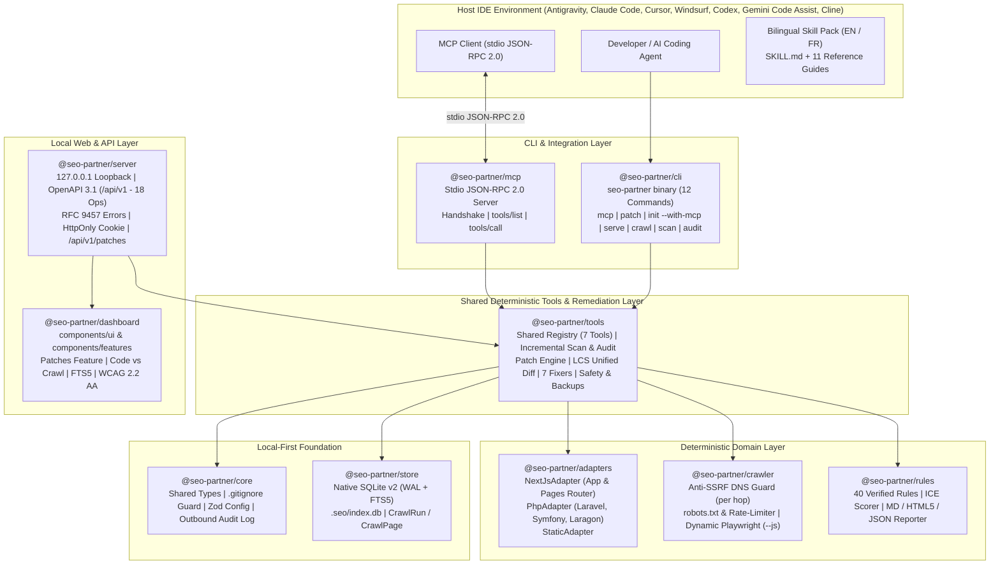

<div align="center">


<br />

[](./package.json)
[](https://nodejs.org/)
[](./tsconfig.base.json)
[](./package.json)
[](./packages/mcp/src/server.ts)
[](./packages/store/src/db.ts)
[](./packages/server/src/openapi.ts)
[](./packages/rules/src/engine.ts)
[](./LICENSE)

<p align="center">
  <strong>Local-First Deterministic SEO Tools Registry, Standard stdio MCP Server (7 Tools), Git Unified Diff Remediation Engine (<code>seo-partner patch</code>), Multi-Framework Adapters (Next.js, Astro, Nuxt 3, SvelteKit, Remix, Django, Laravel, Symfony, PHP, Static), Anti-SSRF Crawler, 40 Rules Engine with ICE Scoring, Local REST API, and WCAG 2.2 AA Dashboard.</strong><br />
  <em>Engineered for Antigravity (<code>agy</code>), Claude Code, Cursor, Windsurf, Codex, Gemini Code Assist, and Cline — zero LLM repairs, zero code execution (<code>F-S5</code>), and verifiable backups.</em>
</p>

<p align="center">
  <strong>English (Active)</strong> &nbsp;|&nbsp; <a href="./README.fr.md">Lire en Francais (README.fr.md)</a> &nbsp;|&nbsp; <a href="./SECURITY.md">Security Policy</a> &nbsp;|&nbsp; <a href="./CONTRIBUTING.md">Contributing</a>
</p>

</div>

---

## Table of Contents

1. [Vision and Value Proposition (`v0.5`)](#1-vision-and-value-proposition-v05)
2. [System Architecture and Data Flow (`10 Packages`)](#2-system-architecture-and-data-flow-10-packages)
3. [Quick Start Guide](#3-quick-start-guide)
4. [Complete CLI Reference (12 Commands)](#4-complete-cli-reference-12-commands)
5. [Model Context Protocol (MCP) Server (`@seo-partner/mcp`)](#5-model-context-protocol-mcp-server-seo-partnermcp)
6. [Deterministic Remediation Engine (`seo-partner patch`)](#6-deterministic-remediation-engine-seo-partner-patch)
7. [Local REST API (`127.0.0.1`, OpenAPI 3.1, RFC 9457) & Web Dashboard](#7-local-rest-api-127001-openapi-31-rfc-9457--web-dashboard)
8. [The 40 Verified SEO Rules Catalog and ICE Methodology](#8-the-40-verified-seo-rules-catalog-and-ice-methodology)
9. [Multi-Framework Support: Next.js, Astro, Nuxt 3, SvelteKit, Remix, Django, Laravel, Symfony, PHP/Laragon & Static](#9-multi-framework-support-nextjs-astro-nuxt-3-sveltekit-remix-django-laravel-symfony-phplaragon--static)
10. [Developer Guide and Workspace Architecture](#10-developer-guide-and-workspace-architecture)
11. [Security, Git Guard, Safe Backups, and Anti-SSRF](#11-security-git-guard-safe-backups-and-anti-ssrf)
12. [Troubleshooting Guide and FAQ](#12-troubleshooting-guide-and-faq)
13. [Roadmap (`v0.1` to `v1.0`) and Documentation Governance](#13-roadmap-v01-to-v10-and-documentation-governance)

---

## 1. Vision and Value Proposition (`v0.5`)

`seo-partner` separates **what must be 100% deterministic** (local TypeScript scanning, standard stdio MCP tools, anti-SSRF crawling, native SQLite WAL + `FTS5`, deterministic AST diff repairs, and local `127.0.0.1` OpenAPI server) from **creative, architectural, and editorial guidance** (AI coding agents in host IDEs):

| Capability | Generic AI Coding Agent | Cloud SaaS Crawler | **`seo-partner` (`v0.5`)** |
| :--- | :--- | :--- | :--- |
| **Model Context Protocol (MCP)** | Manual copy-paste prompts | Proprietary APIs | **Yes — Standard JSON-RPC 2.0 stdio Server (7 Shared Tools)** |
| **Code Remediation & Safe Patches** | Hallucinated code edits | Read-only audit | **Yes — Verifiable Unified Diffs + Safe Atomic `--apply` + Backups** |
| **Multi-Framework Route Discovery** | Context window limits | Deployed URLs only | **Yes — Next.js, Astro, Nuxt 3, SvelteKit, Remix, Django, Laravel, Symfony, PHP, Static** |
| **Incremental Scan in Fast IDE Loops (`< 5s`)** | Re-reads files | N/A | **Yes — `(mtimeMs, sizeBytes, sha256)` diff + `FTS5` `< 100ms`** |
| **Anti-SSRF HTTP Crawler & Code vs. Crawl Comparator** | No | Disconnected from code | **Yes — `seo-partner crawl` + Side-by-Side Code vs. Crawl Diff** |
| **Local Web Dashboard & OpenAPI 3.1 Server (`127.0.0.1`)** | No | Paid external SaaS | **Yes — `seo-partner serve` (Port Auto-Fallback, RFC 9457, WCAG 2.2 AA)** |
| **Target Code Execution (`F-S5`)** | Unsafe shell calls | N/A | **Zero Execution (`php`/`python`/`eval`/`build` strictly forbidden)** |
| **Rules Catalog & Mathematical ICE Prioritization (`F-R3`)** | Subjective | Generic | **40 Verified Rules (`ICE = (I+C+E)/3` + Blockers First)** |
| **Executive Deliverables (Markdown, JSON, Standalone HTML5)** | Ephemeral chat | Proprietary export | **5-section `.md`, `.json`, and 100% offline `.html` reports** |

---

## 2. System Architecture and Data Flow (`10 Packages`)

### 2.1 Modular Monorepo Architecture (`10 Packages` — `pnpm workspaces`)



---

## 3. Quick Start Guide

```powershell
# 0. Clone the repository and build all 10 workspace packages
git clone https://github.com/Firinze/seo-partner.git
cd seo-partner
pnpm install
pnpm run build

# 1. Initialize seo-partner with multi-IDE MCP configurations
seo-partner init --here --ide all --with-mcp --lang fr

# 2. Verify installation health (6 deterministic checks in < 5s)
seo-partner doctor

# 3. Start the MCP stdio server manually (or let Claude/Cursor invoke it)
seo-partner mcp

# 4. Scan source files incrementally (< 5s + FTS5 index)
seo-partner scan

# 5. Run the 40 rules audit
seo-partner audit

# 6. Generate deterministic unified patch proposals (dry-run by default)
seo-partner patch

# 7. Safely apply patches with automatic backup and git dirty protection
seo-partner patch --apply

# 8. Launch the Local Web Dashboard on http://127.0.0.1:4321
seo-partner serve --port 4321 --lang fr
```

---

## 4. Complete CLI Reference (12 Commands)

1. **`seo-partner init`**: Creates `.seo/config.json`, `.seo/decisions.md`, secures `.gitignore`, installs skill packs, and with `--with-mcp` automatically merges stdio MCP configurations for Claude Code (`claude_desktop_config.json` / `.claude/mcp.json`), Cursor (`.cursor/mcp.json`), Windsurf (`.codeium/windsurf/mcp_config.json`), Codex (`.codex/config.toml`), Gemini Code Assist (`.gemini/mcp.json`), and Cline.
2. **`seo-partner mcp`**: Runs the Model Context Protocol stdio server using JSON-RPC 2.0, exposing all 7 deterministic tools. Accepts `--allow-apply` to permit automated patch application.
3. **`seo-partner patch`**: Generates verifiable Git unified diffs (`.seo/patches/<batchId>.diff`) for corrigible rules (`R-TECH-01`, `R-TECH-02`, `R-TECH-03`, `R-TECH-05`, `R-TECH-14`, `R-ONPAGE-01`, `R-ONPAGE-04`). With `--apply`, checks git dirty files, creates backups in `.seo/backups/<timestamp>/`, applies diffs, and counts remaining `TODO-SEO` markers.
4. **`seo-partner doctor`**: Runs 6 health checks in under 5 seconds (`node-version`, `seo-config`, `gitignore-security`, `ide-skill-integrity`, `watch-freshness`, `sqlite-wal`).
5. **`seo-partner scan`**: Incremental scanner (`< 5s`), reusing unchanged files via `(mtimeMs, sizeBytes, sha256)`, purging deleted routes, and indexing routes in SQLite FTS5.
6. **`seo-partner crawl <url>`**: Anti-SSRF HTTP crawler enforcing robots.txt, per-hop DNS validation, and rate limiting (`--allow-local` for Laragon / `127.0.0.1`).
7. **`seo-partner audit`**: Evaluates 40 deterministic SEO rules across static scan data and crawl results.
8. **`seo-partner backlog`**: Displays prioritized action items with indexing blockers (`F-R3`) always listed first, followed by descending ICE score.
9. **`seo-partner report`**: Generates 5-section executive reports in Markdown, JSON, or standalone offline HTML5.
10. **`seo-partner serve`**: Starts the local API server and interactive Web Dashboard on `127.0.0.1` with automatic port fallback (`+1..20`).
11. **`seo-partner memory`**: Synchronizes architectural SEO decisions between `.seo/decisions.md` and SQLite.
12. **`seo-partner uninstall`**: Safely removes IDE skill files while preserving `.seo/` data.

---

## 5. Model Context Protocol (MCP) Server (`@seo-partner/mcp`)

The MCP server implements the standard Model Context Protocol over `stdio` using JSON-RPC 2.0 without third-party heavyweight SDKs:

### Exposed Tools (7 Deterministic Tools)

| Tool Name | Parameters | Description |
| :--- | :--- | :--- |
| `list_routes` | `limit?: number, offset?: number` | Lists all discovered application routes with framework, title, canonical, and robots. |
| `get_route` | `routePattern: string` | Retrieves detailed metadata, headings hierarchy (H1-H6), and links for a single route. |
| `search_routes` | `query: string, limit?: number` | Performs SQLite FTS5 full-text search across titles, descriptions, and headings (`< 100ms`). |
| `get_findings` | `category?, severity?, blocksIndexing?: boolean` | Lists audit findings with exact evidence (`filePath:lineNumber`) and remediation advice. |
| `get_backlog` | `ownerRole?, targetTimeframe?` | Returns ICE prioritized actions (`ICE = (I+C+E)/3`) with indexing blockers ranked first. |
| `run_audit` | `crawlRunId?: string` | Triggers a fresh audit evaluation over static scan data and records findings to SQLite. |
| `propose_patch` | `findingId?, ruleId?, apply?: boolean, force?: boolean` | Generates unified diffs for corrigible rules; applies safely only when `--allow-apply` is granted. |

---

## 6. Deterministic Remediation Engine (`seo-partner patch`)

The remediation engine repairs corrigible SEO defects using pure AST and string transformations without LLM code hallucinations:

1. **Corrigible Rules (`7 Rules`)**:
   - `R-TECH-01`: Creates missing `public/robots.txt` with default crawl policy and `Sitemap` declaration.
   - `R-TECH-02`: Creates missing `public/sitemap.xml` with discovered canonical routes.
   - `R-TECH-03`: Replaces unintended `noindex` directives with `index, follow`.
   - `R-TECH-05`: Injects self-referential `<link rel="canonical" href="...">` tags.
   - `R-TECH-14`: Adds missing `<html lang="fr">` attributes to HTML root elements.
   - `R-ONPAGE-01`: Injects missing `<title>` tags with deterministic `TODO-SEO` editorial placeholders.
   - `R-ONPAGE-04`: Injects missing `<h1>` headings with deterministic `TODO-SEO` editorial placeholders.

2. **Unified Diff Generation (LCS Algorithm)**:
   - Uses Longest Common Subsequence (LCS) matrix with a 5000-line safety cap.
   - Produces standard unified diff hunks (`@@ -oldStart,oldLines +newStart,newLines @@`) compatible with `git apply --check`.

3. **Safe Application Pipeline**:
   - **Path Traversal Protection**: Rejects `..`, absolute paths, `.git/`, and `.env*` secrets.
   - **Git Dirty Work Tree Guard**: Aborts before writing if modified target files have uncommitted git changes (bypassable via `--force`).
   - **Automatic Timestamped Backups**: Backs up every modified file to `.seo/backups/<timestamp>/` before applying changes.
   - **Atomic Writes with Rollback**: Writes to sibling temporary files before atomic rename; restores backups upon failure.

---

## 7. Local REST API (`127.0.0.1`, OpenAPI 3.1, RFC 9457) & Web Dashboard

- **Loopback Isolation (`127.0.0.1`)**: Never exposes endpoints to external networks or `0.0.0.0`.
- **Security Interceptors**: Validates `Host` and `Origin` headers; requires `seo_partner_session` HttpOnly cookie or session header on all mutating POST endpoints.
- **REST Patch Endpoints**:
  - `GET /api/v1/patches`: Lists all recorded patch batches on disk, or returns single batch by `?batchId=...`.
  - `POST /api/v1/patches`: Generates patch proposals in memory and writes `.seo/patches/<batchId>.diff`. Rejects direct `apply: true` via REST with `422 Unprocessable Entity` for security.
- **Modular Dashboard (`@seo-partner/dashboard`)**:
  - 7 Interactive Tabs: Overview, Routes, Findings, Backlog, Comparator, Decisions, and **Patches**.
  - Unified diff inspection with subtle green/red highlighting.
  - Strict UI Rules: WCAG 2.2 AA compliant, zero emojis, zero glassmorphism (`backdrop-filter` forbidden), and zero lateral accent borders.

---

## 8. The 40 Verified SEO Rules Catalog and ICE Methodology

$$\text{ICE} = \text{round}\left(\frac{\text{Impact} + \text{Confidence} + \text{Effort}}{3}, 2\right)$$

> [!IMPORTANT]
> **Absolute Priority Rule (`F-R3`)**: Any finding with `blocksIndexing = true` (`R-TECH-01`, `R-TECH-02`, `R-TECH-03`, `R-TECH-06`, `R-TECH-07`, `R-TECH-09`) is **always ranked first**, ahead of all non-blocking findings regardless of their nominal ICE score.

- **Technical (`R-TECH-01` to `R-TECH-14`, 14 rules)**: `robots.txt`, `sitemap.xml`, `noindex`, private routes in sitemap, missing canonical, client-only routes, HTTP `4xx`/`5xx` errors, redirect chains, `X-Robots-Tag`, code vs crawl canonical contradictions, broken links, orphan pages, click depth `> 3`, and missing `<html lang>`.
- **On-Page (`R-ONPAGE-01` to `R-ONPAGE-14`, 14 rules)**: Missing/duplicate/suboptimal `<title>`, meta `description`, `<h1>` structure, image `alt`, heading hierarchy, duplicate `<h1>`, image dimensions (`CLS`), generic anchor text, Open Graph tags, and code vs crawl divergences.
- **Schema.org (`R-SCHEMA-01` to `R-SCHEMA-05`, 5 rules)**: JSON-LD validity, `Organization`/`WebSite`, `Article`/`BlogPosting`, `Product`, and `FAQPage`/`BreadcrumbList`.
- **Local SEO (`R-LOCAL-01` to `R-LOCAL-04`, 4 rules)**: `LocalBusiness` address, `telephone` (NAP), international E.164 phone formatting, and opening hours / geo coordinates.
- **GEO — International & Generative (`R-GEO-01` to `R-GEO-03`, 3 rules)**: ISO `hreflang` validity, cluster completeness, and explicit AI crawler access policies in `robots.txt`.

---

## 9. Multi-Framework Support: Next.js, Astro, Nuxt 3, SvelteKit, Remix, Django, Laravel, Symfony, PHP/Laragon & Static

In strict adherence to Constitutional Principle II (`F-S5`), **no external interpreter (`python`, `php`, `node`, `eval`) is ever executed on target project files**:

- **`AstroAdapter` (`astro`)**: Statically parses `src/pages/**` (`.astro`, `.md`, `.mdx`, `.html`), extracts YAML frontmatter, `<Layout title="...">` components, and `<html lang>` layout inheritance.
- **`NuxtAdapter` (`nuxt`)**: Statically parses Nuxt 3 `pages/**` (`.vue`), extracts `useSeoMeta()` and `useHead()` composables, Vue `<template>` tags, and inherits root metadata from `layouts/default.vue`.
- **`SvelteKitAdapter` (`sveltekit`)**: Statically parses `src/routes/**/+page.svelte`, extracts `<svelte:head>` SEO tags, and resolves hierarchical layout inheritance from `+layout.svelte`.
- **`RemixAdapter` (`remix`)**: Unified adapter for Remix and React Router v7 (`app/routes/**`), extracts `export const meta = [...]` and inherits global `<html lang>` from `app/root.tsx`.
- **`DjangoAdapter` (`django`)**: 100% zero-execution Python parser, maps `urls.py` patterns to views in `views.py`, extracts DTL template tags (``, ``) and captures exact source lines.
- **`NextJsAdapter` (`nextjs-app`, `nextjs-pages`)**: App Router (`app/**/page.tsx`) and Pages Router (`pages/**/*.tsx`), static `metadata` and `generateMetadata`.
- **`PhpAdapter` (`laravel`)**: Parses `routes/web.php` and Blade templates with `@extends`, `@section`, and `@yield`.
- **`PhpAdapter` (`symfony`)**: Parses PHP 8 `#[Route]` attributes, `config/routes.yaml`, and Twig templates with `` and ``.
- **`PhpAdapter` (`php`)**: Analyzes native PHP / Laragon projects (`public/*.php`), resolving header inclusions.
- **`StaticAdapter` (`static-html`, `markdown`)**: Static HTML5 (`*.html`) and Markdown (`*.md`, `*.mdx`) files.

---

## 10. Developer Guide and Workspace Architecture

```powershell
pnpm run build                        # Build all 10 workspace packages
pnpm exec tsc --noEmit                # Full TypeScript strict verification
pnpm exec vitest run tests/unit       # Unit test suite
pnpm run test:coverage                # Full coverage suite (>= 80%)
```

### Workspace Packages (`10 Packages`)

- `@seo-partner/core`: Shared interfaces, configuration, gitignore guard, and audit log.
- `@seo-partner/store`: Native SQLite database with WAL and FTS5 full-text search.
- `@seo-partner/adapters`: Static AST and template parsers for Next.js, PHP, and Static.
- `@seo-partner/crawler`: Per-hop anti-SSRF HTTP crawler with robots.txt parser.
- `@seo-partner/rules`: 40 verified SEO rules engine and ICE prioritization.
- `@seo-partner/tools`: Shared tools registry, incremental scan/audit engines, LCS unified diff, and remediation fixers.
- `@seo-partner/mcp`: Standard JSON-RPC 2.0 stdio MCP server exposing the 7 shared tools.
- `@seo-partner/server`: Local REST API on `127.0.0.1` (OpenAPI 3.1, RFC 9457).
- `@seo-partner/dashboard`: WCAG 2.2 AA compliant local web dashboard SPA.
- `@seo-partner/cli`: Complete command-line executable (`seo-partner`).

---

## 11. Security, Git Guard, Safe Backups, and Anti-SSRF

- **Zero Target Code Execution (`F-S5`)**: Static AST and template parsing only; never invokes external interpreters on scanned files.
- **Deterministic Fixers Only**: No generative LLM code generation for repairs; editorial text uses `TODO-SEO` placeholders for human review.
- **Git Dirty Work Tree Check**: Refuses to overwrite files if uncommitted modifications are detected, preventing accidental loss of work.
- **Automated Pre-Apply Backups**: Saves target files in `.seo/backups/<timestamp>/` prior to applying diffs.
- **Strict Anti-SSRF with Per-Hop DNS Resolution**: Blocks private, link-local, and cloud metadata IPs (`169.254.169.254` unconditionally blocked).
- **Mandatory Gitignore Protection**: Automatically verifies and injects `.seo/index.db*`, `.seo/patches/`, `.seo/backups/`, and `.seo/audit.log` into `.gitignore`.

---

## 12. Troubleshooting Guide and FAQ

- **How do I connect Claude Code or Cursor to seo-partner via MCP?**:
  Run `seo-partner init --with-mcp`. The command merges the `seo-partner` stdio server entry into your IDE configuration without overwriting existing servers.
- **Why are patch applications rejected via REST API?**:
  Applying file modifications directly via HTTP is strictly forbidden for security. Patches must be reviewed and applied using the CLI (`seo-partner patch --apply`) or via MCP with explicit `--allow-apply`.
- **What happens if a file has uncommitted git changes?**:
  `seo-partner patch --apply` will reject the operation with `git-dirty`. Commit or stash your changes first, or pass `--force` if you intentionally wish to proceed.

---

## 13. Roadmap (`v0.1` to `v1.0`) and Documentation Governance

- **`v0.1` (Delivered)**: Bilingual Skill Pack (`11/11` EN/FR), 8 CLI commands, 5 IDE installers, Next.js and Static AST Scanner, native SQLite WAL, 15 Must rules, ICE scorer, and 5-part reports.
- **`v0.2` (Delivered)**: Incremental Scan (`< 5s`) + SQLite FTS5 search, Anti-SSRF HTTP Crawler, PhpAdapter (Laravel, Symfony, Laragon), 40 Verified SEO Rules, and standalone HTML5 reports.
- **`v0.3` (Delivered)**: Local API Server on `127.0.0.1` (port auto-fallback, OpenAPI 3.1, RFC 9457, HttpOnly cookie) and Modular WCAG 2.2 AA Web Dashboard.
- **`v0.4` (Delivered)**: Standard stdio MCP Server (`@seo-partner/mcp`, 7 tools), Deterministic Remediation Engine (`seo-partner patch`, LCS unified diffs, safe `--apply`, backups, git dirty guard), Multi-IDE MCP config merge, and Dashboard Patches tab.
- **`v0.5` (Delivered)**: Astro, Nuxt 3, SvelteKit, Remix (with React Router v7), and Django adapters (Zero target code execution F-S5, hierarchical layout inheritance, deterministic patch support).
- **`v0.6`–`v1.0` (Planned)**: Autonomous agent loop, opt-in GSC/CWV connectors, and standalone OS binaries.

---

## License

Distributed under the **MIT License**. See [LICENSE](./LICENSE) for details.

<div align="center">
  <sub>Crafted by <strong><a href="https://github.com/Firinze/seo-partner">Firinze Gbenito Dossou</a></strong></sub>
</div>
