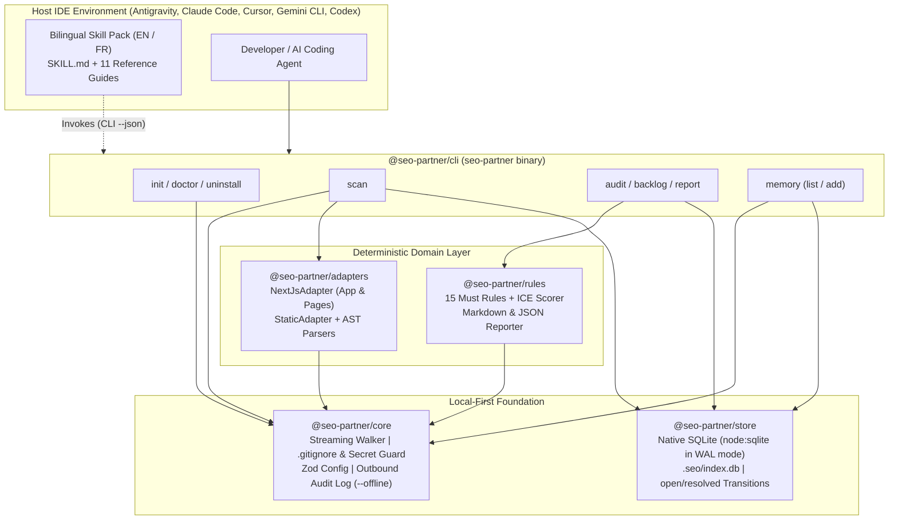
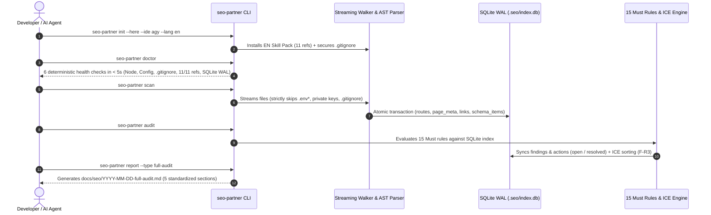

<div align="center">


<br />

[](./package.json)
[](https://nodejs.org/)
[](./tsconfig.base.json)
[](./packages/store/src/db.ts)
[](./vitest.config.ts)
[](./LICENSE)

<p align="center">
  <strong>Deterministic Local-First SEO Scanner, 15 <code>Must</code> Rules Engine with ICE Prioritization, and Bilingual Multi-IDE Skill Pack.</strong><br />
  <em>Built for Antigravity (<code>agy</code>), Claude Code, Cursor, Gemini CLI, and Codex — zero code execution and zero PATH installation traps.</em>
</p>

<p align="center">
  <strong>English (Active)</strong> &nbsp;|&nbsp; <a href="./README.fr.md">Lire en Français (README.fr.md)</a> &nbsp;|&nbsp; <a href="./SECURITY.md">Security Policy</a> &nbsp;|&nbsp; <a href="./CONTRIBUTING.md">Contributing</a>
</p>

</div>

---

## Table of Contents

1. [Vision and Value Proposition](#1-vision-and-value-proposition)
2. [System Architecture and Data Flow](#2-system-architecture-and-data-flow)
3. [Quick Start Guide (Getting Started)](#3-quick-start-guide-getting-started)
4. [Complete CLI Reference (8 Commands)](#4-complete-cli-reference-8-commands)
5. [The 15 `Must` SEO Rules Catalog and ICE Methodology](#5-the-15-must-seo-rules-catalog-and-ice-methodology)
6. [Bilingual Skill Pack (`11/11` References) and Multi-IDE Matrix](#6-bilingual-skill-pack-1111-references-and-multi-ide-matrix)
7. [Developer Guide and TypeScript SDK Reference](#7-developer-guide-and-typescript-sdk-reference)
8. [Security, Privacy and `.gitignore` Guardrails](#8-security-privacy-and-gitignore-guardrails)
9. [Troubleshooting Guide and FAQ](#9-troubleshooting-guide-and-faq)
10. [Roadmap (`v0.1` to `v1.0`) and Documentation Governance](#10-roadmap-v01-to-v10-and-documentation-governance)

---

## 1. Vision and Value Proposition

### The Problem with Current SEO Workflows

Engineering and product teams face two extremes when auditing modern web applications (Next.js, React, static sites):

- **Prompt-only AI skills** force the coding agent to read files one by one inside its context window, produce non-deterministic results across sessions, miss routes, and retain no structured memory of past architectural decisions.
- **External cloud SaaS crawlers** require a deployed environment, cannot pinpoint the exact source file and line number (`filePath:lineNumber`), and do not integrate natively into IDE agent workflows.

### The `seo-partner` Solution: Deterministic Core + Agentic Intelligence

`seo-partner` strictly separates **what must be 100% deterministic** (powered by a local TypeScript AST scanner and native SQLite WAL database) from **strategic and editorial guidance** (powered by a complete 11-reference bilingual skill pack inside your IDE):

| Capability | Prompt-only Skill | Cloud SaaS Crawler | **`seo-partner` (`v0.1`)** |
| :--- | :--- | :--- | :--- |
| **Exhaustive Route Discovery (App & Pages Router)** | No (context window limit) | Partial (deployed URLs only) | **Yes — 100% Deterministic (Static AST)** |
| **Mandatory Evidence (`filePath` + `lineNumber >= 1`)** | No (approximate) | No (compiled HTML only) | **Yes — Exact Source File & Line (`SC-003`)** |
| **Target Code Execution (`F-S5`)** | Depends on agent | N/A | **Zero Execution (`eval`/`build` forbidden)** |
| **Cross-Session Memory & Status Transitions** | No (lost between chats) | Proprietary cloud | **Local SQLite WAL (`.seo/index.db`) + `.seo/decisions.md`** |
| **Mathematical ICE Prioritization & Rule `F-R3`** | No (subjective) | Generic | **`ICE = (I+C+E)/3` + Indexing Blockers First** |
| **Windows Installation without IDE Binary in `PATH`** | Frequently fails | N/A | **Spec Kit Philosophy (`--ignore-agent-tools`)** |

---

## 2. System Architecture and Data Flow

### 2.1 Modular Monorepo Architecture (`pnpm workspaces`)



### 2.2 End-to-End Execution Pipeline



---

## 3. Quick Start Guide (Getting Started)

### 3.1 Prerequisites

- **Node.js**: `>= 22.5.0` (required for the built-in `node:sqlite` engine without `node-gyp` C++ compilation).
- **Package Manager**: `pnpm >= 9.x` (recommended) or `npm`.
- **Operating System**: Windows (PowerShell), macOS, or Linux.

### 3.2 Installation (Spec Kit Philosophy)

#### Option A — From Source Repository (Development / Monorepo)

```powershell
# 1. Clone the repository and install dependencies
git clone https://github.com/leadbooster/seo-partner.git
cd seo-partner
pnpm install

# 2. Build all workspace packages
pnpm run build

# 3. (Optional) Link seo-partner globally on your machine
pnpm --filter seo-partner link --global
```

#### Option B — Global Installation in Any Host Project

```powershell
# Install once globally
pnpm add -g seo-partner

# Initialize inside any existing Next.js or web project:
cd /path/to/my-project
seo-partner init --here --ide agy --lang fr --ignore-agent-tools
```

### 3.3 Five Commands to Your First Audit (< 2 minutes)

```powershell
# 1. Initialize seo-partner (choose --lang en or --lang fr)
seo-partner init --here --ide agy --lang fr --ignore-agent-tools

# 2. Verify installation health (6 deterministic checks in < 5s)
seo-partner doctor

# 3. Scan source files (Next.js AST / HTML / robots.txt / sitemap.xml)
seo-partner scan

# 4. Run the 15 Must rules audit and inspect the ICE-prioritized backlog
seo-partner audit
seo-partner backlog

# 5. Generate the standardized 5-part Markdown deliverable in docs/seo/YYYY-MM-DD-audit.md
seo-partner report --type audit
```

---

## 4. Complete CLI Reference (8 Commands)

### 4.1 Global Flags and Exit Codes

Every `seo-partner` command accepts the following global flags:

| Global Flag | Type | Default | Description |
| :--- | :--- | :--- | :--- |
| `--cwd <dir>` | `string` | `process.cwd()` | Root directory of the target project to inspect. |
| `--json` | `boolean` | `false` | Emits a deterministic JSON envelope to `stdout` (built for AI agents and CI/CD pipelines). |
| `--offline` | `boolean` | `false` | Strictly blocks any outbound network request and logs blocked attempts to `.seo/logs/outbound.jsonl`. |

#### Standardized JSON Envelope (`--json`)

```json
{
  "success": true,
  "command": "audit",
  "timestamp": "2026-10-28T14:00:00.000Z",
  "durationMs": 42,
  "data": {},
  "error": null
}
```

#### Exit Codes

| Code | Meaning | Trigger Condition |
| :---: | :--- | :--- |
| `0` | **Success** | Command completed cleanly (and zero `error` findings when `--fail-on-error` is active). |
| `1` | **Domain / Health Failure** | `doctor` detected a failing check, or `audit --fail-on-error` found at least one `error` finding. |
| `2` | **Invalid Arguments** | Missing or unrecognized CLI option (e.g., invalid `--ide` target). |
| `3` | **External / Security Error** | `--offline` policy violation or filesystem/SQLite I/O error. |

---

### 4.2 Detailed Command Reference

1. **`seo-partner init`**: Creates `.seo/config.json` and `.seo/decisions.md`, installs the selected language variant (`en` or `fr`) of the skill pack into the target IDE directory (`.agents/`, `.claude/`, `.cursor/`, `.gemini/`, `.codex/`) without overwriting user files, and secures `.gitignore`.
   ```powershell
   seo-partner init [--here] [--ide <agy|claude|cursor|gemini|codex|all>] [--lang <en|fr>] [--ignore-agent-tools] [--terminal-only] [--dry-run] [--json]
   ```
2. **`seo-partner doctor`**: Runs 6 health checks in under 5 seconds (`node-version`, `seo-config`, `gitignore-security`, `ide-skill-integrity` verifying all 11 references, `watch-freshness` `<= 90` days, and `sqlite-wal`).
   ```powershell
   seo-partner doctor [--json]
   ```
3. **`seo-partner scan`**: Streams workspace files (`opendir`), excludes secrets (`.env*`, `*.pem`, `*.key`) and `.gitignore` paths, runs `NextJsAdapter` and `StaticAdapter`, and persists routes, metadata, headings, links, images, and `JSON-LD` in `.seo/index.db`.
   ```powershell
   seo-partner scan [--scope <subpath>] [--rebuild] [--max-size <kb>] [--json]
   ```
4. **`seo-partner audit`**: Evaluates the **15 `Must` rules** against `.seo/index.db`, transitions resolved findings (`open` to `resolved`), computes ICE scores, and updates the action backlog.
   ```powershell
   seo-partner audit [--category <technical|onpage|schema|all>] [--severity <error|warning|info>] [--fail-on-error] [--json]
   ```
5. **`seo-partner backlog`**: Lists prioritized actions with **indexing blockers (`F-R3`) always ranked first**, followed by descending `ICE` score.
   ```powershell
   seo-partner backlog [--status <open|acknowledged|resolved|all>] [--limit <n>] [--json]
   ```
6. **`seo-partner report`**: Generates a standardized **5-section Markdown report** in `docs/seo/YYYY-MM-DD-<type>.md` (or `.json`) in the project's configured language (`en` or `fr`).
   ```powershell
   seo-partner report [--type <type>] [--format <md|json>] [--out <filepath>] [--json]
   ```
7. **`seo-partner memory`**: Lists or records SEO architectural decisions synchronized between `.seo/decisions.md` and SQLite.
   ```powershell
   seo-partner memory add --title "Keep /dashboard private" --rationale "Authenticated customer area" [--finding-id <id>]
   seo-partner memory list [--json]
   ```
8. **`seo-partner uninstall`**: Cleanly removes installed IDE skill files while preserving `.seo/decisions.md` unless `--purge-data` is passed.
   ```powershell
   seo-partner uninstall [--ide <target|all>] [--purge-data] [--dry-run] [--json]
   ```

---

## 5. The 15 `Must` SEO Rules Catalog and ICE Methodology

### 5.1 ICE Formula and Absolute Indexing Blocker Rule (`F-R3`)

$$\text{ICE} = \text{round}\left(\frac{\text{Impact} + \text{Confidence} + \text{Effort}}{3}, 2\right)$$

> [!IMPORTANT]
> **Absolute Priority Rule (`F-R3`)**: Any finding with `blocksIndexing = true` (`R-TECH-01`, `R-TECH-02`, `R-TECH-03`, `R-TECH-06`) is **always placed at the top of the backlog**, ahead of all non-blocking findings regardless of their nominal ICE score.

### 5.2 Complete Catalog of the 15 `Must` Rules (`v0.1`)

| Rule ID | Category | Severity | Blocks Indexing (`F-R3`) | Default `(I, C, E)` | ICE Score | Condition Detected and Evidence |
| :--- | :--- | :---: | :---: | :---: | :---: | :--- |
| **`R-TECH-01`** | `technical` | `error` | **Yes (Priority 1)** | `(9, 10, 9)` | **9.33** | Missing `public/robots.txt` or `app/robots.(ts\|js)`. |
| **`R-TECH-02`** | `technical` | `error` | **Yes (Priority 1)** | `(9, 10, 8)` | **9.00** | Missing `public/sitemap.xml` or `app/sitemap.(ts\|js)`. |
| **`R-TECH-03`** | `technical` | `error` | **Yes (Priority 1)** | `(10, 10, 9)` | **9.67** | `noindex` directive detected on a public route. |
| **`R-TECH-04`** | `technical` | `error` | No | `(8, 9, 8)` | **8.33** | Private route (`/admin`, `/dashboard`, `/auth`) included in `sitemap.xml`. |
| **`R-TECH-05`** | `technical` | `warning` | No | `(7, 9, 8)` | **8.00** | Missing canonical URL (`alternates.canonical` or `<link rel="canonical">`) on a public route. |
| **`R-TECH-06`** | `technical` | `error` | **Yes (Priority 1)** | `(9, 8, 6)` | **7.67** | Client-only public page (`'use client'`) without server metadata export. |
| **`R-ONPAGE-01`** | `onpage` | `error` | No | `(9, 10, 9)` | **9.33** | Missing or empty `<title>` / `metadata.title` on a public route. |
| **`R-ONPAGE-02`** | `onpage` | `error` | No | `(8, 10, 8)` | **8.67** | Exact duplicate `<title>` across two or more public routes. |
| **`R-ONPAGE-03`** | `onpage` | `warning` | No | `(6, 8, 9)` | **7.67** | `<title>` length outside optimal SERP bounds (`< 30` or `> 60` chars). |
| **`R-ONPAGE-04`** | `onpage` | `error` | No | `(8, 10, 9)` | **9.00** | Missing or empty meta `description` on a public route. |
| **`R-ONPAGE-05`** | `onpage` | `warning` | No | `(7, 10, 8)` | **8.33** | Exact duplicate meta `description` across two or more public routes. |
| **`R-ONPAGE-06`** | `onpage` | `info` | No | `(5, 8, 9)` | **7.33** | Meta `description` length outside optimal bounds (`< 70` or `> 160` chars). |
| **`R-ONPAGE-07`** | `onpage` | `error` | No | `(8, 9, 8)` | **8.33** | Missing `<h1>` or multiple `<h1>` headings on a single public route. |
| **`R-ONPAGE-08`** | `onpage` | `warning` | No | `(6, 10, 8)` | **8.00** | `` or `<Image>` element missing an `alt` attribute. |
| **`R-SCHEMA-01`** | `schema` | `error` | No | `(7, 10, 8)` | **8.33** | Invalid `application/ld+json` block or missing `@context: "https://schema.org"` / `@type`. |

---

## 6. Bilingual Skill Pack (`11/11` References) and Multi-IDE Matrix

### 6.1 Supported IDE Targets

| `--ide` Target | AI Assistant / IDE | Installed Workspace Path | Notes |
| :--- | :--- | :--- | :--- |
| **`agy`** | **Google Antigravity** | `.agents/skills/seo-partner/SKILL.md` + `references/` | Native discovery by Antigravity skill loader. |
| **`claude`** | **Claude Code** | `.claude/skills/seo-partner/SKILL.md` + `references/` | Compatible with Claude Code workspace skills. |
| **`cursor`** | **Cursor** | `.cursor/rules/seo-partner.mdc` + `.cursor/skills/seo-partner/` | Generates `.mdc` rule wrapper + full reference library. |
| **`gemini`** | **Gemini CLI** | `.gemini/skills/seo-partner/SKILL.md` + `references/` | Contextual loading of all 11 reference guides. |
| **`codex`** | **OpenAI Codex CLI** | `.codex/skills/seo-partner/SKILL.md` + `references/` | Compatible with `.codex/` workspace conventions. |

### 6.2 The 11 Reference Guides (`skills/seo-partner/<lang>/references/`)

All 11 reference files are authored in full in both English (`en`) and French (`fr`) and verified by `seo-partner doctor`:

1. `01-veille-mises-a-jour.md` — Official Search Engine Watch (< 90 days freshness protocol)
2. `02-audit-technique.md` — Technical SEO Audit, Crawlability, Indexability and Core Web Vitals
3. `03-implementation-nextjs.md` — Next.js App and Pages Router SEO Implementation Patterns
4. `04-strategie-mots-cles.md` — Keyword Strategy, Search Intent Clustering and Cannibalization Prevention
5. `05-on-page-et-contenu.md` — On-Page Optimization, Semantic Hierarchy and E-E-A-T Content Standards
6. `06-schema-donnees-structurees.md` — Schema.org and JSON-LD Structured Data Implementation
7. `07-seo-local.md` — Local SEO, Google Business Profile and NAP Consistency
8. `08-geo-geographique-et-generatif.md` — International Multi-Region SEO (`hreflang`) and Generative Engine Optimization (GEO)
9. `09-netlinking-autorite.md` — Ethical Link Building, Digital PR and Domain Authority
10. `10-mesure-dashboard-roi.md` — KPI Measurement, Search Console Analytics and Organic ROI Modeling
11. `11-roadmap-12-mois.md` — 12-Month Quarterly SEO Execution Roadmap

---

## 7. Developer Guide and TypeScript SDK Reference

### 7.1 Programmatic Usage

```typescript
import {
  runInitCommand,
  runScanCommand,
  runAuditCommand,
  runReportCommand,
} from 'seo-partner';

async function runSeoCiPipeline(projectRoot: string): Promise<void> {
  runInitCommand({
    projectRoot,
    ide: 'agy',
    lang: 'en',
    ignoreAgentTools: true,
  });

  const scan = await runScanCommand({ projectRoot });
  console.log(`Scanned ${scan.filesScanned} files and ${scan.routesDiscovered} routes.`);

  const audit = await runAuditCommand({ projectRoot });
  console.log(`Detected ${audit.totalFindings} findings (${audit.blockingIndexingCount} blocking).`);

  await runReportCommand({ projectRoot, type: 'ci-audit', format: 'md' });
}
```

### 7.2 Build, Typecheck and Test Commands

```powershell
pnpm run build                        # Build all 5 packages
pnpm exec tsc --noEmit                # Full TypeScript check across packages, tests, and fixtures
pnpm exec vitest run tests/unit       # Fast unit test suite
pnpm run test:coverage                # Full test suite + 10k-file benchmark + V8 coverage (>= 80%)
```

---

## 8. Security, Privacy and `.gitignore` Guardrails

- **Zero Target Code Execution (`F-S5`)**: Files are parsed statically via `ts.createSourceFile` and streaming readers; `eval`, `Function`, or child process execution on target project files is strictly prohibited.
- **Secret Exclusion before File Open (`SC-005`)**: `.env*` (except `.env.example`/`.env.template`), `*.pem`, `*.key`, `*.p12`, `*.pfx`, `id_rsa`, `.npmrc`, and `credentials.json` are excluded before any file descriptor is opened.
- **Strict `--offline` Enforcement**: Blocks outbound network calls and logs blocked attempts in `.seo/logs/outbound.jsonl`.
- **Automatic `.gitignore` Protection**: Automatically adds `.agents/`, `.claude/`, `.cursor/`, `.gemini/`, `.codex/`, `specs/`, `.seo/index.db*`, `.seo/logs/`, and `.seo/cache/` to `.gitignore`.

---

## 9. Troubleshooting Guide and FAQ

- **IDE binary (`agy`, `cursor`, `claude`) not found in Windows `PATH`**: `seo-partner init` never shells out to the IDE binary. Pass `--ignore-agent-tools` (enabled natively) to install the workspace skill directories directly.
- **Rebuilding a corrupted or stale SQLite index**: Run `seo-partner scan --rebuild` to recreate `.seo/index.db` from scratch while keeping `.seo/decisions.md`.
- **Stale TypeScript errors in VS Code tabs**: Run **`TypeScript: Restart TS Server`** from the Command Palette (`Ctrl+Shift+P`).

---

## 10. Roadmap (`v0.1` to `v1.0`) and Documentation Governance

- **`v0.1` (Delivered)**: Bilingual Skill Pack (`11/11` EN/FR), 8 CLI commands, 5 IDE installers, Next.js and Static AST Scanner, native SQLite WAL, 15 `Must` rules, ICE scorer (`F-R3`), and 5-part reports.
- **`v0.2` (Planned)**: Local HTTP Crawler (`robots.txt` compliant, SSRF guard), redirect chains, broken links, and 30 rules.
- **`v0.3` (Planned)**: Local Dashboard (`127.0.0.1` Hono + OpenAPI 3.1 + React/Tailwind SPA).
- **`v0.4` (Planned)**: MCP Server (`stdio`) and `propose-patch` Git remediation mode.
- **`v0.5` (Planned)**: Astro, Nuxt, Remix, SvelteKit, Django and WordPress adapters.
- **`v0.6`–`v1.0` (Planned)**: Autonomous agent loop, opt-in GSC/CWV connectors, and standalone OS binaries.

> [!NOTE]
> **Documentation Governance (Constitution Principle VI)**: Both `README.md` and [`README.fr.md`](./README.fr.md) are living engineering documents and MUST be updated at every milestone and feature increment.

---

## License

Distributed under the **MIT License**. See [LICENSE](./LICENSE) for details.

<div align="center">
  <sub>Crafted by <strong>Firinze Gbènito Dossou (Leadbooster)</strong></sub>
</div>
