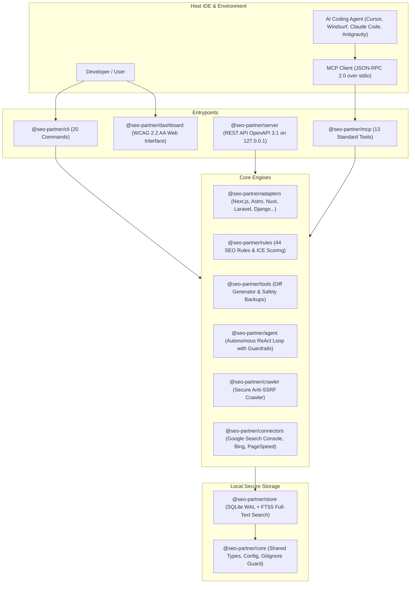

<div align="center">


<br />

[](./package.json)
[](https://nodejs.org/)
[](./tsconfig.base.json)
[](./package.json)
[](./packages/mcp/src/server.ts)
[](./packages/store/src/db.ts)
[](./packages/server/src/openapi.ts)
[](./packages/rules/src/engine.ts)
[](https://github.com/Firinze)
[](./LICENSE)

<br />

### Your all-in-one technical copilot to supercharge natural search engine optimization for web applications

**Safely audit your source code, visualize website health in an intuitive dashboard, apply verified automated patches with zero breakage risk, and let autonomous AI agents optimize your visibility across Google and Bing.**

<br />

<p align="center">
  <strong>English (Active)</strong> &nbsp;|&nbsp; <a href="./README.fr.md">Lire en Francais (README.fr.md)</a> &nbsp;|&nbsp; <a href="./SECURITY.md">Security Policy</a> &nbsp;|&nbsp; <a href="./CONTRIBUTING.md">Contributing Guide</a>
</p>

</div>

---

> [!NOTE]
> **Version 1.0.3 Available**: SEO Partner is now production-ready and fully stabilized. Installs in seconds with `npx seo-partner init`, runs 100% locally on your machine without transmitting files to remote servers, and requires zero mandatory cloud subscriptions.

---

## Table of Contents

1. [Why SEO Partner? The Problem and The Solution](#1-why-seo-partner-the-problem-and-the-solution)
2. [Who Is This Tool For?](#2-who-is-this-tool-for)
3. [The 3 Simple Ways to Use SEO Partner](#3-the-3-simple-ways-to-use-seo-partner)
4. [2-Minute Quick Start Guide](#4-2-minute-quick-start-guide)
5. [The Visual Dashboard: Complete Clarity at a Glance](#5-the-visual-dashboard-complete-clarity-at-a-glance)
6. [Automated Code Fixes: Zero-Risk Guarantee](#6-automated-code-fixes-zero-risk-guarantee)
7. [Multi-Framework Compatibility](#7-multi-framework-compatibility)
8. [Official Connectors: Google Search Console, Bing, and Core Web Vitals](#8-official-connectors-google-search-console-bing-and-core-web-vitals)
9. [MCP Protocol: Connect Your Favorite AI Coding Agent](#9-mcp-protocol-connect-your-favorite-ai-coding-agent)
10. [Complete CLI Command Reference](#10-complete-cli-command-reference)
11. [Technical Architecture and Monorepo](#11-technical-architecture-and-monorepo)
12. [Security and Absolute Privacy](#12-security-and-absolute-privacy)
13. [Roadmap and Milestone History](#13-roadmap-and-milestone-history)
14. [Frequently Asked Questions (FAQ)](#14-frequently-asked-questions-faq)
15. [Author and License](#15-author-and-license)

---

## 1. Why SEO Partner? The Problem and The Solution

### The Technical SEO Bottleneck
Search engine optimization is too often treated as an opaque black box reserved for expensive consultants:
- **Cloud SaaS crawlers** charge steep monthly subscriptions, scan only deployed pages from the outside without understanding your code, and dump 50 vague warnings without helping you write the fix.
- **Generic AI chat models** frequently hallucinate syntax errors incompatible with modern frameworks, unable to verify if their edits break your application.
- **Developers and creators** lack the time to memorize Google's shifting guidelines (Core Web Vitals, OpenGraph tags, Schema.org structured data, XML sitemaps, canonical links).

### The Solution: SEO Partner
SEO Partner combines everything you need into a single local-first powerhouse:

| Need | Traditional Tools | SEO Partner (v1.0.0 GA) |
| :--- | :--- | :--- |
| **Code Inspection** | Scans only rendered HTML on the public web | Inspects your real source files (Next.js, Astro, Nuxt, Laravel, Django...) |
| **Fixing Issues** | Vague recommendations leaving you to code alone | Generates verified, ready-to-merge code diffs with 1 click |
| **Code Privacy** | Sends your code to external cloud providers | 100% local on your machine, zero data leaks, automatic backups |
| **AI Assistants** | Clunky manual copy-pasting into chat windows | Built-in standard MCP server: AI agents (Cursor, Claude, Windsurf) act directly |
| **Real Traffic Metrics** | Constantly switching between Search Console & PageSpeed | Centralized Google Search Console, Bing Webmaster, and Core Web Vitals |
| **Ease of Use** | Complex terminal commands or obscure dashboards | Modern, intuitive visual dashboard accessible to beginners |

---

## 2. Who Is This Tool For?

Whether you are a newcomer launching your first project or a seasoned lead developer, SEO Partner adapts to you:

- **For Beginners, Freelancers, and Creators**:
  No technical jargon required. Open the visual dashboard, look at your clear score out of 100, read straightforward explanations in plain language, and click "Apply Fix" to insert missing metadata automatically.

- **For Web Developers and Product Teams**:
  Save dozens of hours per project. Connect SEO Partner to your favorite IDE with the standard Model Context Protocol (13 tools). Run continuous watch mode (`seo-partner watch`) to see your SEO score update live on every file save.

- **For Agencies and SEO Professionals**:
  Rely on 44 audited rules, mathematical ICE prioritization (Impact, Confidence, Ease), side-by-side source code vs. rendered crawl comparisons, and exportable executive reports in standalone HTML, Markdown, or JSON.

---

## 3. The 3 Simple Ways to Use SEO Partner

> [!TIP]
> **Primary Recommendation: Run Directly in Your IDE Integrated Terminal**  
> For the best developer experience, run SEO Partner directly from your code editor's integrated terminal (Cursor, VS Code, Windsurf, Claude Code, Antigravity):
> - **With IDE Agent (MCP Server - Recommended)**: Zero API key or token cost required. Your IDE's built-in AI agent uses the Model Context Protocol to generate and verify metadata without consuming token quotas.
> - **In Standalone Mode (External API)**: If launched outside an MCP IDE environment, SEO Partner interactively prompts you to **select your AI provider first** (OpenAI, Anthropic Claude, Google Gemini, or local OpenCode / Ollama), and then enter your corresponding API key.
> - **Without AI Available**: SEO Partner applies a pedagogical refusal with helpful setup guidance, never inserting broken code or temporary `TODO-SEO` placeholder markers.
> - **Absolute Code Sovereignty**: Never blindly mutates your files. SEO Partner writes formal diff proposals into `.seo/proposals/`. Source code is only updated upon your explicit review (`seo-partner patch --apply` or via the interactive dashboard).

Pick the workflow that best fits your style:

### Option 1: The Visual Dashboard in Your Browser (Recommended for Beginners)
Run one command:
```bash
npx seo-partner serve
```
Your browser opens immediately with visual health gauges, page inspection trees, an interactive Before/After Diff Viewer, and an AI streaming assistant.

### Option 2: Inside Your IDE Terminal with an AI Coding Agent (Cursor, Windsurf, Claude Code, Antigravity)
Integrate the tools into your assistant in one step:
```bash
npx seo-partner init --with-mcp
```
Your AI coding agent now understands your website's SEO architecture natively via MCP tools (including `generate_semantic_copy`). Just ask: *"Check my homepage SEO and propose missing metadata"*. The agent reviews the diff and waits for your confirmation before writing changes to disk.

### Option 3: Terminal CLI and CI/CD Automation (GitHub Actions, GitLab)
For command-line veterans and release pipelines:
```bash
npx seo-partner audit
npx seo-partner ci --max-blockers=0
```
Fast audits in under 5 seconds with strict non-zero exit codes to prevent broken SEO releases.

#### Official GitHub Action (GitHub Marketplace)
You can directly integrate the official SEO Partner Action into your GitHub repository:
```yaml
name: SEO Quality Gate
on: [push, pull_request]

jobs:
  seo:
    runs-on: ubuntu-latest
    steps:
      - uses: actions/checkout@v4
      - uses: actions/setup-node@v4
        with:
          node-version: '22'
      - name: Run SEO Quality Gate
        uses: firinze/seo-partner@v1
        with:
          fail-on-blockers: 'true'
          format: 'sarif'
```
This action automatically invokes the latest published `seo-partner ci`, uploads SARIF reports to GitHub Code Scanning, and prevents search indexation blockers before PR merge.

---

## 4. 2-Minute Quick Start Guide

### Step 1: Initialize your project
Navigate to your web project root directory and run:
```bash
npx seo-partner init
```
*SEO Partner automatically detects your framework (Next.js, Astro, Nuxt, Laravel, Django, etc.) and sets up the local database in `.seo/`.*

### Step 2: Run a full SEO audit
```bash
npx seo-partner audit
```
*All 44 SEO rules are evaluated against your codebase in less than 5 seconds.*

### Step 3: Open the graphical dashboard
```bash
npx seo-partner serve
```
*The dashboard opens locally at `http://127.0.0.1:4321`.*

### Step 4: Apply recommended fixes safely
```bash
npx seo-partner patch --apply
```
*Essential missing tags (title, meta description, image alt attributes, canonical tags) are inserted cleanly after generating a timestamped backup.*

---

## 5. The Visual Dashboard: Complete Clarity at a Glance

The dashboard bundles everything required to navigate search optimization without leaving your machine:

```
[ SEO Partner Visual Dashboard ]
+-----------------------------------------------------------------------------------+
|  OVERALL SITE HEALTH : 87 / 100         |  AUDITED ROUTES : 42                    |
|  [||||||||||||||||||||||||||||||||]     |  CRITICAL BLOCKERS : 0                  |
+-----------------------------------------------------------------------------------+
|  AVAILABLE WORKSPACES :                                                           |
|  - Overview          : High-level scores by category (Meta, Crawl, Speed, Social) |
|  - Findings          : Detailed breakdown of each issue with clear advice         |
|  - ICE Action Plan   : High-leverage tasks prioritized by search traffic impact   |
|  - Instant Patches   : Preview and apply verified fixes in 1 click                |
|  - Route Explorer    : Live tree of all detected routes, pages, and templates     |
|  - Google Search     : Real clicks, impressions, CTR, and average position        |
|  - Bing Webmaster    : Instant URL indexing through IndexNow protocol             |
|  - Core Web Vitals   : Real LCP loading speed, INP responsiveness, CLS stability  |
|  - AI Chat Assistant : Ask questions and receive tailored suggestions in streaming|
|  - Report Downloads  : Export executive reports in standalone HTML, JSON, or MD   |
+-----------------------------------------------------------------------------------+
```

- **Zero complex configuration**: Starts instantly on local loopback.
- **Certified accessibility**: Built to WCAG 2.2 AA standards.
- **Clean modern theme**: Carefully designed for high legibility and zero cognitive friction.

---

## 6. Automated Code Fixes: Zero-Risk Guarantee

Touching source code demands surgical precision. SEO Partner enforces **four active safety shields**:

1. **Automatic Prior Backups**: Before writing a single character, target files are copied into `.seo/backups/<timestamp>/`. You can roll back anytime.
2. **Git Dirty Guard**: If uncommitted changes exist in your repository, SEO Partner refuses to overwrite them to avoid destroying your in-progress work, unless explicitly overridden with `--force`.
3. **Transparent Line-by-Line Previews**: Nothing happens blindly. Inspect unified diffs (`seo-partner patch --preview`) before giving your approval.
4. **Zero Code Execution**: SEO Partner inspects code syntax statically. It never executes arbitrary code or untrusted scripts on your machine.

---

## 7. Multi-Framework Compatibility

SEO Partner detects conventions and routing logic across major web ecosystems:

| Framework / Ecosystem | Routing Conventions | Metadata & Layout Architecture |
| :--- | :--- | :--- |
| **Next.js** | App Router (`page.tsx`, `layout.tsx`) & Pages Router (`pages/*.tsx`) | `export const metadata`, `<Head>` tags, OpenGraph tags |
| **Astro** | `src/pages/**/*.{astro,md,mdx}` | Layout components and HTML head elements |
| **Nuxt 3** | `pages/**/*.vue` | `useHead`, `useSeoMeta` composables and Vue templates |
| **SvelteKit** | `src/routes/**/+page.svelte` | `<svelte:head>` blocks and layout inheritance |
| **Remix / React Router** | `app/routes/**/*.{tsx,jsx}` | Exported `meta` functions and route nesting |
| **Django** | `urls.py` and `templates/**/*.html` | `` template tags and metadata blocks |
| **Laravel & Symfony** | `routes/web.php` and `resources/views/**/*.blade.php` | `@section('title')` directives, Blade, and Twig |
| **PHP & Laragon** | `.php` file structure and template includes | Header includes and standard HTML head tags |
| **Static HTML** | Pure `.html` files | Standard HTML5 tags, canonical elements, and microdata |

---

## 8. Official Connectors: Google Search Console, Bing, and Core Web Vitals

Measure real-world search performance without leaving your editor:

- **Google Search Console**:
  Connect using your Google service account JSON key (`.seo/credentials.json`). Fetches queries, clicks, impressions, CTR, and average positions with local 7-day caching.

- **Bing Webmaster Tools & IndexNow**:
  Instantly notify Bing whenever a new page is created or updated, bypassing slow crawler discovery.

- **Core Web Vitals (CrUX & PageSpeed)**:
  Directly track user experience metrics:
  - **LCP (Largest Contentful Paint)**: Main content render time (< 2.5s).
  - **INP (Interaction to Next Paint)**: User interaction response latency (< 200ms).
  - **CLS (Cumulative Layout Shift)**: Page visual stability (< 0.1).

---

## 9. MCP Protocol: Connect Your Favorite AI Coding Agent

SEO Partner ships with an official **Model Context Protocol (MCP)** standard server for Antigravity (`agy`), Claude Code, Cursor, Windsurf, Codex, Gemini Code Assist, and Cline.

### 1-Command Integration:
```bash
npx seo-partner init --with-mcp
```

### The 13 Frozen MCP Tools:
1. `audit_rules`: Audits all 44 SEO rules and computes the overall site score.
2. `get_findings`: Lists all detected anomalies sorted by severity.
3. `get_route_inventory`: Full inventory of pages, routes, and template files.
4. `inspect_url`: Deeply inspects an individual route's metadata and structure.
5. `propose_patch`: Generates a deterministic code diff proposal to resolve an issue.
6. `search_knowledge`: Searches the embedded SEO knowledge base.
7. `crawl_live`: Live HTTP crawler with strict anti-SSRF protections.
8. `fetch_gsc_performance`: Pulls real Google Search Console query metrics.
9. `fetch_cwv_metrics`: Retrieves Google CrUX and PageSpeed performance metrics.
10. `fetch_bing_performance`: Queries Bing Webmaster indexing data.
11. `submit_bing_indexnow`: Submits fresh URLs directly to Bing via IndexNow.
12. `generate_audit_report`: Exports reports in HTML, Markdown, or JSON.
13. `run_agent_step`: Executes an autonomous ReAct loop step with cycle guards.

---

## 10. Complete CLI Command Reference

20 clear and focused commands for all operational scenarios:

```bash
# Core commands
npx seo-partner init            # Initialize workspace and detect framework
npx seo-partner scan            # Quick scan of modified files
npx seo-partner audit           # Full audit evaluating all 44 rules with score out of 100
npx seo-partner serve           # Start the interactive web dashboard

# Automated fixes and monitoring
npx seo-partner patch           # List and preview available code patches
npx seo-partner patch --apply   # Apply verified code patches safely
npx seo-partner watch           # Real-time file watcher with live dashboard sync
npx seo-partner pr              # Automated Pull Request bot creating branch and proposal

# Quality gates and crawling
npx seo-partner ci              # CI/CD quality gate enforcement (SARIF v2.1.0)
npx seo-partner crawl <url>     # Crawl a staging URL with anti-SSRF protection
npx seo-partner report          # Generate executive reports in HTML, Markdown, or JSON

# Connectors
npx seo-partner gsc query       # Query Google Search Console metrics
npx seo-partner cwv query       # Inspect Core Web Vitals metrics
npx seo-partner bing query      # Query Bing Webmaster indexing data
npx seo-partner bing indexnow   # Submit URLs through IndexNow

# AI and MCP
npx seo-partner mcp             # Launch stdio MCP server for IDEs
npx seo-partner agent run       # Run autonomous ReAct loop with guardrails
```

---

## 11. Technical Architecture and Monorepo

SEO Partner is architected as a modular, industrial-grade monorepo split into 12 standalone packages (`pnpm workspaces`):



---

## 12. Security and Absolute Privacy

Your code, traffic numbers, and credentials remain strictly yours:

- **100% Local-First Privacy**: No source files are ever transmitted to third-party clouds. All parsing runs locally on your machine.
- **Zero Secret Leaks**: Active scanning across 39 credential patterns ensures keys, passwords, and tokens are scrubbed from reports and logs.
- **Strict Anti-SSRF Crawler**: DNS resolution checks ensure private IPs, loopbacks, and cloud metadata endpoints (`169.254.169.254`) are blocked unconditionally.
- **Mandatory Gitignore Guards**: SEO Partner automatically writes `.seo/index.db*`, `.seo/patches/`, and `.seo/backups/` into your `.gitignore` upon initialization.

---

## 13. Roadmap and Milestone History

Every phase of development has been delivered and verified:

```
[ v0.1 ] Foundation: Bilingual Skill Pack, static Next.js parser, SQLite WAL storage.
   |
[ v0.2 ] Fast incremental scan (< 5s), SQLite FTS5 search, HTTP crawler, PHP adapters.
   |
[ v0.3 ] Local OpenAPI 3.1 REST server, auto-port fallback, WCAG 2.2 AA Web dashboard.
   |
[ v0.4 ] Stdio MCP server, verified unified diff patches with backups, multi-IDE merging.
   |
[ v0.5 ] Framework adapters for Astro, Nuxt 3, SvelteKit, Remix, Django without code execution.
   |
[ v0.6 ] Official Google Search Console, Core Web Vitals connectors, autonomous ReAct loop.
   |
[ v0.7 ] Real-time file watcher (SSE), CI/CD quality gate (SARIF), PR automation bot, SEA binaries.
   |
[ v0.8 ] Bing Webmaster & IndexNow connector, interactive streaming AI chat assistant.
   |
[ v0.9 ] Multi-site workspace management, enterprise audit rules, stream supervision.
   |
[ v1.0.0 GA - DELIVERED ] Final hardening, 13 frozen MCP tools, CycloneDX v1.5 SBOM,
                         zero secret leaks, 44 verified rules, standalone SEA binaries, GA release.
```

---

## 14. Frequently Asked Questions (FAQ)

### Do I need a paid subscription to use SEO Partner?
No. SEO Partner is completely free and open-source software distributed under the permissive MIT license. You can use it on commercial and private projects without restriction.

### Is an AI API key required?
No! All 44 SEO rules, the complete audit engine, the visual dashboard, and the automated code patch generator run 100% locally for free without any API key. If you configure an optional OpenAI, Anthropic, or Gemini key, you unlock enhanced editorial copy suggestions and streaming chat interactions.

### Can I use this if I am not a developer?
Yes. Simply launch `npx seo-partner serve`. The dashboard presents all issues visually with clear health scores (Green, Orange, Red). Each finding explains the problem in plain language and provides a 1-click button to apply the needed fix.

### What happens if I dislike an applied patch?
Every patch is automatically saved in a timestamped folder inside `.seo/backups/`. Furthermore, if you use Git, you can inspect the exact diff and revert changes instantly (`git checkout .`).

### Can I run SEO Partner without installing Node.js?
Yes. Standalone single-executable binaries are built for Windows (`seo-partner.exe`), Linux (`seo-partner-linux`), and macOS (`seo-partner-darwin`).

---

## 15. Author and License

<br />

<div align="center">

### Designed and Engineered by

**Firinze Gbenito Dossou**

*Lead Architect & Product Experience Engineer*

[](https://github.com/Firinze)
[](https://github.com/Firinze/seo-partner)
[](./LICENSE)

<br />

Distributed under the open-source **MIT License**. You are free to use, modify, and distribute this software according to the terms of the license.

*Feedback, bug reports, and pull requests are warmly welcomed via [GitHub Issues](https://github.com/Firinze/seo-partner/issues).*

</div>
