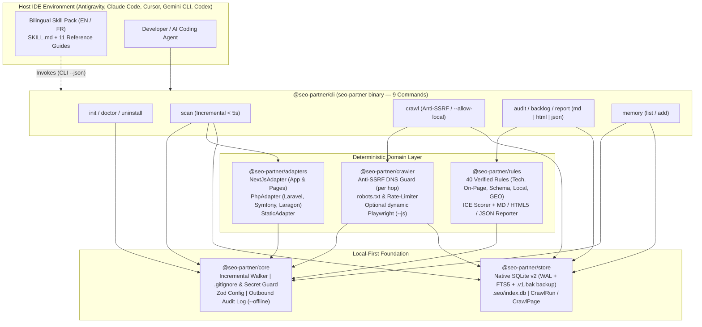
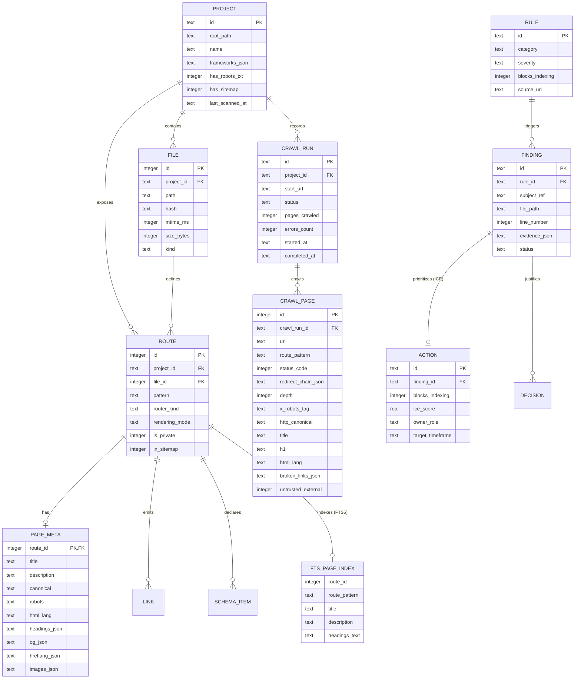

<div align="center">


<br />

[](./package.json)
[](https://nodejs.org/)
[](./tsconfig.base.json)
[](./packages/store/src/db.ts)
[](./packages/rules/src/engine.ts)
[](./LICENSE)

<p align="center">
  <strong>Incremental Local-First SEO Scanner (<code>&lt; 5s</code>), Anti-SSRF HTTP Crawler, Next.js &amp; PHP Adapters (Laravel, Symfony, Laragon), 40 Verified SEO Rules Engine with ICE Prioritization, Standalone HTML5 Reports, and Bilingual Multi-IDE Skill Pack.</strong><br />
  <em>Built for Antigravity (<code>agy</code>), Claude Code, Cursor, Gemini CLI, and Codex — zero target code execution (<code>F-S5</code>) and zero PATH installation traps.</em>
</p>

<p align="center">
  <strong>English (Active)</strong> &nbsp;|&nbsp; <a href="./README.fr.md">Lire en Français (README.fr.md)</a> &nbsp;|&nbsp; <a href="./SECURITY.md">Security Policy</a> &nbsp;|&nbsp; <a href="./CONTRIBUTING.md">Contributing</a>
</p>

</div>

---

## Table of Contents

1. [Vision and Value Proposition (`v0.2`)](#1-vision-and-value-proposition-v02)
2. [System Architecture, Data Flow and ERD (`SQLite v2`)](#2-system-architecture-data-flow-and-erd-sqlite-v2)
3. [Quick Start Guide (Getting Started)](#3-quick-start-guide-getting-started)
4. [Complete CLI Reference (9 Commands)](#4-complete-cli-reference-9-commands)
5. [The 40 Verified SEO Rules Catalog and ICE Methodology](#5-the-40-verified-seo-rules-catalog-and-ice-methodology)
6. [Multi-Framework Support: Next.js, Laravel, Symfony, PHP/Laragon & Static](#6-multi-framework-support-nextjs-laravel-symfony-phplaragon--static)
7. [Bilingual Skill Pack (`11/11` References) and Multi-IDE Matrix](#7-bilingual-skill-pack-1111-references-and-multi-ide-matrix)
8. [Developer Guide and TypeScript SDK Reference](#8-developer-guide-and-typescript-sdk-reference)
9. [Security, Anti-SSRF, Privacy and `.gitignore` Guardrails](#9-security-anti-ssrf-privacy-and-gitignore-guardrails)
10. [Troubleshooting Guide and FAQ](#10-troubleshooting-guide-and-faq)
11. [Roadmap (`v0.1` to `v1.0`) and Documentation Governance](#11-roadmap-v01-to-v10-and-documentation-governance)

---

## 1. Vision and Value Proposition (`v0.2`)

`seo-partner` strictly separates **what must be 100% deterministic** (powered by a local TypeScript scanner, an anti-SSRF HTTP crawler, and a native SQLite WAL + `FTS5` database) from **strategic and editorial guidance** (powered by a complete 11-reference bilingual skill pack inside your IDE):

| Capability | Prompt-only Skill | Cloud SaaS Crawler | **`seo-partner` (`v0.2`)** |
| :--- | :--- | :--- | :--- |
| **Route Discovery (Next.js, Laravel, Symfony, PHP/Laragon)** | No (context window limit) | Partial (deployed URLs only) | **Yes — 100% Deterministic (Static AST & Template Parsers)** |
| **Incremental Scan in Fast IDE Loops (`< 5s`)** | No (re-reads files) | No | **Yes — `(mtimeMs, sizeBytes, sha256)` diff + `FTS5` `< 100ms`** |
| **Anti-SSRF HTTP Crawler & Code vs. Rendered Diff** | No | Disconnected from source code | **Yes — `seo-partner crawl` (SSRF guard + `--allow-local` Laragon)** |
| **Mandatory Evidence (`filePath:lineNumber` or `url + statusCode`)** | No (approximate) | Compiled HTML only | **Yes — Exact Source File & Line or HTTP Status** |
| **Target Code Execution (`F-S5`)** | Depends on agent | N/A | **Zero Execution (`php`/`eval`/`build` forbidden)** |
| **Rules Catalog & Mathematical ICE Prioritization (`F-R3`)** | No (subjective) | Generic | **40 Verified Rules (`ICE = (I+C+E)/3` + Blockers First)** |
| **Executive Deliverables (Markdown, JSON, Standalone HTML5)** | Ephemeral chat text | Proprietary export | **5-section `.md`, `.json`, and 100% offline `.html` reports** |

---

## 2. System Architecture, Data Flow and ERD (`SQLite v2`)

### 2.1 Modular Monorepo Architecture (`pnpm workspaces`)



### 2.2 Entity-Relationship Diagram (`ERD` — SQLite `v2` Schema)



---

## 3. Quick Start Guide (Getting Started)

```powershell
# 0. Clone the repository and build the workspace packages
git clone https://github.com/Firinze/seo-partner.git
cd seo-partner
pnpm install
pnpm run build

# 1. Initialize seo-partner (choose --lang en or --lang fr)
seo-partner init --here --ide agy --lang fr --ignore-agent-tools

# 2. Verify installation health (6 deterministic checks in < 5s)
seo-partner doctor

# 3. Scan source files (incremental < 5s on subsequent runs + FTS5 index)
seo-partner scan

# 4. (Optional) Crawl your staging or local server (Laragon *.test / localhost)
seo-partner crawl http://my-project.test --allow-local

# 5. Run the 40 rules audit (Code + Crawl) and inspect the ICE backlog
seo-partner audit
seo-partner backlog

# 6. Generate standalone offline HTML5 and Markdown reports
seo-partner report --type audit-complet --format html
seo-partner report --type audit-complet --format md
```

---

## 4. Complete CLI Reference (9 Commands)

1. **`seo-partner init`**: Creates `.seo/config.json` and `.seo/decisions.md`, installs the selected language variant (`en` or `fr`) of the skill pack into `.agents/`, `.claude/`, `.cursor/`, `.gemini/`, or `.codex/`, and secures `.gitignore`.
2. **`seo-partner doctor`**: Runs 6 health checks in under 5 seconds (`node-version`, `seo-config`, `gitignore-security`, `ide-skill-integrity` `11/11`, `watch-freshness` `<= 90` days, `sqlite-wal`).
3. **`seo-partner scan`**: Runs an **incremental scan (`< 5s`)** by default, reusing unchanged files via `(mtimeMs, sizeBytes, sha256)`, purging deleted routes, and updating the `SQLite FTS5` full-text index (`--rebuild` forces a full re-index).
4. **`seo-partner crawl <url>`**: Crawls a live site or local development server (`--allow-local` for Laragon `*.test` and `127.0.0.1`), enforcing `robots.txt` and per-hop DNS anti-SSRF checks (`--max-pages`, `--max-depth`, `--concurrency`, `--rate-limit-ms`, `--js`, `--resume <runId>`).
5. **`seo-partner audit`**: Evaluates all **40 deterministic SEO rules** across static scan data and the latest completed `CrawlRun` (or `--crawl-run <id>`).
6. **`seo-partner backlog`**: Lists prioritized actions with **indexing blockers (`F-R3`) always ranked first**, followed by descending `ICE` score.
7. **`seo-partner report`**: Generates a standardized **5-section report** in `docs/seo/YYYY-MM-DD-<type>.<md|html|json>` (`--format md|html|json`).
8. **`seo-partner memory`**: Lists or records SEO architectural decisions synchronized between `.seo/decisions.md` and SQLite.
9. **`seo-partner uninstall`**: Cleanly removes installed IDE skill files while preserving `.seo/decisions.md` unless `--purge-data` is passed.

---

## 5. The 40 Verified SEO Rules Catalog and ICE Methodology

$$\text{ICE} = \text{round}\left(\frac{\text{Impact} + \text{Confidence} + \text{Effort}}{3}, 2\right)$$

> [!IMPORTANT]
> **Absolute Priority Rule (`F-R3`)**: Any finding with `blocksIndexing = true` (`R-TECH-01`, `R-TECH-02`, `R-TECH-03`, `R-TECH-06`, `R-TECH-07`, `R-TECH-09`) is **always placed at the top of the backlog**, ahead of all non-blocking findings regardless of their nominal ICE score.

- **Technical (`R-TECH-01` to `R-TECH-14`, 14 rules)**: `robots.txt`, `sitemap.xml`, `noindex` on public routes, private routes in sitemap, missing canonical, client-only routes without server metadata, HTTP `4xx`/`5xx` crawl errors, redirect chains (`>= 2` hops), `X-Robots-Tag: noindex` headers, code vs. crawl canonical contradictions, broken internal links, orphan pages, click depth `> 3`, and missing `<html lang>`.
- **On-Page (`R-ONPAGE-01` to `R-ONPAGE-14`, 14 rules)**: Missing/duplicate/suboptimal `<title>`, missing/duplicate/suboptimal meta `description`, missing/multiple `<h1>`, missing image `alt`, skipped heading hierarchy (`H1 -> H3`), duplicate `<h1>` across routes, missing image `width`/`height` (`CLS`), generic/empty internal anchor text, incomplete Open Graph tags, and code vs. crawl `<title>`/`<h1>` divergence.
- **Schema.org (`R-SCHEMA-01` to `R-SCHEMA-05`, 5 rules)**: JSON-LD syntax and `@context`/`@type` validity, `Organization`/`WebSite` (`name`, `url`), `Article`/`BlogPosting` (`headline`, `datePublished`, `author`), `Product` (`name`, `offers`/`review`/`aggregateRating`), and `FAQPage`/`BreadcrumbList` (`mainEntity`, `itemListElement`).
- **Local SEO (`R-LOCAL-01` to `R-LOCAL-04`, 4 rules)**: `LocalBusiness` postal `address`, `telephone` (`NAP`), international `E.164` phone formatting (`+...`), and `openingHoursSpecification` / `geo` coordinates.
- **GEO — International & Generative (`R-GEO-01` to `R-GEO-03`, 3 rules)**: Valid `ISO 639-1` / `ISO 3166-1` `hreflang` codes, self-referential + `x-default` `hreflang` cluster completeness, and explicit `robots.txt` crawler policy without unintended full `Disallow: /`.

---

## 6. Multi-Framework Support: Next.js, Laravel, Symfony, PHP/Laragon & Static

In strict compliance with Constitutional Principle II (`F-S5`), **no external interpreter (`php`, `node`, `eval`) is ever executed on target project files**:

- **`NextJsAdapter`**: App Router (`app/**/page.tsx`) and Pages Router (`pages/**/*.tsx`), static `metadata` and `generateMetadata`.
- **`PhpAdapter` (`laravel`)**: Detects `composer.json` (`laravel/framework`) / `artisan`, parses `routes/web.php` (`Route::view`, `Route::get`), and extracts Blade templates (`resources/views/**/*.blade.php`) with `@extends`, `@section`, and `@yield` layout inheritance.
- **`PhpAdapter` (`symfony`)**: Detects `symfony/framework-bundle`, parses PHP 8 `#[Route('/...')]` controller attributes and `config/routes.yaml`, and extracts Twig templates (`templates/**/*.html.twig`) with `` and `` inheritance.
- **`PhpAdapter` (`php`)**: Detects native PHP / Laragon projects (`public/*.php` or `*.php`), resolving `require`/`include` header files (`includes/header.php`).
- **`StaticAdapter`**: Static HTML5 (`*.html`) and Markdown (`*.md`, `*.mdx`) files.

---

## 7. Bilingual Skill Pack (`11/11` References) and Multi-IDE Matrix

All 11 reference files (`01-veille-mises-a-jour.md` through `11-roadmap-12-mois.md`) are authored in full in both English (`en`) and French (`fr`) and verified by `seo-partner doctor` across Antigravity (`agy`), Claude Code (`claude`), Cursor (`cursor`), Gemini CLI (`gemini`), and Codex (`codex`).

---

## 8. Developer Guide and TypeScript SDK Reference

```powershell
pnpm run build                        # Build all 6 workspace packages
pnpm exec tsc --noEmit                # Full TypeScript check across packages, tests, and fixtures
pnpm exec vitest run tests/unit       # Fast unit test suite
pnpm run test:coverage                # Full test suite + 10k-file benchmark + V8 coverage (>= 80%)
```

---

## 9. Security, Anti-SSRF, Privacy and `.gitignore` Guardrails

- **Zero Target Code Execution (`F-S5`)**: Static AST and template parsing only; never invokes `php`, `eval`, or `node` on scanned files.
- **Strict Anti-SSRF with Per-Hop DNS Resolution (`FR-004`)**: Blocks private, loopback, link-local, and cloud metadata IPs (`127.0.0.0/8`, `10.0.0.0/8`, `172.16.0.0/12`, `192.168.0.0/16`, `169.254.0.0/16`, `::1`, `fc00::/7`, `fe80::/10`, `localhost`, `*.test`) by default. Explicit `--allow-local` enables local server auditing (Laragon, `artisan serve`, `symfony server`, `next dev`) while keeping `169.254.169.254` unconditionally blocked.
- **Untrusted External Content Tagging & HTML Escaping**: Crawled data is flagged with `untrustedExternal: true` and strictly escaped in HTML5 and Markdown reports.
- **Automatic SQLite Migration Backup**: Upgrading `.seo/index.db` from `v1` to `v2` automatically creates `.seo/index.db.v1.bak`.

---

## 10. Troubleshooting Guide and FAQ

- **Auditing a local Laragon virtual host (`http://my-app.test`)**: Run `seo-partner crawl http://my-app.test --allow-local` (without `--allow-local`, private/local IPs exit with code `3`).
- **Using optional Playwright rendering (`--js`)**: Install on demand with `pnpm add -D playwright && npx playwright install chromium` before passing `--js`.
- **Rebuilding a stale SQLite index**: Run `seo-partner scan --rebuild` to recreate `.seo/index.db` from scratch while keeping `.seo/decisions.md`.

---

## 11. Roadmap (`v0.1` to `v1.0`) and Documentation Governance

- **`v0.1` (Delivered)**: Bilingual Skill Pack (`11/11` EN/FR), 8 CLI commands, 5 IDE installers, Next.js and Static AST Scanner, native SQLite WAL, 15 `Must` rules, ICE scorer (`F-R3`), and 5-part reports.
- **`v0.2` (Delivered)**: Incremental Scan (`< 5s`) + `SQLite FTS5` full-text search (`< 100ms`), Anti-SSRF HTTP Crawler (`seo-partner crawl` + `--allow-local` Laragon), `PhpAdapter` (Laravel/Blade, Symfony/Twig, Native PHP/Laragon), **40 Verified SEO Rules**, and standalone offline **HTML5 reports** (`--format html`).
- **`v0.3` (Planned)**: Local Dashboard (`127.0.0.1` Hono + OpenAPI 3.1 + React/Tailwind SPA).
- **`v0.4` (Planned)**: MCP Server (`stdio`) and `propose-patch` Git remediation mode.
- **`v0.5` (Planned)**: Astro, Nuxt, Remix, SvelteKit, and Django adapters.
- **`v0.6`–`v1.0` (Planned)**: Autonomous agent loop, opt-in GSC/CWV connectors, and standalone OS binaries.

> [!NOTE]
> **Documentation Governance (Constitution Principle VI)**: Both `README.md` and [`README.fr.md`](./README.fr.md) are living engineering documents and MUST be updated at every milestone and feature increment.

---

## License

Distributed under the **MIT License**. See [LICENSE](./LICENSE) for details.

<div align="center">
  <sub>Crafted by <strong><a href="https://github.com/Firinze/seo-partner">Firinze Gbènito Dossou</a></strong></sub>
</div>
